# AI 圖片提示詞示例庫 | AI Image Prompt Examples

一套可以直接照抄、再按說明修改的 AI 圖片提示詞案例。每個案例都包含：**效果圖、完整提示詞、適用模型、修改說明**。

A hands-on collection of AI image prompts you can copy as-is, then adapt with the included notes. Every case includes: **a result image, the full prompt, recommended models, and adaptation notes.**

全部案例來自 [AIOAE 免費 AI 圖片提示詞庫](https://aioae.us/prompts)——免費、無需註冊、一鍵複製。想看更多風格（人像、美食、產品、動漫、故事版等），直接去提示詞庫挑：

All cases come from the [AIOAE free AI image prompt library](https://aioae.us/prompts) — free, no sign-up, one-click copy. For many more styles (portraits, food, product shots, anime, storyboards and more), browse the full library there.

## 案例目錄 | Case Index

| # | 案例 / Case | 效果圖 / Result | 風格 / Style |
|---|---|---|---|
| 01 | [龍女神話幻想肖像 Dragon Goddess Fantasy Portrait](examples/01-dragon-goddess/) |  | 東方神話、厚塗幻想 / Eastern mythology fantasy |
| 02 | [故宮建築極簡海報 Forbidden City Minimalist Poster](examples/02-forbidden-city-poster/) | 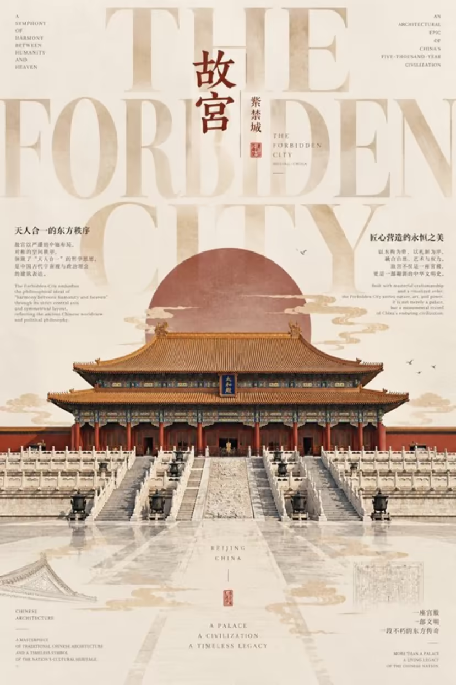 | 極簡海報、建築版式 / Minimalist poster |
| 03 | [復古旗袍數碼相機人像 Vintage Qipao Portrait](examples/03-vintage-qipao-portrait/) | 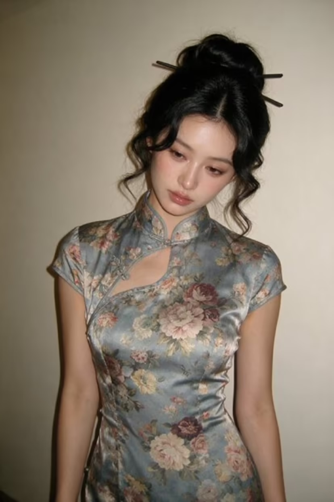 | 寫實人像、閃光懷舊 / Photorealistic, flash nostalgia |
| 04 | [絲綢飄帶新中式插畫 Silk Ribbon Illustration（模板型）](examples/04-silk-ribbon-illustration/) |  | 新中式插畫、模板提示詞 / New-Chinese illustration, template prompt |
| 05 | [復古敞篷車上的女友 POV · Girlfriend Sitting Beside Me in a Vintage Convertible POV](examples/05-girlfriend-vintage-convertible-pov/) | 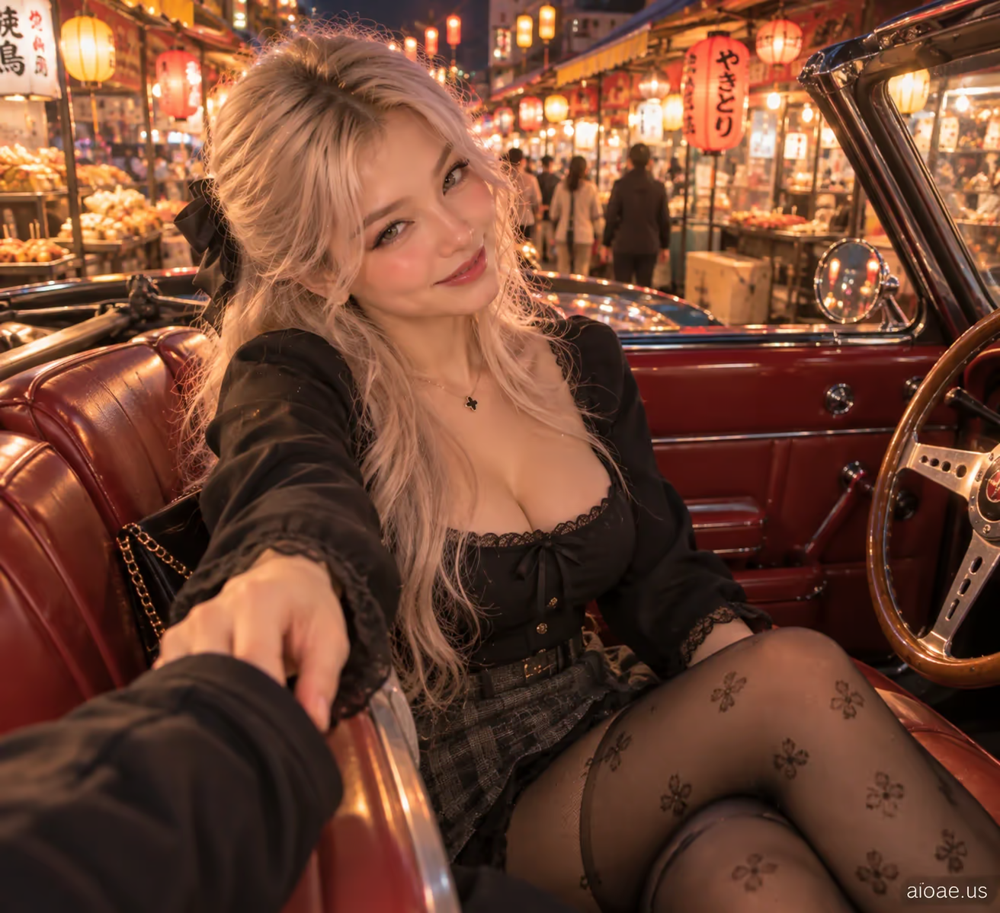 | 第一人稱浪漫視角、電影感寫實 / First-person romantic POV, cinematic photorealism |
| 06 | [與女友共泡溫泉 POV · Girlfriend Sharing a Hot Spring With Me POV](examples/06-girlfriend-hot-spring-pov/) | 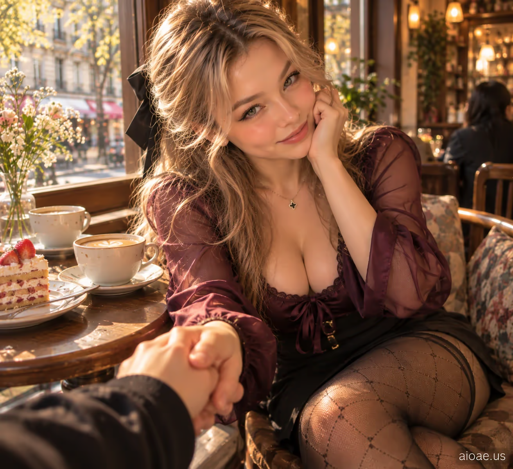 | 第一人稱浪漫視角、電影感寫實 / First-person romantic POV, cinematic photorealism |
| 07 | [女友傾身索吻 POV · Girlfriend Leaning In for a Slow Kiss POV](examples/07-girlfriend-slow-kiss-pov/) |  | 第一人稱浪漫視角、電影感寫實 / First-person romantic POV, cinematic photorealism |
| 08 | [女友面對面坐腿上 POV · Girlfriend Sitting on My Lap Facing Me POV](examples/08-girlfriend-on-lap-pov/) |  | 第一人稱浪漫視角、電影感寫實 / First-person romantic POV, cinematic photorealism |
| 09 | [煙花下與女友牽手 POV · Girlfriend Holding My Hand During Fireworks POV](examples/09-girlfriend-fireworks-hand-pov/) |  | 第一人稱浪漫視角、電影感寫實 / First-person romantic POV, cinematic photorealism |
| 10 | [書店裡女友拉衣袖 POV · Girlfriend Tugging My Sleeve in a Bookstore Aisle POV](examples/10-girlfriend-bookstore-sleeve-pov/) | 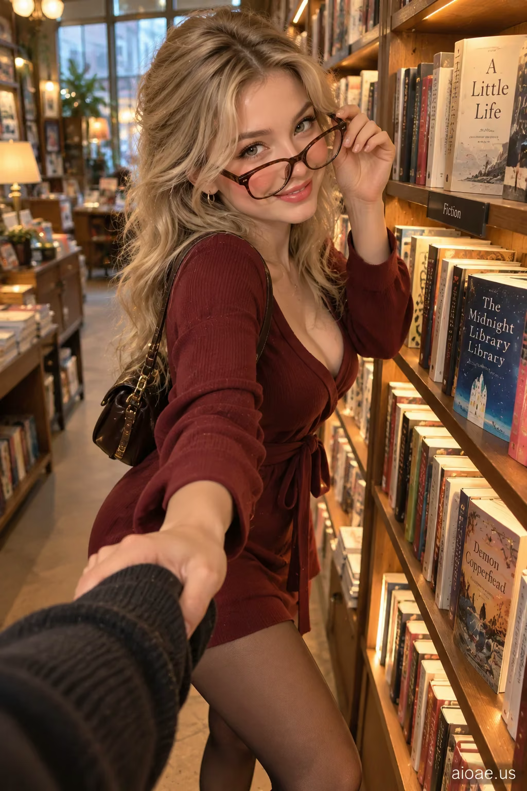 | 第一人稱浪漫視角、電影感寫實 / First-person romantic POV, cinematic photorealism |
| 11 | [電影夜女友靠肩入睡 POV · Girlfriend Falling Asleep on My Shoulder During Movie Night POV](examples/11-girlfriend-movie-night-shoulder-pov/) |  | 第一人稱浪漫視角、電影感寫實 / First-person romantic POV, cinematic photorealism |
| 12 | [牽女友逛深夜小吃街 POV · Girlfriend Leading Me Through a Night Snack Street POV](examples/12-girlfriend-night-snack-street-pov/) | 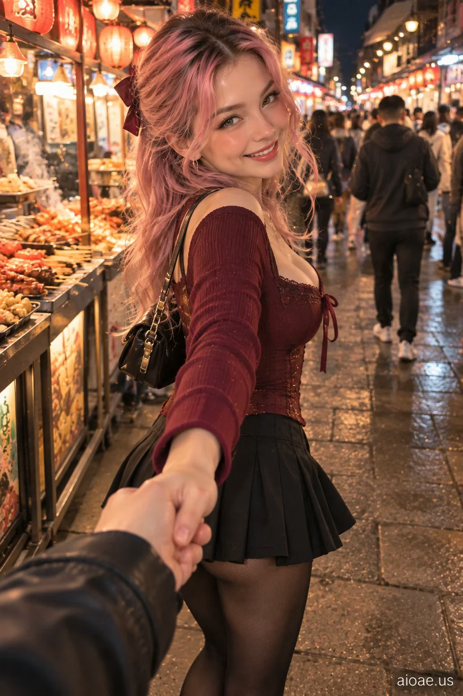 | 第一人稱浪漫視角、電影感寫實 / First-person romantic POV, cinematic photorealism |
| 13 | [公園長椅上搶薯條的女友 POV · Girlfriend Stealing My Last French Fry POV on a Park Bench](examples/13-girlfriend-french-fry-park-bench-pov/) |  | 第一人稱浪漫視角、電影感寫實 / First-person romantic POV, cinematic photorealism |
| 14 | [政治諷刺雙格漫畫：椅子部門 · Political Comic Meme Not in the Chair Department](examples/14-political-comic-chair-department/) | 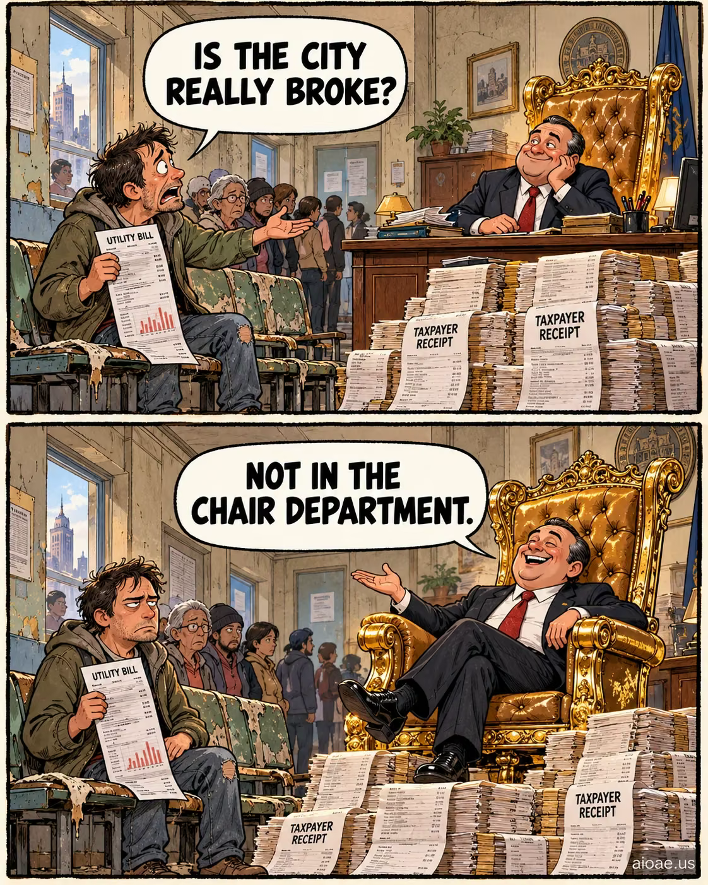 | 手繪報紙風雙格漫畫 / Hand-drawn newspaper-style two-panel comic |
| 15 | [萬聖節鬼屋嘉年華海報 · Halloween Haunted Carnival Poster](examples/15-halloween-haunted-carnival-poster/) | 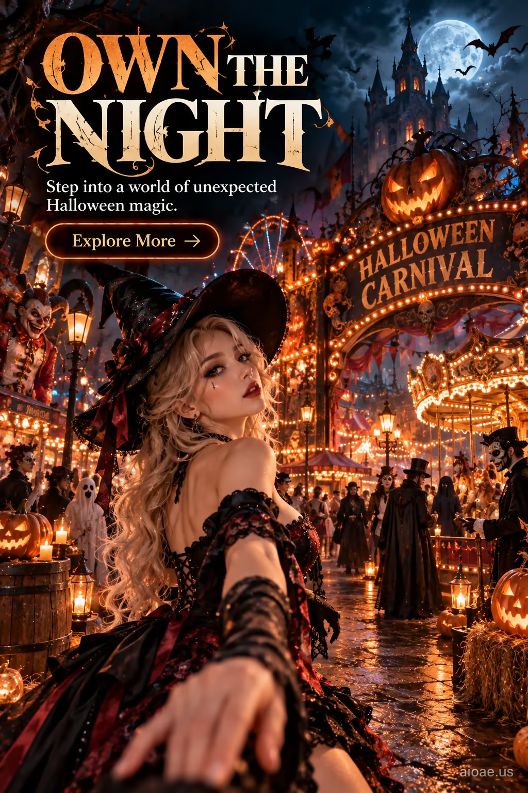 | 萬聖節嘉年華、商業海報 / Halloween carnival, commercial poster |
| 16 | [奢華酒店週年慶典晚宴海報 · Luxury Hotel Anniversary Gala Poster](examples/16-luxury-hotel-anniversary-gala/) | 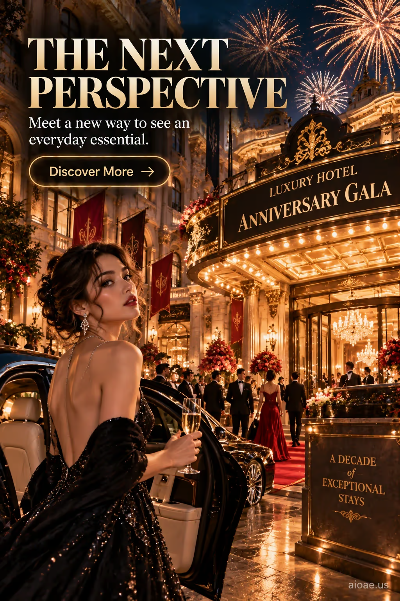 | 酒店慶典、紅毯電影感 / Hotel gala, cinematic red-carpet |
| 17 | [美妝品牌 VIP 之夜海報 · Beauty Brand VIP Night Poster](examples/17-beauty-brand-vip-night/) |  | 美妝派對、金色主視覺 / Beauty party, golden key visual |
| 18 | [咖啡店盛大開業海報 · Grand Opening Coffee Shop Poster](examples/18-grand-opening-coffee-shop/) | 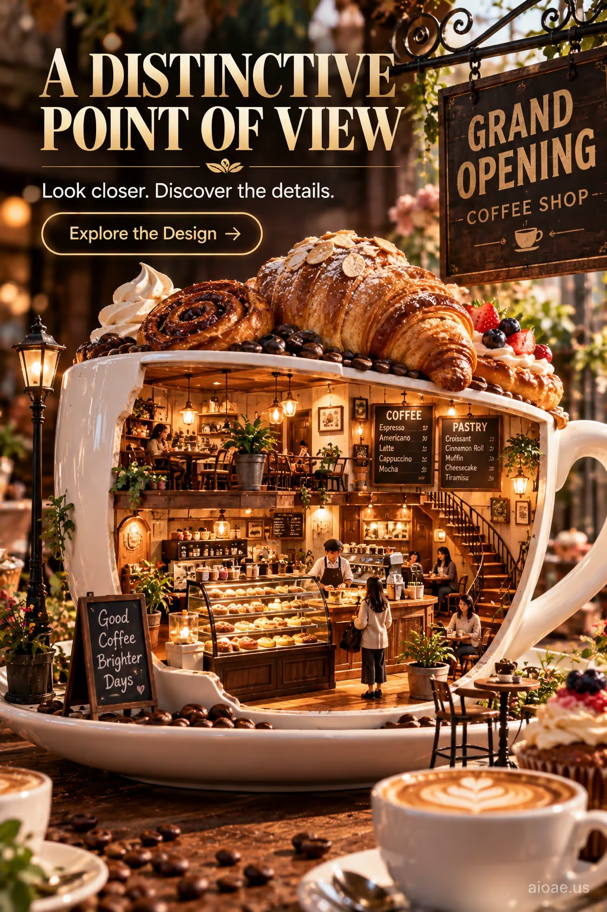 | 尺寸融合創意廣告 / Scale-fusion creative ad |
| 19 | [奢華黑色星期五促銷海報 · Luxury Black Friday Sale Poster](examples/19-luxury-black-friday-sale/) |  | 黑金大促、奢華反差 / Black-gold sale, luxury contrast |
| 20 | [哥特化裝舞會海報 · Gothic Masquerade Ball Poster](examples/20-gothic-masquerade-ball-poster/) | 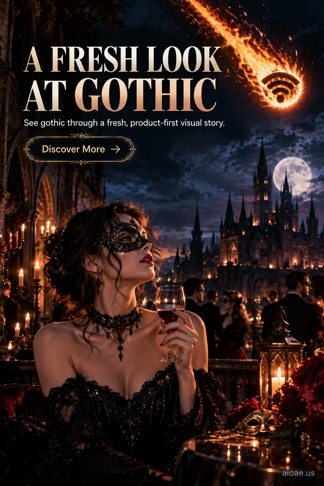 | 面具舞會、圖標融合奇觀 / Masquerade ball, icon-fusion spectacle |
| 21 | [星空下古典音樂會海報 · Classical Music Under the Stars Poster](examples/21-classical-music-under-the/) |  | 露天音樂會、星空燭光 / Open-air concert, starlit candles |
| 22 | [午夜爵士屋頂派對海報 · Midnight Jazz Rooftop Party Poster](examples/22-midnight-jazz-rooftop-party/) |  | 屋頂爵士、都會浪漫 / Rooftop jazz, urban romance |
| 23 | [霓虹地下電子音樂節海報 · Neon Underground Techno Festival Poster](examples/23-neon-underground-techno-festival/) | 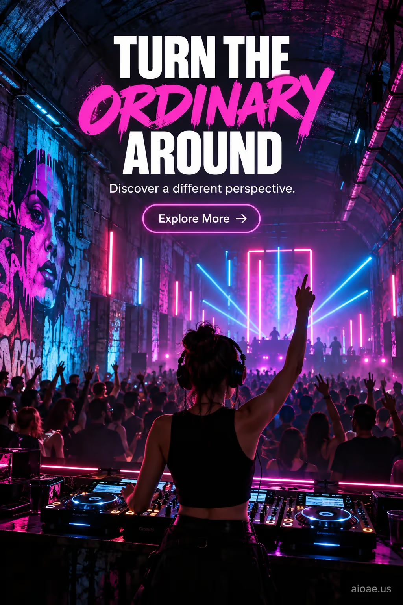 | 霓虹電音、地下隧道 / Neon techno, underground tunnel |
| 24 | [柳橙汁廣告：為今天擠入更多色彩 · Orange Juice Ad Squeeze More Color Into Today](examples/24-orange-juice-ad-squeeze/) | 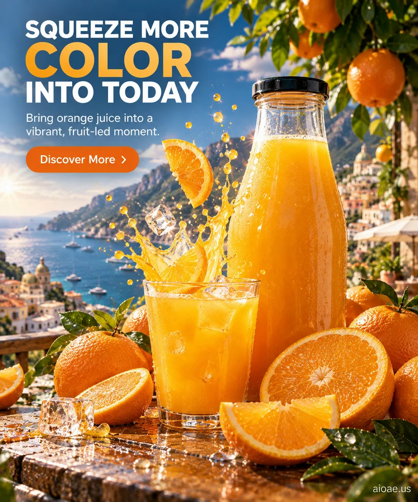 | 夏日商業攝影、果汁飛濺 / Summer commercial photo, juice splash |

| 25 | [通往後室的樓梯 · A Staircase Leading Into the Backrooms](examples/25-staircase-leading-backrooms/) | 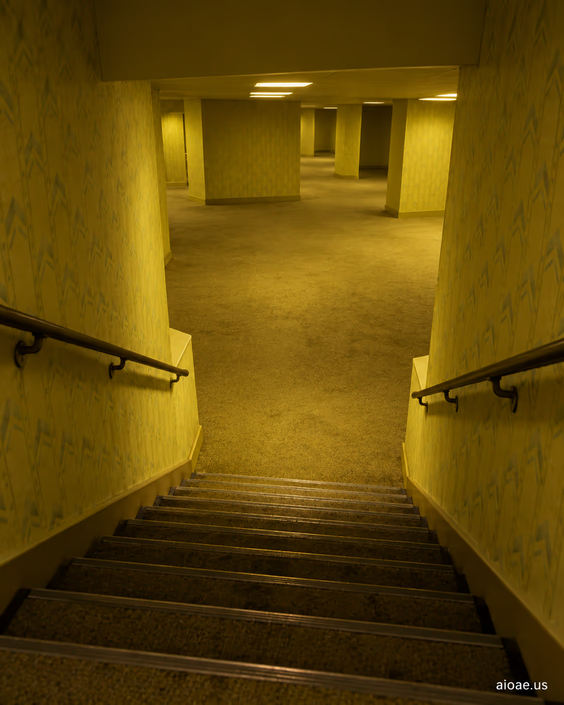 | 後室樓梯、閾限恐怖 / Backrooms staircase, liminal horror |
| 26 | [午夜被遺棄的室內泳池群 · Abandoned Indoor Poolrooms at Midnight](examples/26-abandoned-indoor-poolrooms-midnight/) |  | 池室閾限、水面倒影 / Poolrooms liminal, water reflection |
| 27 | [淹水的後室購物中心 · A Flooded Backrooms Shopping Mall](examples/27-flooded-backrooms-shopping-mall/) | 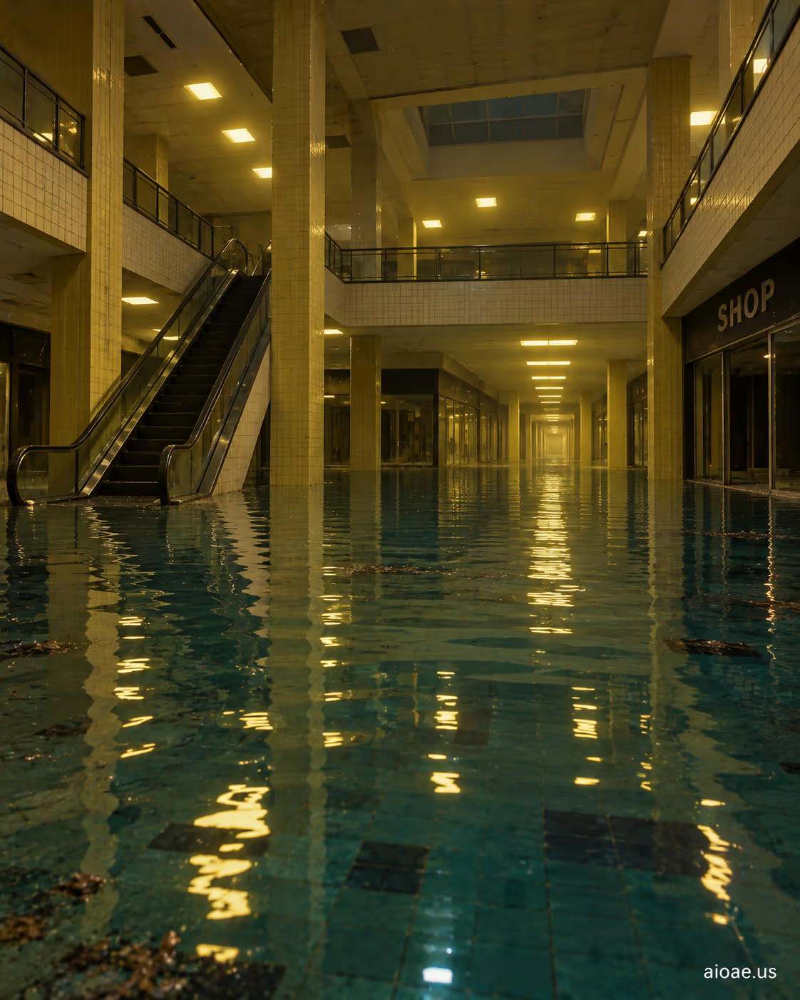 | 淹水商場、死寂商業空間 / Flooded mall, dead retail space |
| 28 | [被遺忘的兒童遊樂迷宮 · A Forgotten Children's Play Maze](examples/28-forgotten-childrens-play-maze/) | 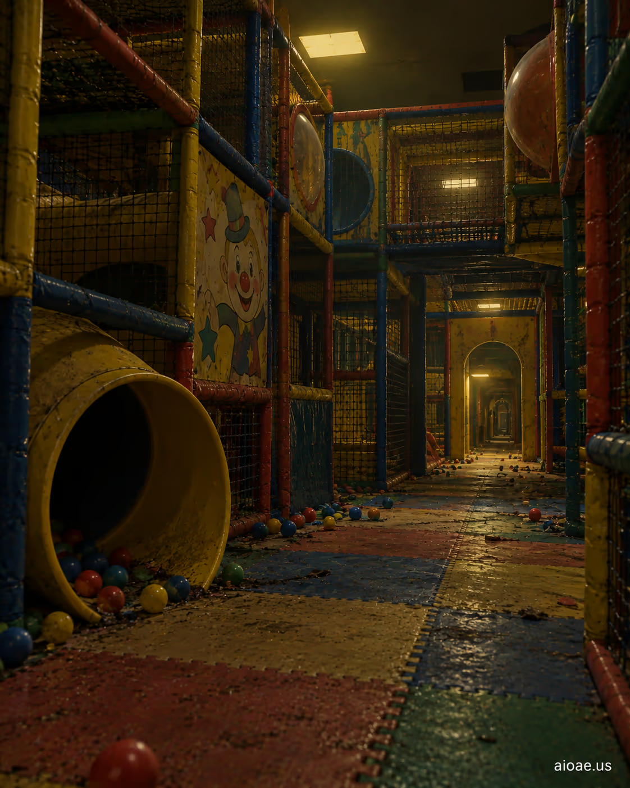 | 童年陰影、廢棄遊樂場 / Childhood shadows, abandoned playground |
| 29 | [無盡的醫院候診室 · The Endless Hospital Waiting Room](examples/29-endless-hospital-waiting-room/) |  | 醫療閾限、無盡排隊 / Medical liminal, endless queue |
| 30 | [開往後室的最後一班地鐵 · The Last Subway Train to the Backrooms](examples/30-last-subway-train-backrooms/) | 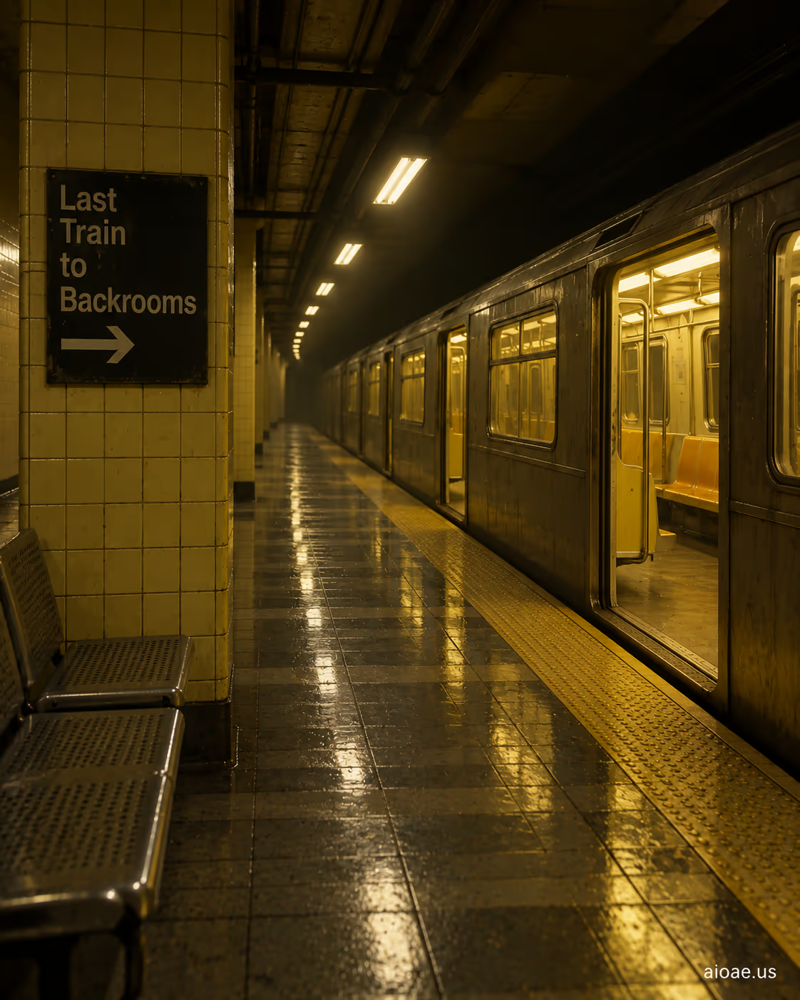 | 午夜地鐵、都市傳說 / Midnight subway, urban legend |
| 31 | [永不打烊的空蕩超市 · An Empty Supermarket That Never Closes](examples/31-empty-supermarket-never-closes/) | 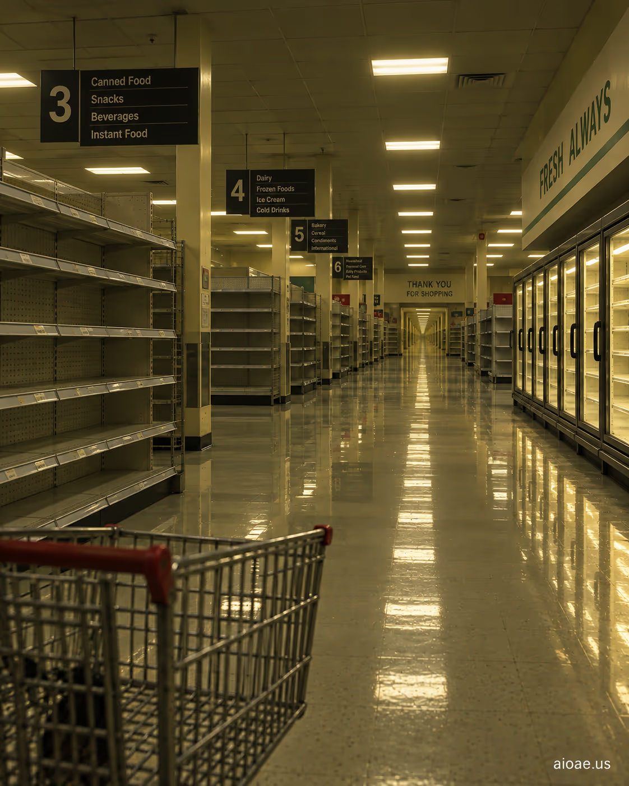 | 消費主義閾限、空蕩貨架 / Consumerism liminal, empty shelves |
| 32 | [磨砂玻璃後的後室實體 · The Backrooms Entity Behind the Frosted Glass](examples/32-backrooms-entity-frosted-glass/) | 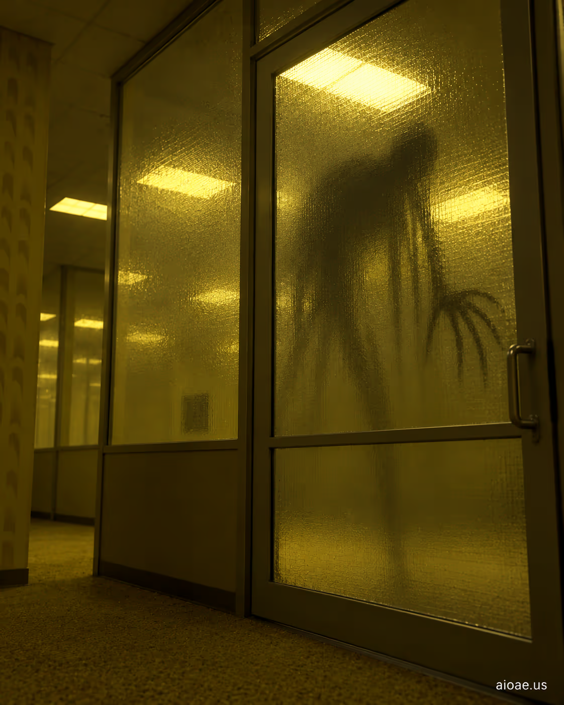 | 實體剪影、磨砂玻璃 / Entity silhouette, frosted glass |
| 33 | [1998 年 VHS 錄影帶中的後室 · 1998 VHS Footage of the Backrooms](examples/33-1998-vhs-footage-backrooms/) | 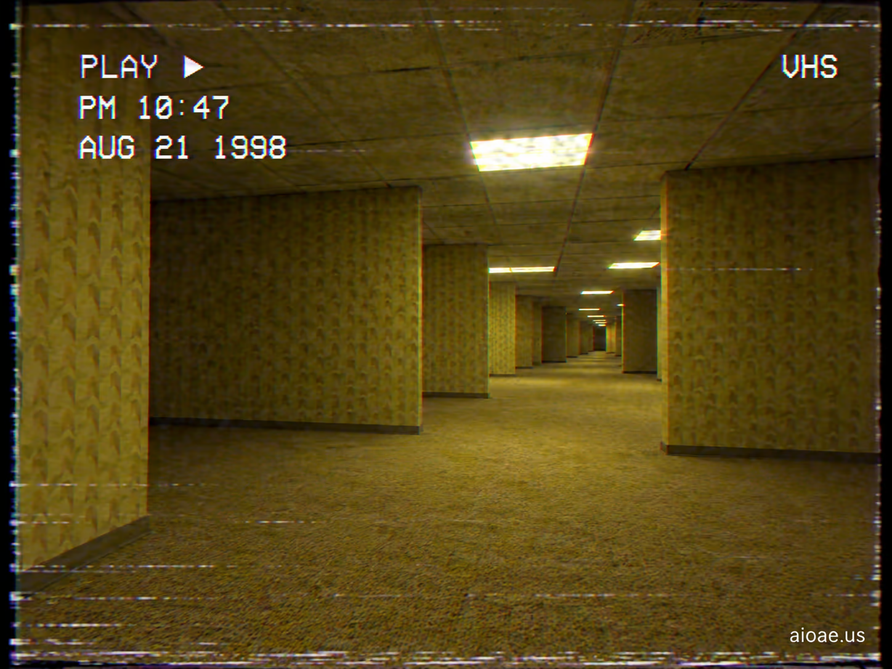 | 偽紀錄片、VHS 噪點 / Found footage, VHS noise |
| 34 | [外星皇帝驗證自己不是機器人梗圖 · Alien Emperor Asked to Verify He Is Not a Robot Meme](examples/34-alien-emperor-robot-meme/) |  | AI 梗雙格漫畫、驗證碼 / AI meme two-panel comic, captcha |
| 35 | [太陽能露營燈產品海報 · Solar Camping Lantern Product Poster](examples/35-solar-camping-lantern-product/) | 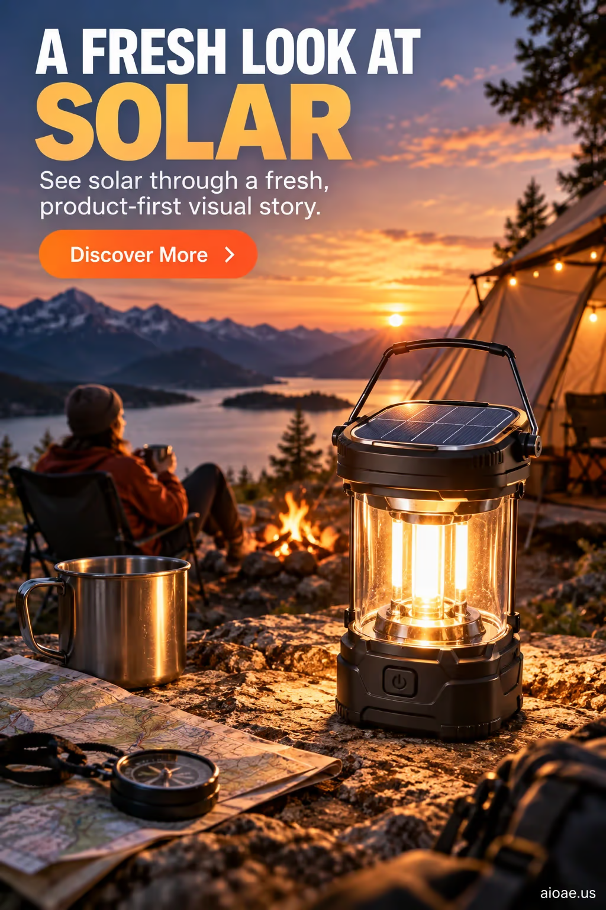 | 太陽能露營燈、黃昏營地 / Solar camping lantern, dusk campsite |
| 36 | [折疊登山杖戶外海報 · Foldable Trekking Pole Outdoor Poster](examples/36-foldable-trekking-pole-outdoor/) | 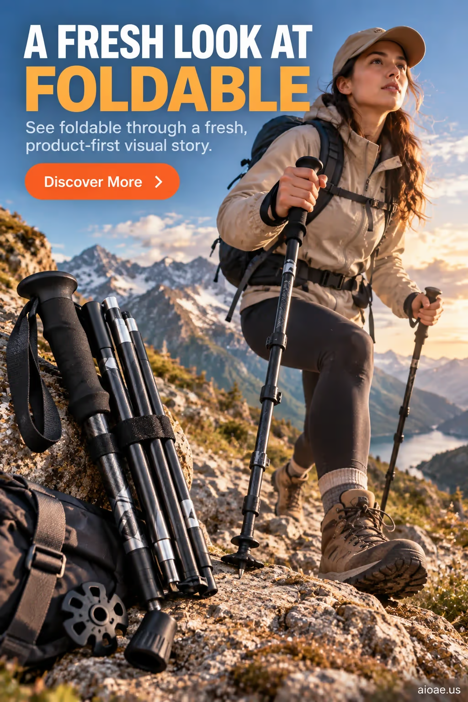 | 折疊登山杖、雪山徒步 / Foldable trekking pole, snowy hike |
| 37 | [車頂帳篷冒險海報 · Car Roof Tent Adventure Poster](examples/37-car-roof-tent-adventure/) |  | 車頂帳篷、日落露營 / Rooftop tent, sunset camp |
| 38 | [設計師瑜伽墊生活風格海報 · Designer Yoga Mat Lifestyle Poster](examples/38-designer-yoga-mat-lifestyle/) |  | 設計師瑜伽墊、海景瑜伽 / Designer yoga mat, seaside yoga |
| 39 | [奢華旅行收納套裝海報 · Luxury Travel Organizer Set Poster](examples/39-luxury-travel-organizer-set/) |  | 旅行收納套裝、海岸度假 / Travel organizer set, coastal holiday |
| 40 | [機能羽絨夾克冬季時尚海報 · Technical Puffer Jacket Winter Fashion Poster](examples/40-technical-puffer-jacket-winter/) | 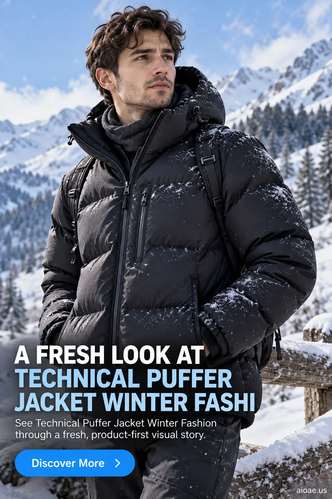 | 機能羽絨夾克、雪山時尚 / Technical puffer jacket, snowy fashion |
| 41 | [GPS 寵物追蹤項圈海報 · GPS Pet Tracker Collar Poster](examples/41-gps-pet-tracker-collar/) | 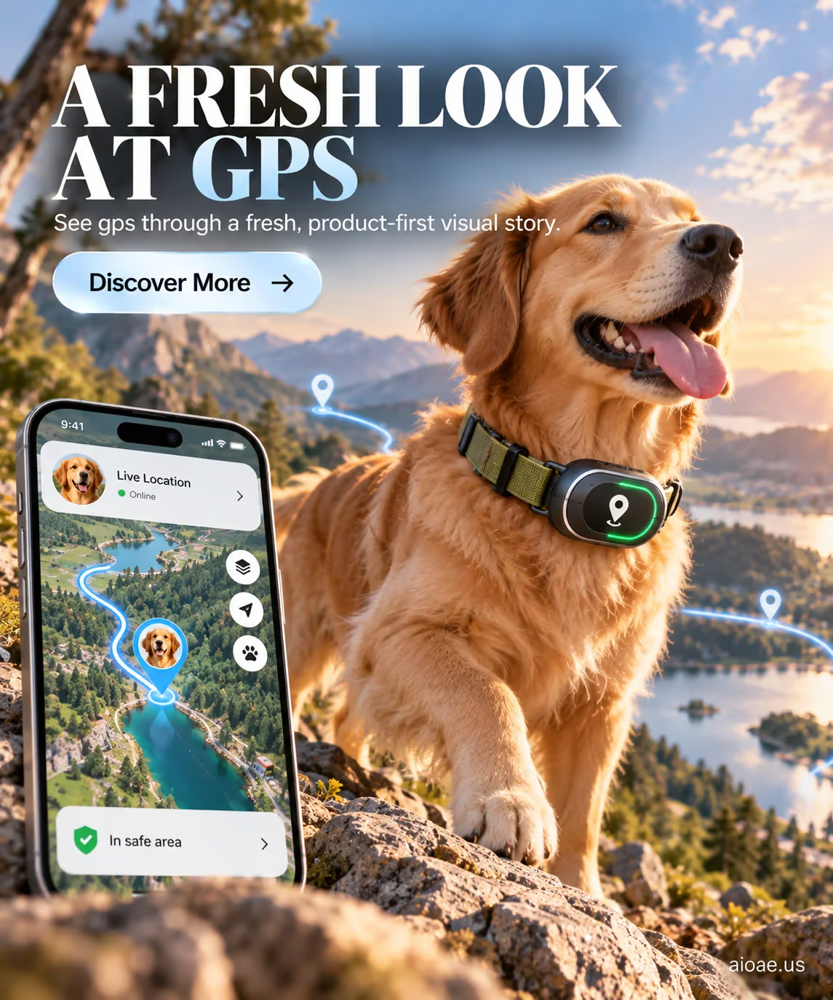 | GPS 寵物追蹤項圈、實時定位 / GPS pet tracker, live location |
| 42 | [智能寵物飲水機廣告海報 · Smart Pet Water Fountain Advertising Poster](examples/42-smart-pet-water-fountain/) | 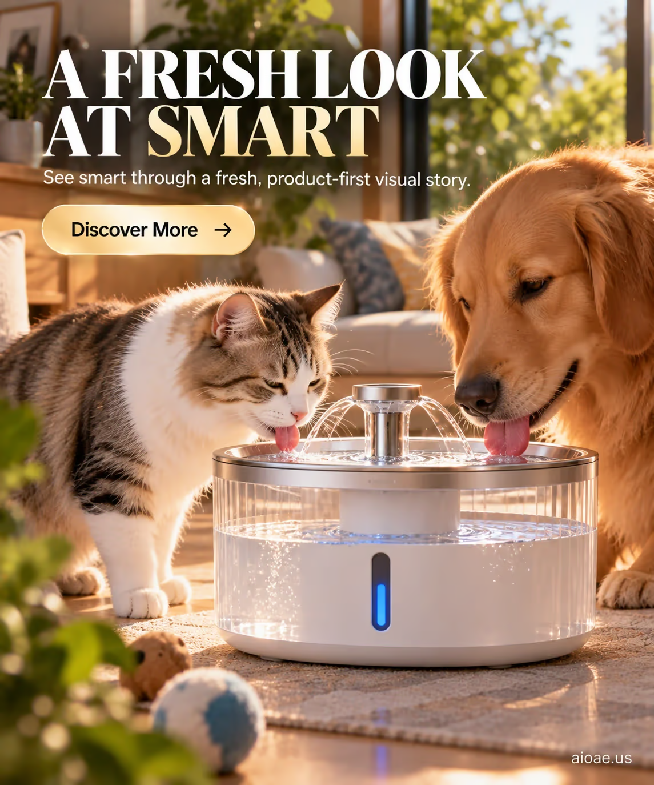 | 智能寵物飲水機、貓狗同框 / Smart pet fountain, cat & dog |
| 43 | [自動餵貓器智能寵物海報 · Automatic Cat Feeder Smart Pet Poster](examples/43-automatic-cat-feeder-smart/) | 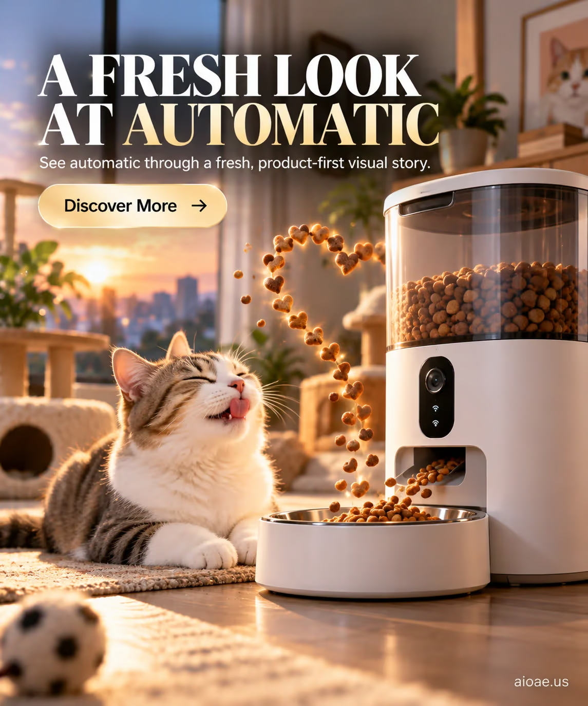 | 自動餵貓器、心形貓糧 / Automatic cat feeder, heart kibble |
| 44 | [便攜掛脖風扇夏季產品海報 · Portable Neck Fan Summer Product Poster](examples/44-portable-neck-fan-summer/) | 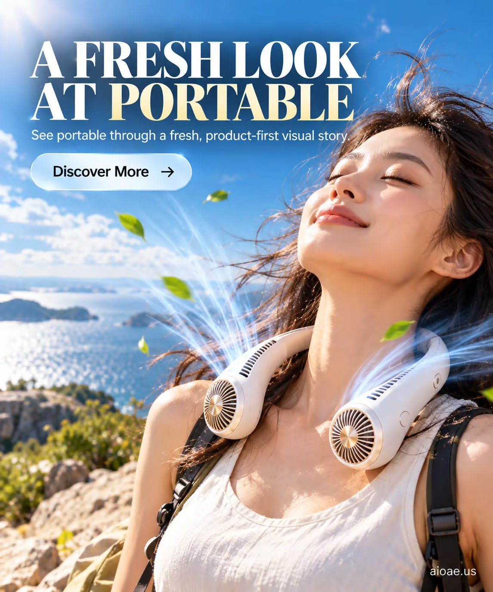 | 便攜掛脖風扇、夏日清涼 / Portable neck fan, summer cool |
| 45 | [微型星球吸塵記 · Vacuuming a Tiny Planet](examples/45-vacuuming-a-tiny-planet/) | 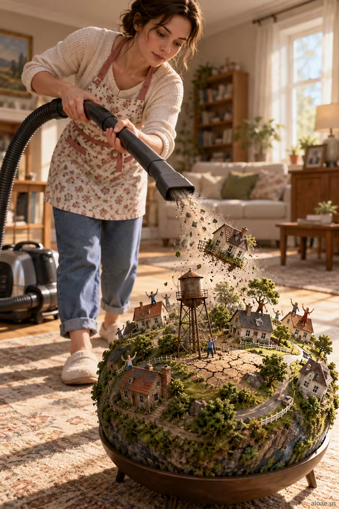 | 電影超現實、尺度碰撞 / Cinematic surrealism, scale collision |
| 46 | [紮根的觀眾把夢送上銀幕 · Rooted Viewers Send Dreams to the Screen](examples/46-rooted-viewers-send-dreams/) |  | 電影超現實、夢境寓言 / Cinematic surrealism, dream allegory |
| 47 | [最後的擁抱：消逝的投影 · Last Embrace Fading Projection](examples/47-last-embrace-fading-projection/) | 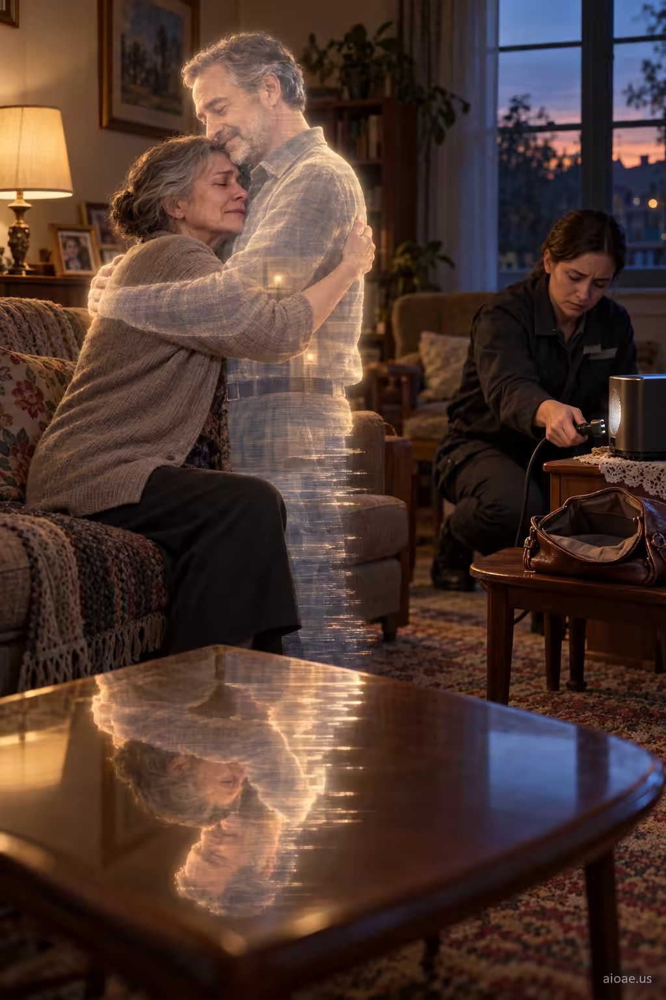 | 電影情感、科幻寓言 / Cinematic emotion, sci-fi allegory |
| 48 | [狗遛人：身份顛倒 · A Dog Walks Its Human](examples/48-a-dog-walks-its/) | 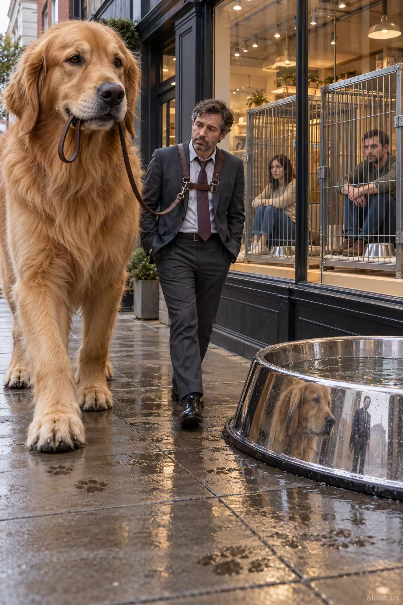 | 身份反轉、社會諷刺 / Role reversal, social satire |
| 49 | [微型士兵與落下的軍服 · Miniature Soldiers and Falling Uniforms](examples/49-miniature-soldiers-and-falling/) |  | 戰爭寓言、尺度反差 / War allegory, scale contrast |
| 50 | [囚犯入畫，農夫出牢 · Prisoner Enters Painting Farmer Emerges](examples/50-prisoner-enters-painting-farmer/) |  | 魔幻現實、畫框穿越 / Magical realism, frame crossing |
| 51 | [金色液體與消逝的粉絲 · Golden Tube Fading Fan](examples/51-golden-tube-fading-fan/) |  | 名利寓言、社會諷刺 / Fame allegory, social satire |
| 52 | [鏡中的飢餓倒影 · Untouched Dinner Hungry Mirror Reflection](examples/52-untouched-dinner-hungry-mirror/) |  | 鏡像寓言、貧富對照 / Mirror allegory, wealth contrast |
| 53 | [他留下的那條領帶 · The Tie He Left Behind](examples/53-the-tie-he-left/) | 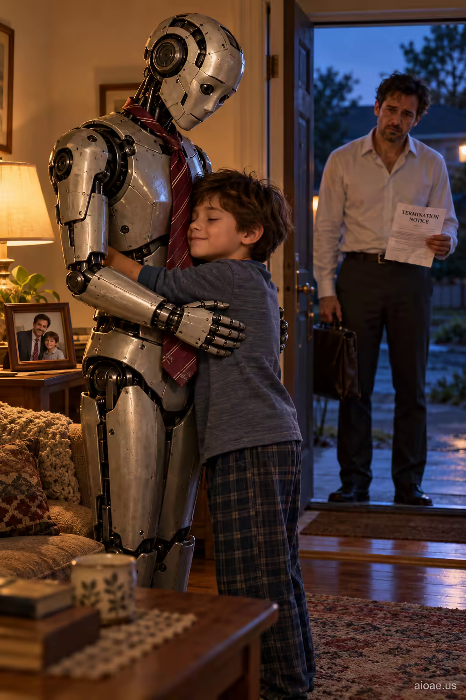 | 溫情科幻、家庭敘事 / Tender sci-fi, family narrative |
| 54 | [外星家庭參觀人類辦公室展覽 · Alien Family Photographs a Human Office Exhibit](examples/54-alien-family-photographs-a/) | 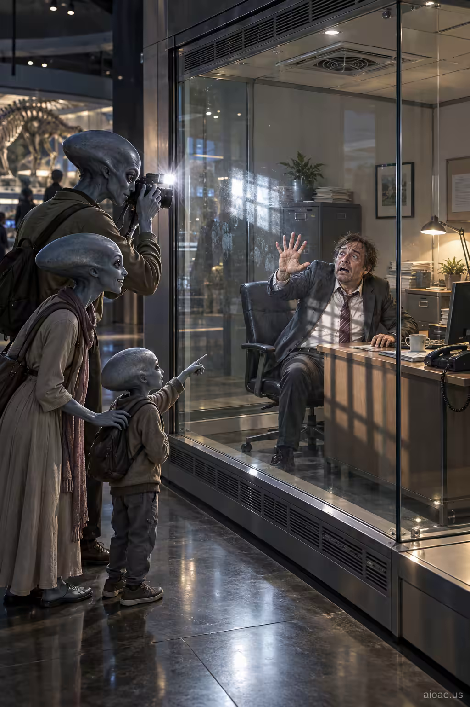 | 視角反轉、科幻幽默 / Perspective flip, sci-fi humor |
| 55 | [聖誕倒數月曆廣告海報 · Advent Calendar Poster](examples/55-advent-calendar-poster/) | 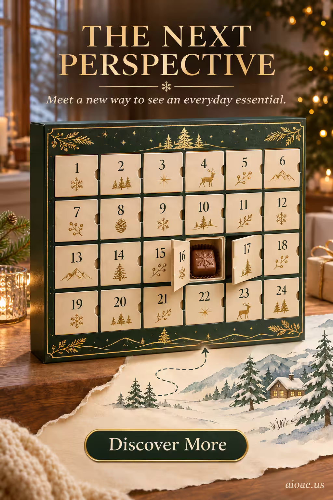 | 聖誕廣告、產品海報 / Christmas ad, product poster |
| 56 | [電熱毯廣告海報 · Heated Blanket Poster](examples/56-heated-blanket-poster/) | 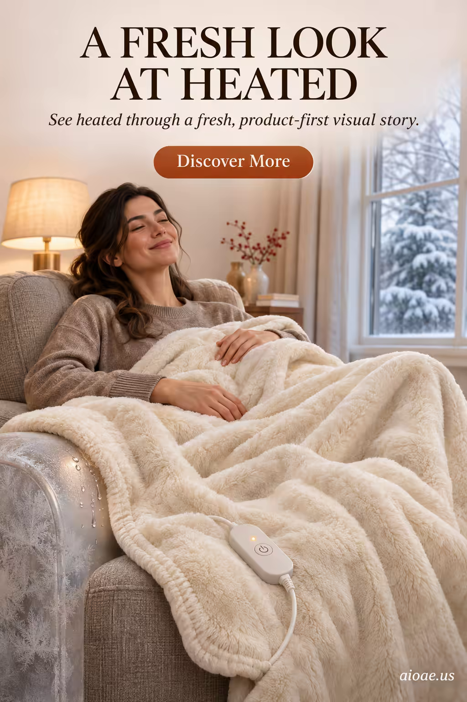 | 冬季家電、產品海報 / Winter appliance, product poster |
| 57 | [淹水公寓上的香檳 · Champagne Above the Flooded Apartments](examples/57-champagne-above-the-flooded/) |  | 階級諷刺、電影超現實 / Class satire, cinematic surrealism |
| 58 | [瓶裝陽光與借來的時間 · Bottled Sunlight and Borrowed Time](examples/58-bottled-sunlight-and-borrowed/) |  | 時間寓言、電影超現實 / Time allegory, cinematic surrealism |
| 59 | [機械掌聲與門外的帳單 · Mechanical Applause and Bills Outside](examples/59-mechanical-applause-and-bills/) |  | 政治諷刺、電影超現實 / Political satire, cinematic surrealism |
| 60 | [機器人布景後的燭光晚餐 · Candlelit Dinner Behind a Robot Held Garden](examples/60-candlelit-dinner-behind-a/) |  | 戰爭浪漫、電影超現實 / Wartime romance, cinematic surrealism |
| 61 | [打卡鐘與釀造的利潤 · Feeding the Clock Brewing Profit](examples/61-feeding-the-clock-brewing/) | 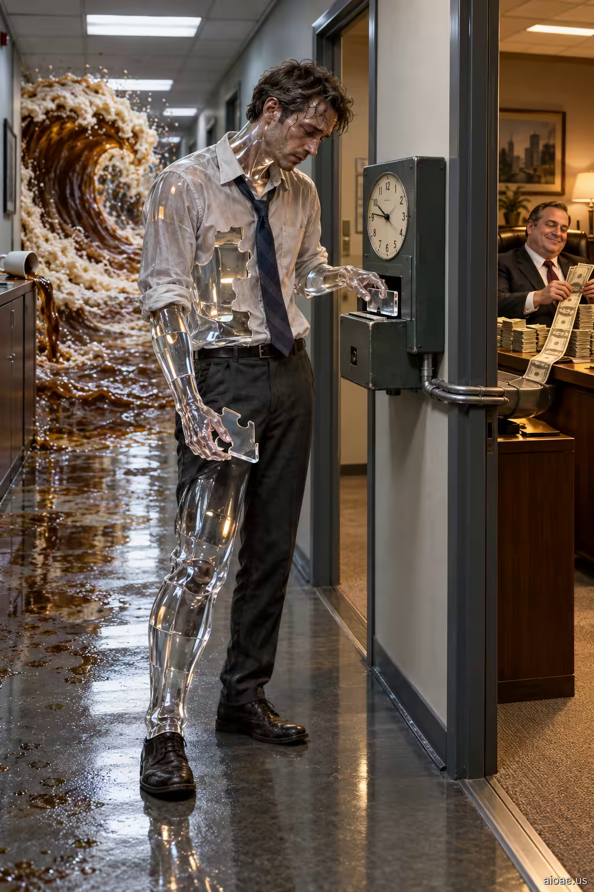 | 打工寓言、電影超現實 / Worker allegory, cinematic surrealism |
| 62 | [被囚禁的太陽與凍結的家庭 · Captive Sun and Frozen Families](examples/62-captive-sun-and-frozen/) | 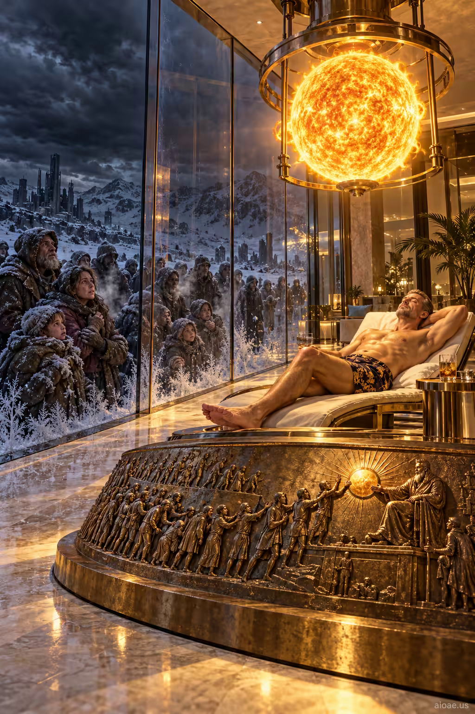 | 貧富對照、電影超現實 / Wealth contrast, cinematic surrealism |
| 63 | [租戶的電線點亮房東的吊燈 · Tenants Wires Power the Landlords Chandelier](examples/63-tenants-wires-power-the/) | 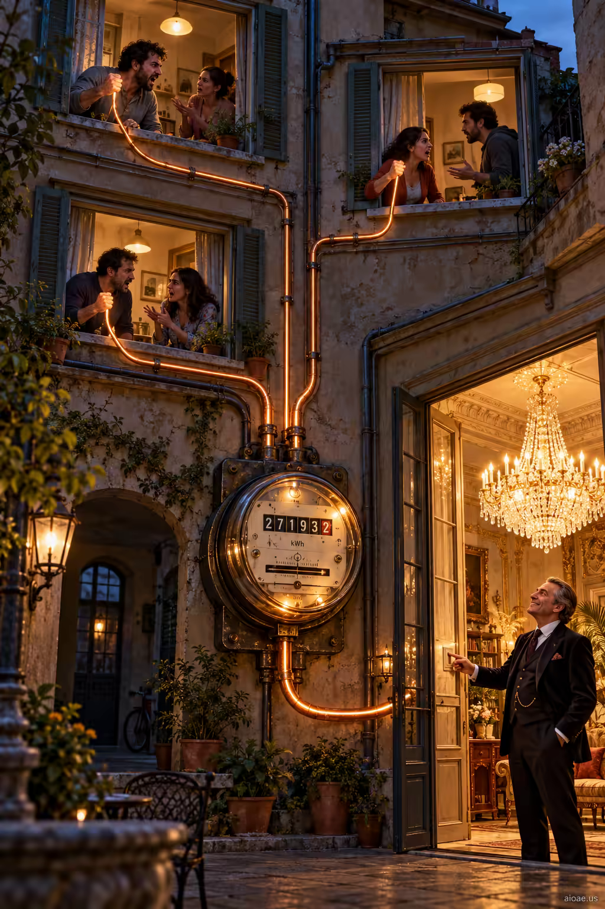 | 住房諷刺、電影超現實 / Housing satire, cinematic surrealism |
| 64 | [美白牙貼廣告海報 · Teeth Whitening Strips Poster](examples/64-teeth-whitening-strips-poster/) |  | 美妝個護、產品海報 / Beauty care, product poster |
| 65 | [黃銅倒影中的握手 · Handshake with a Brass Reflection](examples/65-handshake-with-a-brass/) |  | 懸疑電影、機械驚悚 / Suspense cinema, mechanical thriller |
| 66 | [明天的紙條提早送達 · Tomorrows Note Arrives Early](examples/66-tomorrows-note-arrives-early/) | 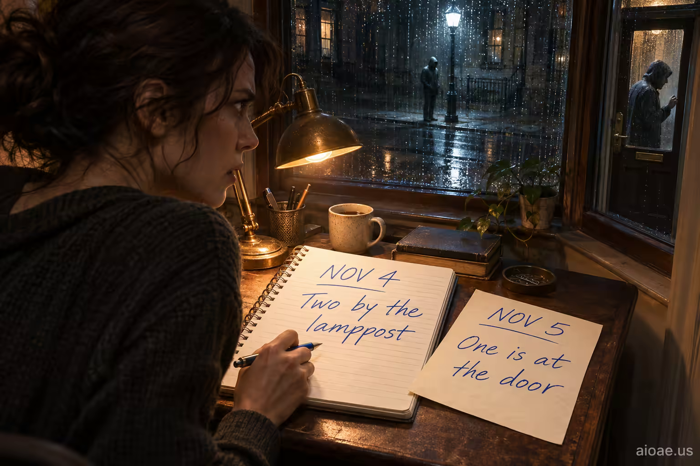 | 懸疑電影、時間悖論 / Suspense cinema, time paradox |
| 67 | [不被需要的奇蹟 · The Unwanted Miracle](examples/67-the-unwanted-miracle/) | 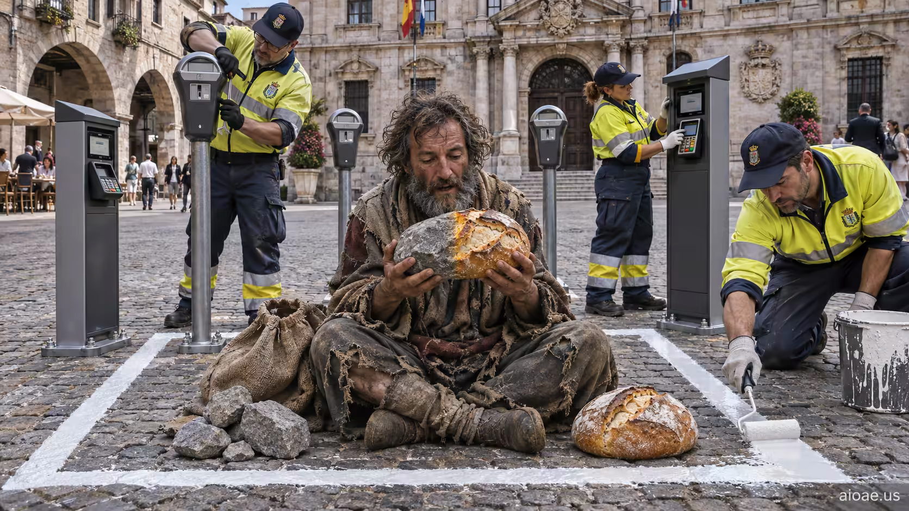 | 街頭魔幻寫實 / Street magic realism |
| 68 | [夢魘洗衣店 · The Nightmare Laundry](examples/68-the-nightmare-laundry/) | 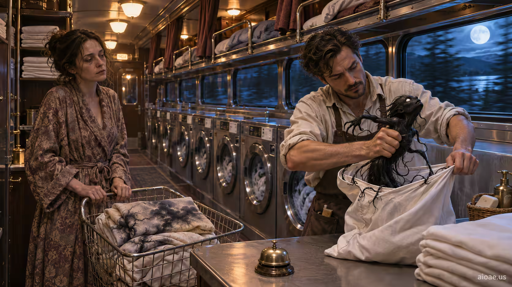 | 夢魘奇幻、電影超現實 / Nightmare fantasy, cinematic surrealism |
| 69 | [慷慨的稻草人 · The Generous Scarecrow](examples/69-the-generous-scarecrow/) |  | 田園魔幻寫實 / Pastoral magic realism |
| 70 | [收集雪的人 · The Snow Collector](examples/70-the-snow-collector/) | 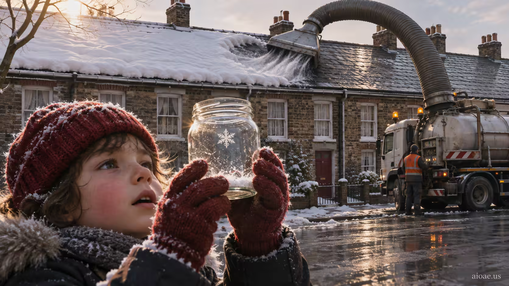 | 冬日寓言、電影超現實 / Winter fable, cinematic surrealism |
| 71 | [婚禮見證人 · The Wedding Witness](examples/71-the-wedding-witness/) |  | 婚禮驚悚、身份錯位 / Wedding thriller, identity twist |
| 72 | [緊急出口 · The Emergency Exit](examples/72-the-emergency-exit/) | 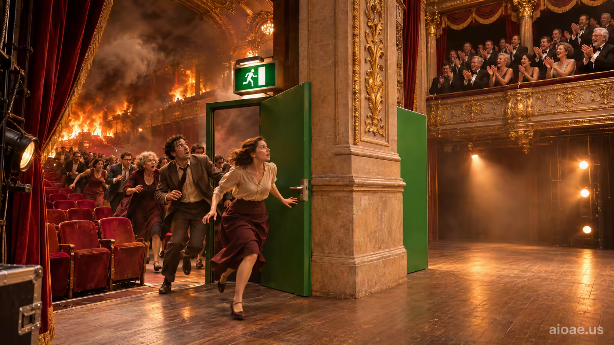 | 劇院災難、空間悖論 / Theater disaster, spatial paradox |
| 73 | [滅絕博物館 · Museum of Extinction](examples/73-museum-of-extinction/) | 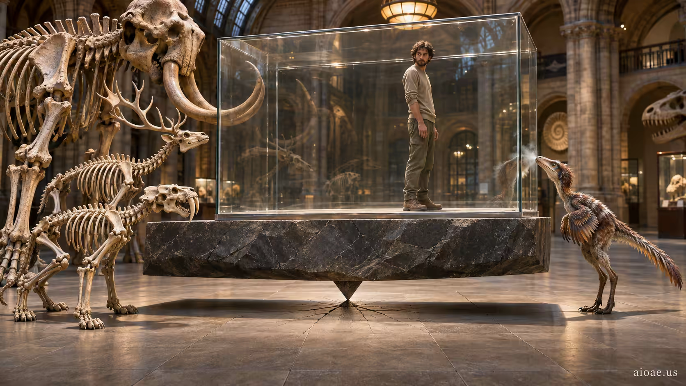 | 滅絕寓言、博物館奇觀 / Extinction fable, museum spectacle |
| 74 | [聽話的火山 · The Obedient Volcano](examples/74-the-obedient-volcano/) |  | 荒誕喜劇、災難反轉 / Absurdist comedy, disaster reversal |
| 75 | [地獄滅火專家諷刺漫畫 · Lindsey Graham Hell Extinguisher Experts Comic](examples/75-lindsey-graham-hell-extinguisher/) |  | 雙格政治諷刺漫畫、對白反轉 / Two-panel political satire comic, dialogue punchline |
| 76 | [辦公桌前的充氣西裝「感覺棒極了」 · Im Feeling Tremendous Inflated Suit at the Desk](examples/76-im-feeling-tremendous-inflated/) |  | 梗圖字面化、概念變形 / Meme literalized, conceptual mutation |
| 77 | [跛腳鴨的大步 · Trumps Lame Duck Stride](examples/77-trumps-lame-duck-stride/) |  | 政治梗圖、字面視覺變化 / Political meme, literal visual change |
| 78 | [義大利三色石鑲嵌軍人節海報 · Italian Tricolor Stone Mosaic Tribute](examples/78-italian-tricolor-stone-mosaic/) | 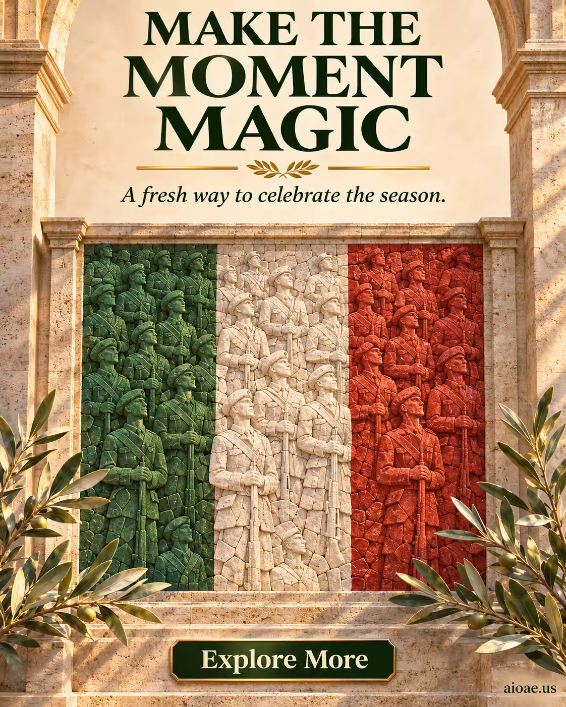 | 節日海報、石鑲嵌工藝 / Holiday poster, stone mosaic craft |
| 79 | [黃昏巴拿馬城上空的巨型國旗 · Panama Flag over Panama City at Dusk](examples/79-panama-flag-over-panama/) | 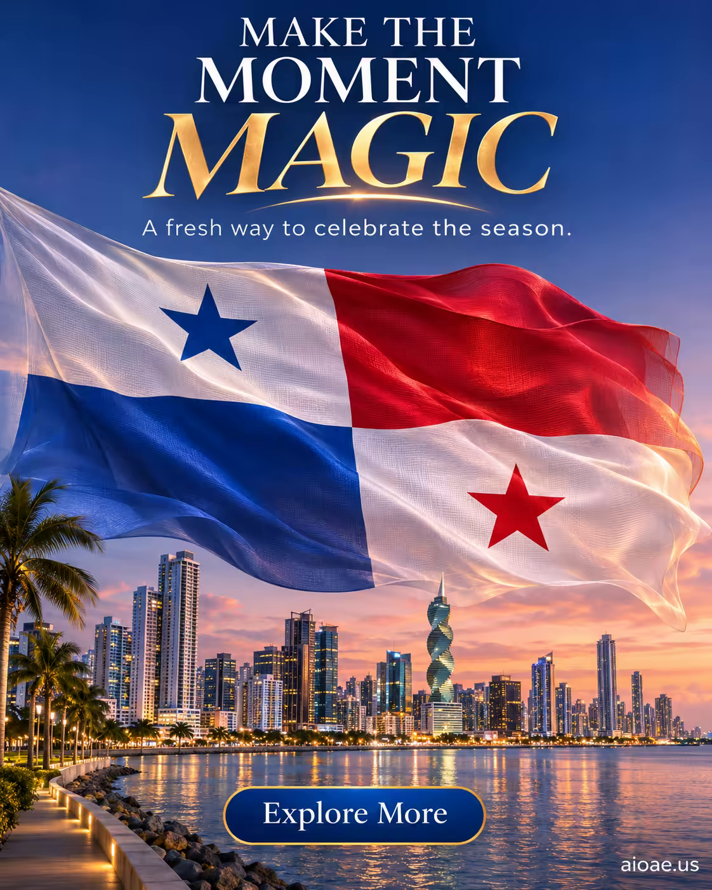 | 電影感節慶海報、城市天際線 / Cinematic festive poster, city skyline |
| 80 | [紅場團結日光之盛典 · Luminous Unity Day at Red Square](examples/80-luminous-unity-day-at/) |  | 節日海報、光帶奇觀 / Holiday poster, light-ribbon spectacle |
| 81 | [機器人與狗的影子 · A Robot with a Dogs Shadow](examples/81-a-robot-with-a/) | 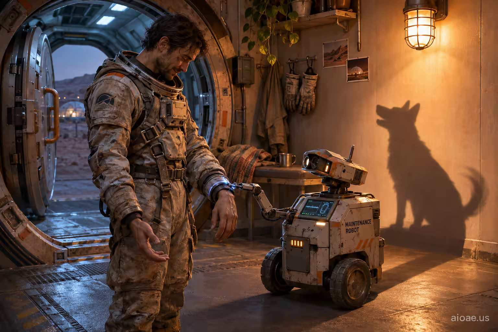 | 太空站日常、地球記憶反差 / Station life, Earth-memory contrast |
| 82 | [棲息艙窗外的火星沙漏 · Martian Hourglass Beyond the Habitat Window](examples/82-martian-hourglass-beyond-the/) | 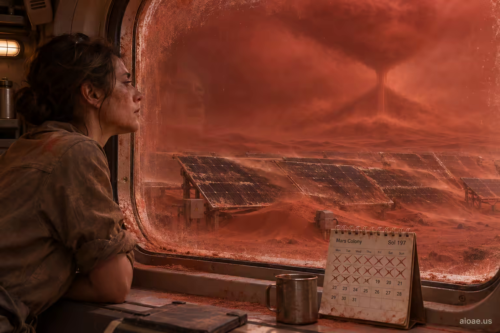 | 火星塵暴、時間隱喻 / Martian dust storm, time metaphor |
| 83 | [鏡頭看到同樣的眼睛 · The Camera Sees the Same Eyes](examples/83-the-camera-sees-the/) | 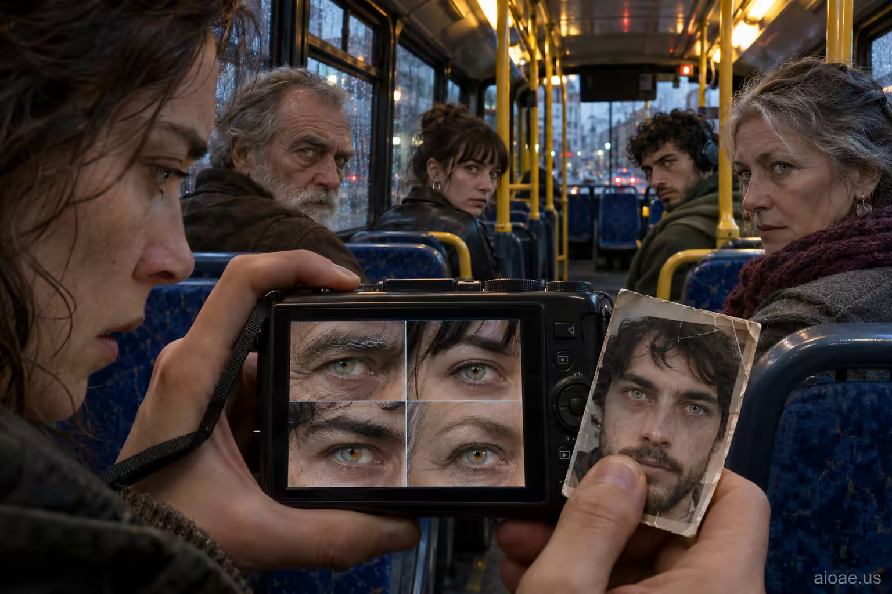 | 心理驚悚、視覺符號 / Psychological thriller, visual symbol |
| 84 | [繞著鐵字閱讀 · Reading Around the Iron Words](examples/84-reading-around-the-iron/) |  | 超現實主義、材質變形 / Surrealism, material transformation |
| 85 | [金色疊戴項鍊廣告海報 · Elevate Every Moment Gold Layering Necklace Poster](examples/85-elevate-every-moment-gold/) | 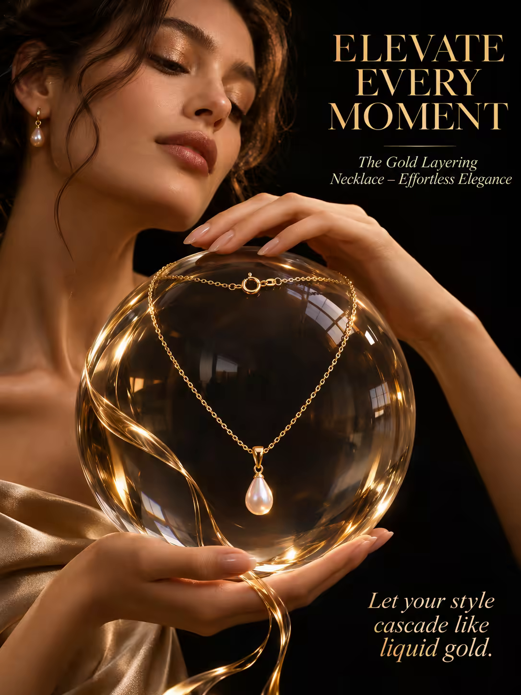 | 高端珠寶廣告、流動金屬 / Luxury jewellery ad, liquid metal |
| 86 | [充電頭燈探險海報 · Navigate the Unknown Rechargeable Headlamp Poster](examples/86-navigate-the-unknown-rechargeable/) | 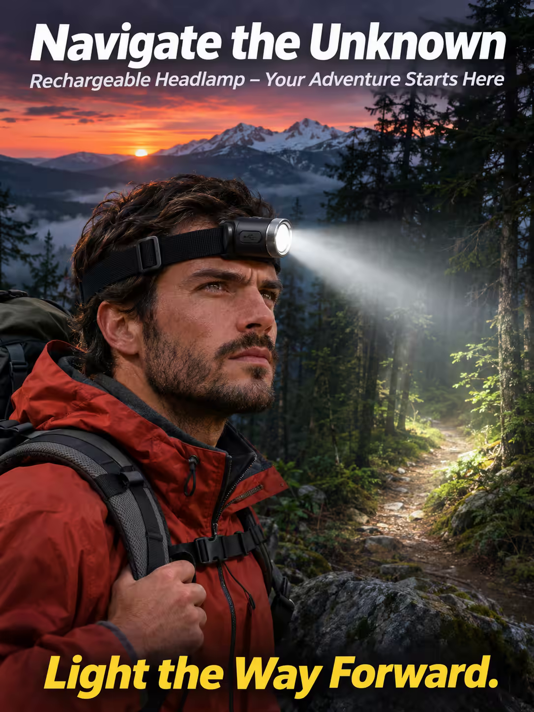 | 戶外探險、夜間光束 / Outdoor adventure, night beam |
| 87 | [升降桌廣告海報 · Stand Above the Ordinary Standing Desk Poster](examples/87-stand-above-the-ordinary/) |  | 未來辦公、升降桌 / Futuristic office, standing desk |
| 88 | [互動學習書廣告海報 · Unlock the Universe of Knowledge Learning Book Poster](examples/88-unlock-the-universe-of/) |  | 奇幻教育、互動書籍 / Fantasy education, interactive book |
| 89 | [Insight 品牌標誌 · Insight See the Pattern Logo](examples/89-insight-see-the-pattern/) |  | 極簡標誌、品牌識別 / Minimal logo, brand identity |
| 90 | [Sam Altman 記憶體專家漫畫 · Sam Altman RAM Experts Comic](examples/90-sam-altman-ram-experts/) |  | 雙格漫畫、時事梗圖 / Two-panel comic, topical meme |
| 91 | [三頭電動剃鬚刀廣告海報 · A Fresh Look at Three Head Electric Razor Poster](examples/91-a-fresh-look-at-three/) |  | 產品海報、小家電 / Product poster, small appliance |
| 92 | [無線旋轉清潔刷廣告海報 · A Fresh Look at Cordless Spin Scrubber Poster](examples/92-a-fresh-look-at-cordless/) |  | 產品海報、家居清潔 / Product poster, home cleaning |
| 93 | [痘痘貼廣告海報 · A Fresh Look at Acne Pimple Patch Poster](examples/93-a-fresh-look-at-acne/) |  | 產品海報、護膚 / Product poster, skincare |
| 94 | [世界海嘯意識日海報 · Feel the Surge World Tsunami Awareness Day Poster](examples/94-feel-the-surge-world/) |  | 公益海報、防災宣導 / Public-service poster, disaster awareness |
| 95 | [冬日暖光中的加絨打底褲 · Fleece Lined Tights in Winter Light](examples/95-fleece-lined-tights-in/) |  | 產品海報、冬季服飾 / Product poster, winter apparel |
| 96 | [霓虹城市中的靈活手機三腳架 · Flexible Phone Tripod in Neon City](examples/96-flexible-phone-tripod-in/) |  | 產品海報、賽博龐克 / Product poster, cyberpunk |
| 97 | [一塵不染硬木地板上的智能掃地機器人 · Sleek Robot Vacuum Spotless Hardwood](examples/97-sleek-robot-vacuum-spotless/) |  | 產品海報、家居清潔 / Product poster, home cleaning |
| 98 | [陽光黃解壓捏捏球 · Sunny Yellow Squishy Stress Ball](examples/98-sunny-yellow-squishy-stress/) |  | 產品海報、3D 渲染玩具 / Product poster, 3D-rendered toy |
| 99 | [日出時分的越野跑鞋 · Rugged Trail Shoes at Sunrise](examples/99-rugged-trail-shoes-at/) |  | 產品海報、戶外運動 / Product poster, outdoor sports |
| 100 | [夢幻雲端上的毛絨兔子 · Cuddly Bunny Plush on Dreamy Clouds](examples/100-cuddly-bunny-plush-on/) |  | 產品海報、可愛治癒 / Product poster, cute and comforting |
| 101 | [魔法森林中的落地投影儀支架 · Rooted Projector Stand in Enchanted Forest](examples/101-rooted-projector-stand-in/) |  | 產品海報、戶外投影 / Product poster, outdoor projection |
| 102 | [城市霓虹蓮花耳機 · Neon Lotus Earbuds in the City](examples/102-neon-lotus-earbuds-in/) |  | 產品海報、音頻 / Product poster, audio |
| 103 | [銀色 iPhone 17 手機殼 · Sleek Silver iPhone 17 Case](examples/103-sleek-silver-iphone-17/) |  | 產品海報、手機配件 / Product poster, phone accessories |
| 104 | [吹牛網民的肖像活了過來 · A Boastful Netizens Portrait Comes Alive](examples/104-a-boastful-netizens-portrait/) |  | 雙格漫畫、梗圖 / Two-panel comic, meme |

> 每日新增 10 個新案例（自 2026-10-29 起）。/ 10 new cases added daily since 2026-10-29.

## 怎麼用 | How to Use

1. 打開案例頁，複製「完整提示詞」整段，貼到你的生圖工具（GPT Image、即夢、Flux、Midjourney 等）。
2. 先原樣生成一張，確認構圖與色調，再按「修改說明」逐項換人物、配色、場景。
3. 模板型提示詞（案例 04）要先改開頭的變量表，再替換正文所有方括號，不要留空。

1. Open a case page, copy the full prompt, and paste it into your image tool (GPT Image, Jimeng, Flux, Midjourney, etc.).
2. Generate once as-is to check composition and palette, then follow the adaptation notes to swap the character, colours or setting, one change at a time.
3. For template prompts (Case 04), edit the variable list at the top first, then replace every bracketed slot in the body — leave none empty.

## 關於 AIOAE | About AIOAE

**AIOAE 代表 All-in-One AI Engine。** 目前包括：AI 提示詞庫、Prompt Builder、AI 圖片檢測、AI 文字檢測、開源模型導航、模型部署指南，以及提供精選數字優惠和實用在線服務的 BonusHub。

**AIOAE stands for All-in-One AI Engine.** It currently includes an AI prompt library, Prompt Builder, an AI image detector, an AI text detector, an open-source model directory, model deployment guides, and BonusHub — curated digital deals and useful online services.

🌐 [aioae.us](https://aioae.us) ｜ 🎨 [免費提示詞庫 Free Prompt Library](https://aioae.us/prompts) ｜ 🧭 [開源模型導航 Model Directory](https://aioae.us/models) ｜ 👤 [GitHub @aioaeus](https://github.com/aioaeus)

## 授權 | License

本倉庫的提示詞文字可自由使用與修改，註明出處（AIOAE / aioae.us）即可；效果圖由 AIOAE 製作，僅供學習與效果示範。更多案例持續更新於 [aioae.us/prompts](https://aioae.us/prompts)。

Prompt texts in this repository may be used and modified freely with attribution (AIOAE / aioae.us). The result images were created by AIOAE and are provided for learning and demonstration. New cases are published on an ongoing basis at [aioae.us/prompts](https://aioae.us/prompts).
