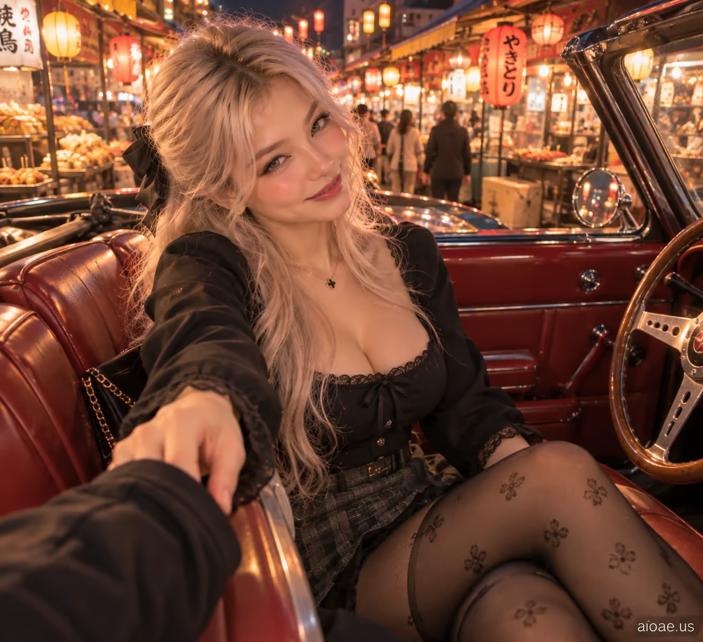

# 案例 05：復古敞篷車上的女友 POV | Case 05: Girlfriend Sitting Beside Me in a Vintage Convertible POV



復古敞篷車＋夜市燈籠光的第一人稱浪漫視角，男友視角的真實互動，電影感寫實人像。

First-person romantic POV beside a vintage convertible under night-market lantern light; genuine partner interaction, cinematic photorealism.

## 完整提示詞 / Full Prompt

```
SUBJECT & IDEA: Girlfriend Sitting Beside Me in a Vintage Convertible POV. an adult woman. Preserve subject, specified action, relationships and any reference appearance. Adult romantic partners only.

SCENE: a warmly lit evening food market under hanging lanterns. warm stall lighting complemented by subtle ambient street illumination. The location, time of day and core props specified by the user are fixed. No unrelated fantasy changes.

RECIPROCAL POV: Genuine first-person romantic-partner viewpoint, not a photographer or fashion shoot. RECIPROCAL INTERACTION DNA: The subject hooks a fingertip around the viewer's sleeve and gently tugs closer while still interacting with the scene. VIEWER PRESENCE: The near-camera sleeve is actually held by the subject; no disconnected grab. PARTNER RESPONSE: A teasing raised eyebrow and a smile as she waits for the viewer to respond. CONTACT EVIDENCE: Fabric creases in the exact direction of her tug and the camera-side arm follows naturally. Keep the exact movement or posture requested by the user; add only compatible reciprocal expressions and viewpoint cues.  A real response occurs between both people, with correct weight, touch and eye line.

CASTING & FASHION: Clearly adult woman; contemporary Western-inspired styling unless nationality/reference was specified. Hair: cool platinum-blonde hair with a soft side part. Outfit: a fitted square-neck black blouse with lace-collar details and a tailored skirt. Hosiery: black semi-sheer tights with a small tasteful floral jacquard pattern; incidental in the crop, subordinate to emotional interaction. Sensual but tasteful fully clothed adult styling; the romantic exchange, not the outfit, is the hero.

CAMERA: Close first-person eye-level 30–65 cm when possible; one partial viewer hand/forearm or shoulder only if physically involved. Normal 26–35 mm smartphone perspective. Face and expression dominate; background secondary.

MUTATION RULES: Preserve the original subject and activity. Creative change is a more emotionally reciprocal atmosphere: spontaneous joy and mischievous shared laughter rather than glamour. warm stall lighting complemented by subtle ambient street illumination. A coherent shared gesture, not a portal or unrelated prop.

ANTI-POSING: No detached glamour modeling, staged smile at an anonymous lens, invisible contact, third-person scene, disconnected fingers or camera-holder visible as a second full person.

SAFETY: Consensual affection between clearly adult characters; no nudity, coercion, fetish-only cropping or explicit acts.

WATERMARK: Small legible "aioae.us" in the bottom-right corner.
```

## 適用模型 / Recommended Models

擅長第一人稱視角與寫實人臉的模型：GPT Image（Image2）、Flux Pro；想要更強的膚質與光影可用 Midjourney。

Models strong at first-person POV and realistic faces: GPT Image (Image2), Flux Pro; Midjourney for richer skin texture and lighting.

## 修改說明 / How to Adapt

- 換場景：把 SCENE 的夜市換成海邊或老城區，燈光與道具描述跟著換，POV 機位段不用動。
- 換互動：把拉衣袖改成遞飲料或並肩走，RECIPROCAL INTERACTION DNA 與 CONTACT EVIDENCE 要同步改。
- 換造型：髮色、服裝、絲襪整組換（如黑長直＋風衣），SAFETY 與 ANTI-POSING 段保留。

- Change the scene: swap the night market for a beach or old town; update lighting and props in SCENE, keep the POV camera block.
- Change the interaction: replace the sleeve-tug with handing a drink or walking side by side; update RECIPROCAL INTERACTION DNA and CONTACT EVIDENCE to match.
- Change the styling: swap hair, outfit and hosiery as a set (e.g. long black hair + trench coat); keep SAFETY and ANTI-POSING.

---
直達本案例 / Direct link: https://aioae.us/prompt?title=Girlfriend%20Sitting%20Beside%20Me%20in%20a%20Vintage%20Convertible%20POV
更多同類提示詞 / More prompts like this: [AIOAE 免費 AI 圖片提示詞庫](https://aioae.us/prompts)
