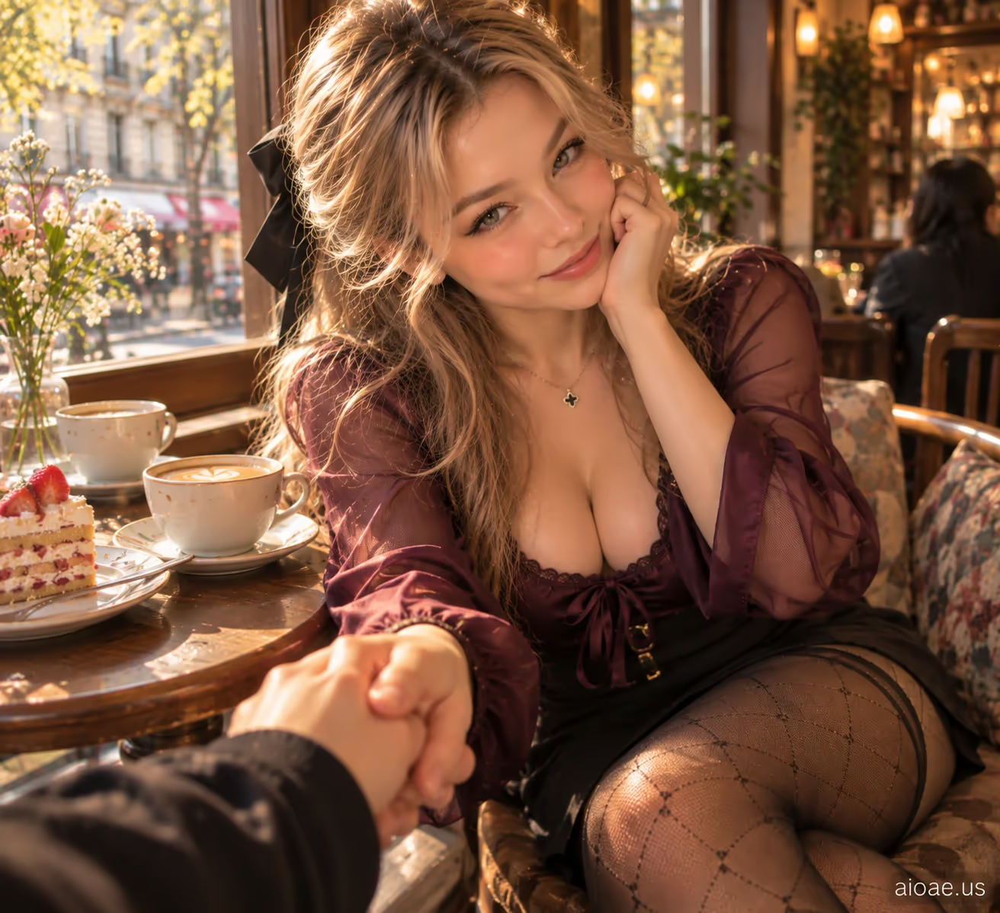

# 案例 06：與女友共泡溫泉 POV | Case 06: Girlfriend Sharing a Hot Spring With Me POV



咖啡館窗邊的親密第一視角，柔光暖調，情緒重於擺拍，電影感寫實人像。

Intimate first-person POV by a café window; soft warm light, emotion over posing, cinematic photorealism.

## 完整提示詞 / Full Prompt

```
SUBJECT & IDEA: Girlfriend Sharing a Hot Spring With Me POV. an adult woman. Preserve subject, specified action, relationships and any reference appearance. Adult romantic partners only.

SCENE: a cafe window seat with two drinks. diffused natural light with warm reflected fill. The location, time of day and core props specified by the user are fixed. No unrelated fantasy changes.

RECIPROCAL POV: Genuine first-person romantic-partner viewpoint, not a photographer or fashion shoot. RECIPROCAL INTERACTION DNA: The subject gently squeezes the viewer's hand beside her while both remain comfortably seated or standing as originally requested. VIEWER PRESENCE: Only one joined pair of hands appears near the lower frame edge, connected anatomically to the visible subject. PARTNER RESPONSE: A soft response in the eyes, then a small smile not directed at an imagined audience. CONTACT EVIDENCE: Realistic shared pressure in fingers and wrist posture; no extra hands.   A real response occurs between both people, with correct weight, touch and eye line.

CASTING & FASHION: Clearly adult woman; contemporary Western-inspired styling unless nationality/reference was specified. Hair: dark blonde hair with caramel face-framing highlights. Outfit: a plum satin blouse with softly sheer sleeves over full opaque lining and a tailored mini skirt. Hosiery: sheer black tights with a restrained diamond-knit pattern; incidental in the crop, subordinate to emotional interaction. Sensual but tasteful fully clothed adult styling; the romantic exchange, not the outfit, is the hero.

CAMERA: Close first-person eye-level 35–80 cm when possible; one partial viewer hand/forearm or shoulder only if physically involved. Normal 26–35 mm smartphone perspective. Face and expression dominate; background secondary.

MUTATION RULES: Preserve the original subject and activity. Creative change is a more emotionally reciprocal atmosphere: gentle connection through a tiny shared ritual, peaceful and personal. diffused natural light with warm reflected fill. A coherent shared gesture, not a portal or unrelated prop.

ANTI-POSING: No detached glamour modeling, staged smile at an anonymous lens, invisible contact, third-person scene, disconnected fingers or camera-holder visible as a second full person.

SAFETY: Consensual affection between clearly adult characters; no nudity, coercion, fetish-only cropping or explicit acts.

WATERMARK: Small legible "aioae.us" in the bottom-right corner.
```

## 適用模型 / Recommended Models

擅長第一人稱視角與寫實人臉的模型：GPT Image（Image2）、Flux Pro；柔光人像可加 Midjourney。

Models strong at first-person POV and realistic faces: GPT Image (Image2), Flux Pro; Midjourney for soft-light portraits.

## 修改說明 / How to Adapt

- 換場景：把 SCENE 的咖啡館換成溫泉旅館或陽台，光線與道具描述跟著改，POV 機位段不用動。
- 換互動：把牽手改成靠肩或碰杯，RECIPROCAL INTERACTION DNA 與 CONTACT EVIDENCE 要同步改。
- 換造型：髮色、服裝、絲襪整組換（如深棕長髮＋針織衫），SAFETY 與 ANTI-POSING 段保留。

- Change the scene: swap the café for a hot-spring inn or balcony; update lighting and props in SCENE, keep the POV camera block.
- Change the interaction: replace hand-holding with leaning on a shoulder or clinking cups; update RECIPROCAL INTERACTION DNA and CONTACT EVIDENCE to match.
- Change the styling: swap hair, outfit and hosiery as a set (e.g. long dark-brown hair + knit top); keep SAFETY and ANTI-POSING.

---
直達本案例 / Direct link: https://aioae.us/prompt?title=Girlfriend%20Sharing%20a%20Hot%20Spring%20With%20Me%20POV
更多同類提示詞 / More prompts like this: [AIOAE 免費 AI 圖片提示詞庫](https://aioae.us/prompts)
