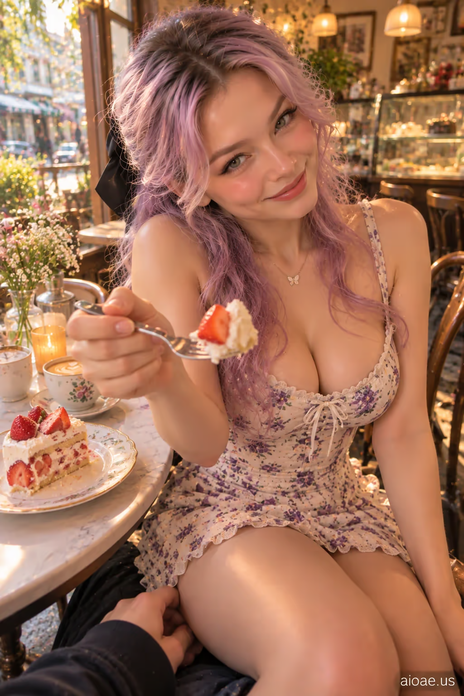

# 案例 08：女友面對面坐腿上 POV | Case 08: Girlfriend Sitting on My Lap Facing Me POV



陽光糕點店裡的膝上對坐第一視角，俏皮甜蜜的雙人互動，電影感寫實人像。

Lap-facing first-person POV in a sunlit patisserie; playful, flirtatious two-person interaction, cinematic photorealism.

## 完整提示詞 / Full Prompt

```
SUBJECT & IDEA: Girlfriend Sitting on My Lap Facing Me POV. an adult woman. Preserve subject, specified action, relationships and any reference appearance. Adult romantic partners only.

SCENE: a tiny sunlit patisserie table with strawberry cake and cups. soft amber cafe lamps mingling with diffused natural window light. The location, time of day and core props specified by the user are fixed. No unrelated fantasy changes.

RECIPROCAL POV: Genuine first-person romantic-partner viewpoint, not a photographer or fashion shoot. RECIPROCAL INTERACTION DNA: She takes a real bite of the specified cake, grins, and offers the viewer a separate small bite on her fork without stopping her own dessert. VIEWER PRESENCE: The viewer's free hand rests near the plate; the fork passes naturally into shared personal space. PARTNER RESPONSE: An affectionate side glance, a restrained smile and a playful pause while waiting for the viewer's reaction. CONTACT EVIDENCE: One fork, a partly eaten cake and an unobstructed hand-to-food trajectory; no extra floating cutlery. Keep the exact movement or posture requested by the user; add only compatible reciprocal expressions and viewpoint cues.  A real response occurs between both people, with correct weight, touch and eye line.

CASTING & FASHION: Clearly adult woman; contemporary Western-inspired styling unless nationality/reference was specified. Hair: soft lavender-purple hair with a gentle gradient. Outfit: a stylish fitted summer sundress with a modest neckline, adapted to warm outdoor weather. Sensual but tasteful fully clothed adult styling; the romantic exchange, not the outfit, is the hero.

CAMERA: Close first-person eye-level 38–70 cm when possible; one partial viewer hand/forearm or shoulder only if physically involved. Normal 26–35 mm smartphone perspective. Face and expression dominate; background secondary.

MUTATION RULES: Preserve the original subject and activity. Creative change is a more emotionally reciprocal atmosphere: flirtatious warmth, a teasing pause, and the feeling of a small private joke. soft amber cafe lamps mingling with diffused natural window light. A coherent shared gesture, not a portal or unrelated prop.

ANTI-POSING: No detached glamour modeling, staged smile at an anonymous lens, invisible contact, third-person scene, disconnected fingers or camera-holder visible as a second full person.

SAFETY: Consensual affection between clearly adult characters; no nudity, coercion, fetish-only cropping or explicit acts.

WATERMARK: Small legible "aioae.us" in the bottom-right corner.
```

## 適用模型 / Recommended Models

擅長第一人稱視角與寫實人臉的模型：GPT Image（Image2）、Flux Pro；甜點靜物細節可加 Midjourney。

Models strong at first-person POV and realistic faces: GPT Image (Image2), Flux Pro; Midjourney for dessert still-life detail.

## 修改說明 / How to Adapt

- 換地點：把 SCENE 的糕點店換成野餐或客廳，道具描述跟著改，POV 機位段不用動。
- 換互動：把分蛋糕改成餵食或碰杯，CONTACT EVIDENCE 的叉子軌跡要同步改。
- 換造型：洋裝整組換成日常裝（如白襯衫＋牛仔裙），SAFETY 與 ANTI-POSING 段保留。

- Change the location: swap the patisserie for a picnic or living room; update the props in SCENE, keep the POV camera block.
- Change the interaction: replace sharing cake with feeding or clinking cups; update the fork trajectory in CONTACT EVIDENCE to match.
- Change the styling: swap the sundress for casual wear (e.g. white shirt + denim skirt); keep SAFETY and ANTI-POSING.

---
直達本案例 / Direct link: https://aioae.us/prompt?title=Girlfriend%20Sitting%20on%20My%20Lap%20Facing%20Me%20POV
更多同類提示詞 / More prompts like this: [AIOAE 免費 AI 圖片提示詞庫](https://aioae.us/prompts)
