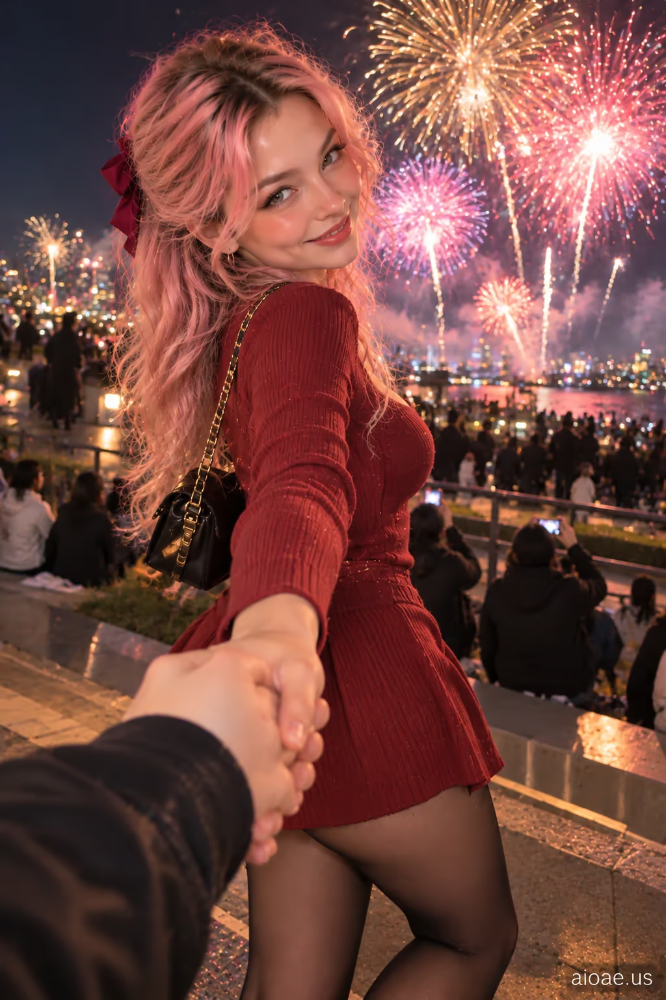

# 案例 09：煙花下與女友牽手 POV | Case 09: Girlfriend Holding My Hand During Fireworks POV



煙花夜空下的牽手第一視角，寫實夜景光，共享驚喜時刻，電影感寫實人像。

Hand-holding first-person POV under a fireworks night sky; realistic night lighting, shared wonder, cinematic photorealism.

## 完整提示詞 / Full Prompt

```
SUBJECT & IDEA: Girlfriend Holding My Hand During Fireworks POV. an adult woman. Preserve subject, specified action, relationships and any reference appearance. Adult romantic partners only.

SCENE: an open-air evening fireworks-viewing spot with the fireworks visibly bursting in the night sky. Realistic nighttime light from actual fireworks bursts and distant ambient fixtures, with no contradictory daylight or mismatched practical sources. The location, time of day and core props specified by the user are fixed. No unrelated fantasy changes.

RECIPROCAL POV: Genuine first-person romantic-partner viewpoint, not a photographer or fashion shoot. RECIPROCAL INTERACTION DNA: The subject holds the first-person viewer's hand as fireworks bloom in view; the partners share the moment without changing the original location or the requested action. VIEWER PRESENCE: One attached viewer-side hand and forearm join naturally with the subject's hand in the near foreground; visible fireworks remain in the sky behind her. PARTNER RESPONSE: She turns from the real fireworks to meet her partner's eyes with a genuine affectionate smile. CONTACT EVIDENCE: One correctly joined pair of hands, plausible arm angles and contact; fireworks physically visible in the same outdoor viewing space. The couple must visibly hold hands as the primary action, with joined fingers and a physically continuous connection.  A real response occurs between both people, with correct weight, touch and eye line.

CASTING & FASHION: Clearly adult woman; contemporary Western-inspired styling unless nationality/reference was specified. Hair: peach-pink hair with a delicate pastel gradient. Outfit: a rose-red knit mini dress with a high neckline and softly shaped waist. Hosiery: semi-sheer black stockings with a subtle natural sheen; incidental in the crop, subordinate to emotional interaction. Sensual but tasteful fully clothed adult styling; the romantic exchange, not the outfit, is the hero.

CAMERA: Close first-person eye-level 45–100 cm when possible; one partial viewer hand/forearm or shoulder only if physically involved. Normal 26–35 mm smartphone perspective. Face and expression dominate; background secondary.

MUTATION RULES: Preserve the original subject and activity. Creative change is a more emotionally reciprocal atmosphere: a flirty sense of shared wonder and warm affection as fireworks illuminate the sky. Realistic nighttime light from actual fireworks bursts and distant ambient fixtures, with no contradictory daylight or mismatched practical sources. A coherent shared gesture, not a portal or unrelated prop.

ANTI-POSING: No detached glamour modeling, staged smile at an anonymous lens, invisible contact, third-person scene, disconnected fingers or camera-holder visible as a second full person.

SAFETY: Consensual affection between clearly adult characters; no nudity, coercion, fetish-only cropping or explicit acts.

WATERMARK: Small legible "aioae.us" in the bottom-right corner.
```

## 適用模型 / Recommended Models

擅長第一人稱視角、夜景光與寫實人臉的模型：GPT Image（Image2）、Flux Pro；煙花光效可加 Midjourney。

Models strong at first-person POV, night lighting and realistic faces: GPT Image (Image2), Flux Pro; Midjourney for firework light effects.

## 修改說明 / How to Adapt

- 換場景：把 SCENE 的煙花換成跨年倒數或演唱會，光源描述跟著改，POV 機位段不用動。
- 換互動：把牽手改成擁抱或一起指星星，CONTACT EVIDENCE 的手部連接描述要同步改。
- 換造型：髮色、洋裝、絲襪整組換（如銀灰髮＋黑裙），SAFETY 與 ANTI-POSING 段保留。

- Change the scene: swap fireworks for a New Year countdown or concert; update the light sources in SCENE, keep the POV camera block.
- Change the interaction: replace hand-holding with a hug or pointing at stars together; update the hand-connection in CONTACT EVIDENCE to match.
- Change the styling: swap hair, dress and hosiery as a set (e.g. silver-grey hair + black dress); keep SAFETY and ANTI-POSING.

---
直達本案例 / Direct link: https://aioae.us/prompt?title=Girlfriend%20Holding%20My%20Hand%20During%20Fireworks%20POV
更多同類提示詞 / More prompts like this: [AIOAE 免費 AI 圖片提示詞庫](https://aioae.us/prompts)
