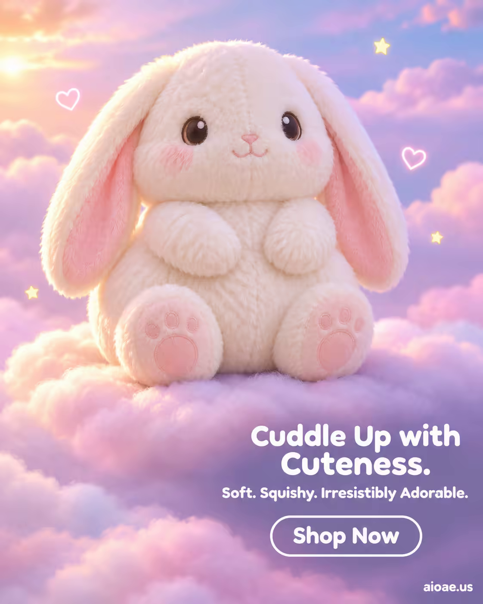

# 案例 100：夢幻雲端上的毛絨兔子 | Case 100: Cuddly Bunny Plush on Dreamy Clouds



可愛治癒風：毛絨兔子坐在粉彩雲朵之間，柔軟絨毛、馬卡龍配色與夢幻光暈，傳遞「抱一下就好」的溫柔。

Cute and comforting: a plush bunny sits among pastel clouds — soft fur, macaron colours and a dreamy glow, selling the urge to give it a hug.

## 完整提示詞 / Full Prompt

```
SUBJECT & IDEA: Kawaii Animal Plush Toy. A soft, cuddly bunny plush toy sits in the center of a dreamy, pastel-colored cloud, its fluffy white fur glowing with a soft, warm light. The bunny’s eyes are large and round, with a gentle, innocent expression, and its ears are long and floppy, with pink inner ears. The bunny is surrounded by a halo of tiny, glowing stars and hearts, creating a magical, whimsical atmosphere. The scene is soft and dreamy, with a focus on the bunny’s cuteness and the joy it brings. The bunny’s fur is not just soft—it is a cloud, a pillow, a hug, a friend. The bunny is not just a toy—it is a companion, a comfort, a source of happiness. The scene is designed to evoke feelings of warmth, love, and nostalgia, making the viewer want to cuddle the bunny and never let go.
PRODUCT: The kawaii animal plush toy is the hero of the image, positioned in the center of the frame. The toy is a bunny, rendered in soft, fluffy white fur with pink inner ears and a small, pink nose. The bunny’s eyes are large and round, with a gentle, innocent expression, and its body is round and chubby, with short, stubby arms and legs. The bunny is sitting on a pastel-colored cloud, with its paws resting on its belly. The bunny’s fur is detailed and realistic, with visible texture and softness. The bunny’s design is cute and whimsical, with a focus on its large eyes and fluffy fur.
SCENE: A dreamy, pastel-colored sky with soft, fluffy clouds and a gentle, warm light. The bunny plush toy sits on a pastel-colored cloud in the center of the frame, surrounded by tiny, glowing stars and hearts. The background is soft and dreamy, with pastel pinks, blues, and purples dominating the palette. The scene is whimsical and magical, with a focus on the bunny’s cuteness and the joy it brings. The clouds are soft and fluffy, with a slight translucency that allows the light to shine through.
LIGHTING & COLOR: Soft, diffused light from the sun casts a warm, golden glow on the bunny and the surrounding clouds. The light creates a soft, dreamy atmosphere, with pastel pinks, blues, and purples dominating the palette. The bunny’s white fur glows with a soft, warm light, making it stand out against the pastel background. The overall color palette is soft and dreamy, with a focus on pastel colors and warm light.
CAMERA: A straight-on, eye-level shot captures the bunny plush toy in sharp focus, with the pastel-colored clouds blurred in the background. The camera is positioned at a slight angle, creating a sense of depth and dimension. The bunny is centered in the frame, with ample negative space around it to emphasize its cuteness.
ON-IMAGE COPY: Headline "Cuddle Up with Cuteness."; subheadline "Soft. Squishy. Irresistibly Adorable."; CTA "Shop Now". Playful, rounded sans-serif font, white on a transparent background, positioned in the lower right corner. The font size is large enough to be legible against the pastel background but small enough not to distract from the visual. No additional text is included to keep the focus on the imagery.
WATERMARK: Small readable "aioae.us" in the bottom-right corner.
```

## 適用模型 / Recommended Models

擅長可愛治癒風與毛絨質感的模型：GPT Image（Image2）、Flux Pro、Midjourney。

Models strong at cute, comforting styles and plush textures: GPT Image (Image2), Flux Pro, Midjourney.

## 修改說明 / How to Adapt

- 換主角：兔子換成熊貓或小熊，SUBJECT & IDEA 與 PRODUCT 段的主角描述整組換。
- 換配色：粉彩雲朵換成星空藍或薄荷綠，LIGHTING & COLOR 段的配色描述整組換。
- 換場景：雲端換成兒童房或野餐草地，SCENE 段的背景元素整組換。

- Change the character: swap the bunny for a panda or teddy bear; replace the character description in SUBJECT & IDEA and PRODUCT as a set.
- Change the palette: swap the pastel clouds for starry blue or mint green; replace the colour description in LIGHTING & COLOR as a set.
- Change the scene: swap the clouds for a children's room or a picnic meadow; replace the background elements in SCENE as a set.

---
直達本案例 / Direct link: https://aioae.us/prompt?title=Cuddly%20Bunny%20Plush%20on%20Dreamy%20Clouds
更多同類提示詞 / More prompts like this: [AIOAE 免費 AI 圖片提示詞庫](https://aioae.us/prompts)
