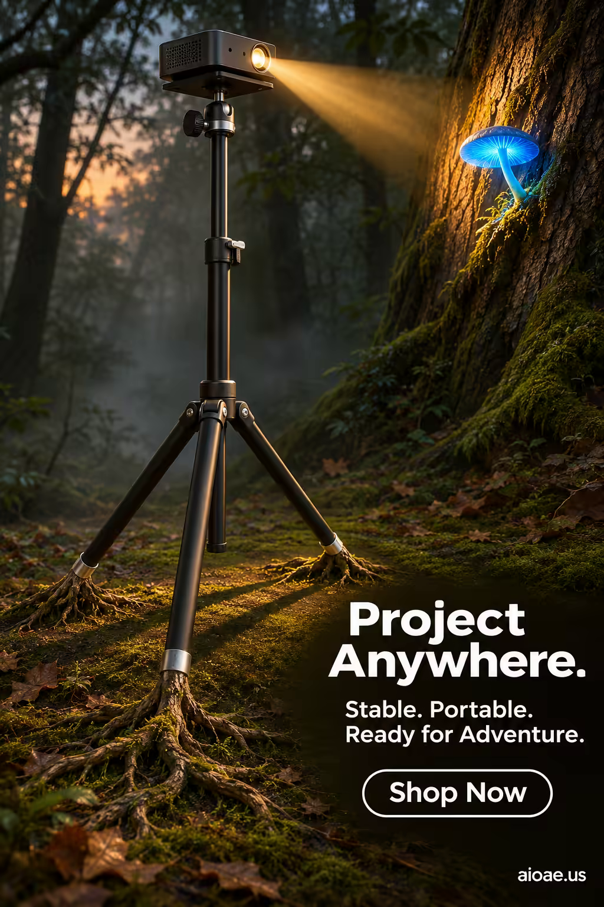

# 案例 101：魔法森林中的落地投影儀支架 | Case 101: Rooted Projector Stand in Enchanted Forest



奇幻戶外投影風：黑色投影儀支架立於幽暗魔法森林，霧氣、苔蘚與微光交織，突出「隨處都能投影」的便攜與穩定。

Fantasy outdoor-projection style: a black projector stand rises in a dark enchanted forest — mist, moss and faint glow selling projection anywhere, stable and portable.

## 完整提示詞 / Full Prompt

```
SUBJECT & IDEA: Projector Tripod Stand. A sleek, black projector tripod stand stands tall in the center of a dark, moody forest clearing, its three legs splayed out like the roots of an ancient tree. The stand’s metal frame is matte black, with subtle silver accents that catch the light. At the top of the stand, a small, glowing projector sits, casting a beam of light that illuminates a nearby tree trunk. The beam of light reveals a hidden, glowing mushroom growing on the tree, its cap a vibrant, bioluminescent blue. The scene is surreal and dreamlike, blending technology with nature in a way that feels both futuristic and organic. The tripod stand’s legs are not just metal—they are living, breathing roots that have grown into the forest floor, anchoring the stand in place. The projector’s light is not just illumination—it is a portal to another world, revealing the hidden magic of the forest.
PRODUCT: The projector tripod stand is the hero of the image, positioned in the center of the frame. The stand is rendered in matte black metal, with subtle silver accents on the joints and feet. The stand’s three legs are splayed out like the roots of a tree, with intricate, organic details that suggest they are alive. The projector at the top of the stand is small and compact, with a glowing lens that casts a beam of light. The stand’s design is sleek and modern, but its organic, root-like legs give it a natural, earthy feel. The stand is positioned on a bed of moss and fallen leaves, with the forest floor visible in the foreground.
SCENE: A dark, moody forest clearing at dusk, with tall, ancient trees surrounding the area. The ground is covered in moss and fallen leaves, and the air is thick with mist. The projector tripod stand stands in the center of the clearing, its legs rooted into the forest floor. The projector’s beam of light illuminates a nearby tree trunk, revealing a hidden, glowing mushroom. The background is dark and moody, with the trees fading into the mist. The scene is surreal and dreamlike, blending technology with nature.
LIGHTING & COLOR: Soft, diffused light from the projector’s beam creates a warm, golden glow on the tree trunk and the glowing mushroom. The surrounding forest is dark and moody, with deep greens and browns dominating the palette. The projector’s light is the main source of illumination, casting long shadows and creating a sense of depth. The overall color palette is dark and atmospheric, with the glowing mushroom providing a pop of vibrant blue.
CAMERA: A low-angle shot (20° from the ground) captures the projector tripod stand in sharp focus, with the forest clearing blurred in the background. The camera is positioned close to the ground, looking up at the stand, emphasizing its height and presence. The stand is centered in the frame, with the glowing mushroom visible in the background.
ON-IMAGE COPY: Headline "Project Anywhere."; subheadline "Stable. Portable. Ready for Adventure."; CTA "Shop Now". Bold, modern sans-serif font, white on a transparent background, positioned in the lower right corner. The font size is large enough to be legible against the dark forest background but small enough not to distract from the visual. No additional text is included to keep the focus on the imagery.
WATERMARK: Small readable "aioae.us" in the bottom-right corner.
```

## 適用模型 / Recommended Models

擅長奇幻場景與科技產品海報的模型：GPT Image（Image2）、Flux Pro、Midjourney。

Models strong at fantasy scenes and tech-product posters: GPT Image (Image2), Flux Pro, Midjourney.

## 修改說明 / How to Adapt

- 換產品：投影儀支架換成露營燈架或音箱支架，SUBJECT & IDEA 與 PRODUCT 段的產品描述整組換。
- 換場景：魔法森林換成露營地或後院星空，SCENE 段的背景元素整組換。
- 換色調：幽暗冷調換成篝火暖調，LIGHTING & COLOR 段的配色與光線描述整組換。

- Change the product: swap the projector stand for a camping-lamp stand or speaker stand; replace the product description in SUBJECT & IDEA and PRODUCT as a set.
- Change the scene: swap the enchanted forest for a campsite or a starry backyard; replace the background elements in SCENE as a set.
- Change the palette: swap the dark cool tones for warm campfire tones; replace the colour and lighting description in LIGHTING & COLOR as a set.

---
直達本案例 / Direct link: https://aioae.us/prompt?title=Rooted%20Projector%20Stand%20in%20Enchanted%20Forest
更多同類提示詞 / More prompts like this: [AIOAE 免費 AI 圖片提示詞庫](https://aioae.us/prompts)
