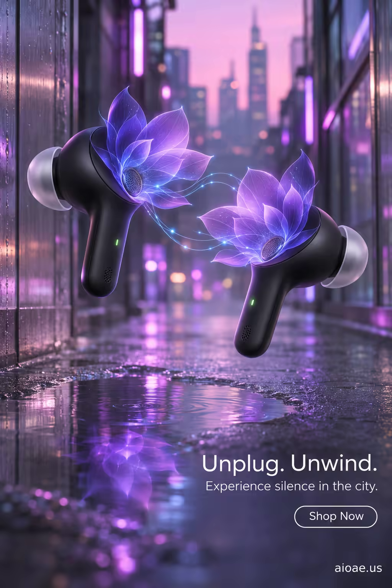

# 案例 102：城市霓虹蓮花耳機 | Case 102: Neon Lotus Earbuds in the City



都市霓虹音頻風：黑色真無線耳機懸浮於城市夜色，蓮花光影在小小腔體上綻放，傳遞「城市中的寂靜」。

Urban neon audio style: black true-wireless earbuds float in the city night — lotus light blooming across the tiny shells, selling silence in the city.

## 完整提示詞 / Full Prompt

```
SUBJECT & IDEA: True Wireless Earbuds. A pair of sleek, black earbuds float midair, their tiny speaker domes morphing into blooming lotus petals that unfurl around them. The petals pulse softly with light, casting delicate shadows on a reflective, chrome floor that mimics water. The scene feels like a quiet zen garden in the heart of a bustling city, hinting at the earbuds’ promise of escape and clarity. The transformation—speakers turning into living, breathing flowers—emphasizes the earbuds’ ability to turn everyday noise into personal, serene soundscapes.

PRODUCT: The earbuds sit in the center of the composition, positioned at eye level. Each unit is rendered with matte black housing, silver ear tips, and a subtle LED status indicator glowing faintly green. The earbuds’ speaker grills expand into translucent lotus petals, each petal a gradient from deep indigo to soft violet. The petals are rendered with a slight translucency, allowing the chrome floor’s reflection to weave through them. The earbuds are connected to the petals by a faint, glowing blue filament that appears to be the audio signal itself, pulsing in time with an unseen beat.

SCENE: A narrow, rain-slick alleyway in a neon-lit city, the walls made of brushed steel and glass. At the alley’s center, on a small reflective puddle of water, the earbuds hover just above the surface. The lotus petals unfurl around the earbuds, their edges glowing with soft bioluminescent light. Behind the earbuds, faint silhouettes of skyscrapers blur into a pastel pink twilight, but the focus remains on the floating earbuds and their floral transformation. The petals’ light refracts through the water, creating a shimmering halo. The background is deliberately blurred to keep the earbuds and petals as the visual anchor.

LIGHTING & COLOR: Soft, diffused light emanates from the earbuds’ glowing LED and the petals, casting gentle, elongated shadows on the puddle. A subtle backlight from the city’s neon signs creates a rim of violet light around the earbuds, enhancing the metallic sheen of their housings. The overall illumination feels calm yet slightly futuristic, with a slight blue tint to suggest technology.

CAMERA: A slightly low angle shot (30° from the ground) captures the earbuds and petals in close focus, with the reflective puddle filling the lower third of the frame. The background is intentionally shallow depth of field, so the city’s neon glow is a soft bokeh, keeping the earbuds and lotus petals crisp and prominent.

ON-IMAGE COPY: Headline "Unplug. Unwind."; subheadline "Experience silence in the city."; CTA "Shop Now". Minimalist sans-serif font, white on a transparent background, positioned in the lower right corner. The font size is large enough to be legible against the subtle reflections but small enough not to distract from the visual. No additional text is included to keep the focus on the imagery.

WATERMARK: Small readable "aioae.us" in the bottom-right corner.
```

## 適用模型 / Recommended Models

擅長霓虹都市場景與音頻產品海報的模型：GPT Image（Image2）、Flux Pro、Midjourney。

Models strong at neon city scenes and audio-product posters: GPT Image (Image2), Flux Pro, Midjourney.

## 修改說明 / How to Adapt

- 換產品：耳機換成頭戴式耳機或音箱，SUBJECT & IDEA 與 PRODUCT 段的產品描述整組換。
- 換意象：蓮花換成音浪波紋或星軌，SUBJECT & IDEA 段的視覺意象整組換。
- 換色調：霓虹冷調換成日落暖調，LIGHTING & COLOR 段的配色與光線描述整組換。

- Change the product: swap the earbuds for over-ear headphones or a speaker; replace the product description in SUBJECT & IDEA and PRODUCT as a set.
- Change the motif: swap the lotus for sound-wave ripples or star trails; replace the visual motif in SUBJECT & IDEA as a set.
- Change the palette: swap the neon cool tones for sunset warm tones; replace the colour and lighting description in LIGHTING & COLOR as a set.

---
直達本案例 / Direct link: https://aioae.us/prompt?title=Neon%20Lotus%20Earbuds%20in%20the%20City
更多同類提示詞 / More prompts like this: [AIOAE 免費 AI 圖片提示詞庫](https://aioae.us/prompts)
