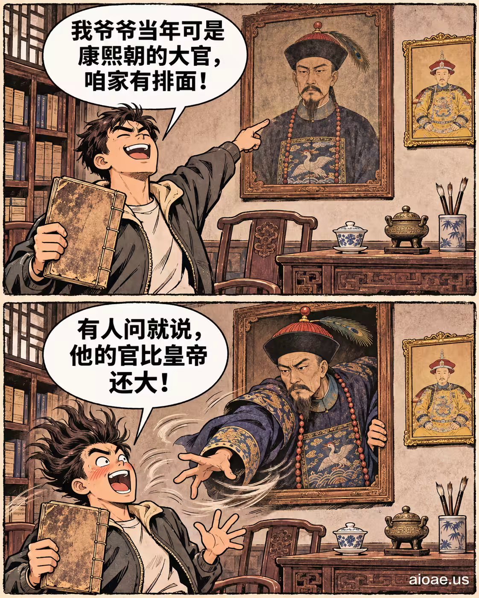

# 案例 104：吹牛網民的肖像活了過來 | Case 104: A Boastful Netizens Portrait Comes Alive



雙格諷刺漫畫風：上下兩格對比「吹牛的肖像」與「活過來的現實」，誇張表情與簡潔構圖讓梗一目了然。

Two-panel satirical comic: the top and bottom panels contrast a boastful portrait with the reality that comes alive — exaggerated expressions and clean composition make the joke land at a glance.

## 完整提示詞 / Full Prompt

```
SUBJECT: Original TWO-PANEL comic about "Kangxi era grandpa meme "Kangxi era grandpa meme"". Show the exact named people, props and relationship through the actions below.
LAYOUT: ONE portrait 4:5 illustration with EXACTLY TWO horizontal rectangular panels STACKED TOP TO BOTTOM, same size, thin off-white gutter and rough dark ink borders. Never render two separate pictures or a third panel.
STYLE: Hand-drawn newspaper comic, warm muted colors, thick confident ink outlines, expressive cartoon faces/gestures, subtle old-paper texture. Original visual composition; not a glossy advertisement or an imitation of a copyrighted comic image.
CAST & CONTINUITY: ONE recurring speaking character = Proud Netizen. A separate recognizable named subject from the user's input is PRESENT but SILENT in BOTH panels. Both stay in the same outfit. SAME camera and exact physical setting: Old-fashioned study room, a portrait of an emperor of the Qing dynasty on the wall.
TOP PANEL — SETUP: The netizen stands beside an old portrait, waving a dusty genealogy book, eyes beaming, hand pointing at a faded Qing official portrait. Show Speaker A's clear expression and Speaker B listening/reacting. Topic focus: Kangxi era grandpa meme.
TOP PANEL TEXT: ONE large white dialogue balloon with its tail pointing ONLY to Speaker A. RENDER VERBATIM in bold readable black capitals: "My grandpa was a Qing official back then. We’re classy."
BOTTOM PANEL — PUNCHLINE: A Kangxi-era portrait in the background transforms into a stern Qing official, the netizen’s hair is blown upward and cheeks flushed, while a silent wall in the back shows the name of the first scene "Kangxi-era grandpa". Same named subject, props and space; the main VISUAL CHANGE must be unmistakable even if both bubbles were covered. Clearly show the physical consequence before the observer reads the words.
BOTTOM PANEL TEXT: ONE large white dialogue balloon with its tail pointing ONLY to the SAME speaking character as top panel. RENDER VERBATIM in bold readable black capitals: "If anyone asks, his rank was higher than the emperor’s!"
COMIC TIMING: Setup above, surprising comeback below. Two bubbles TOTAL, one per panel, positioned above their speaker without obstructing faces. No other speech, captions, typography, fake labels or misspelled text.
CONTEXT: Clearly fictional cartoon humor, not a fake factual report.
ORIGINALITY: Borrow only abstract humor structures, never replicate the reference artwork, characters, distinctive dialogue or meme screenshot.
WATERMARK: Small clear "aioae.us" at bottom-right outside speech balloons.
AVOID: extra panels, photo collage, unrelated portals, generic jokes, confusing bubble tails, duplicate panel poses, extra text, busy unrelated backgrounds.
圖片裡的文字改用簡體中文，要符合中文場景
```

## 適用模型 / Recommended Models

擅長雙格漫畫與梗圖的模型：GPT Image（Image2）、Flux Pro、Midjourney。

Models strong at two-panel comics and meme images: GPT Image (Image2), Flux Pro, Midjourney.

## 修改說明 / How to Adapt

- 換主角：網民換成其他網路人物或名人，CAST & CONTINUITY 段的人物設定整組換。
- 換對白：上下格的 TOP PANEL TEXT 與 BOTTOM PANEL TEXT 換成另一組反差對白。
- 換畫風：寫實漫畫換成扁平插畫或像素風，STYLE 段的畫風描述整組換。

- Change the cast: swap the netizen for another online persona or celebrity; replace the character setup in CAST & CONTINUITY as a set.
- Change the dialogue: swap the TOP PANEL TEXT and BOTTOM PANEL TEXT for another contrasting pair of lines.
- Change the art style: swap the realistic comic style for flat illustration or pixel art; replace the style description in STYLE as a set.

---
直達本案例 / Direct link: https://aioae.us/prompt?title=A%20Boastful%20Netizens%20Portrait%20Comes%20Alive
更多同類提示詞 / More prompts like this: [AIOAE 免費 AI 圖片提示詞庫](https://aioae.us/prompts)
