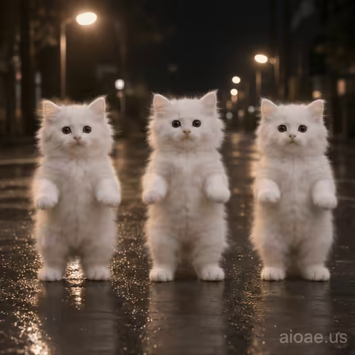

# 案例 105：三隻跳舞小貓循環動畫精靈圖 | Case 105: Three Dancing Kittens Loop Animation Sprite Sheet



夜晚濕瀝青路面上三隻白色小貓站立搖擺跳舞，寫實毛髮＋街燈柔光，可愛又帶點荒誕的深夜街頭感。

Three photorealistic fluffy white kittens dance in a row on a wet asphalt road at night — soft streetlight glow, detailed fur, cute with a touch of absurd late-night street charm.

## 完整提示詞 / Full Prompt

```
Create a single animation sprite sheet for a seamless looping GIF. Three photorealistic fluffy white kittens stand upright on their hind legs in a row in the middle of an asphalt road at night, streetlights glowing softly in the dark background, wet asphalt reflecting the lights. A small watermark reading 'aioae.us' appears in the bottom-right corner of every panel, applied to each of the 6 frames individually at 70% transparency (30% opacity), identical in size, position, and wording in every frame. Exactly 6 sequential frames arranged in a precise 3-column by 2-row grid, read left-to-right and then top-to-bottom. Every panel has identical dimensions. Fixed front camera, consistent character identity, body proportions, fur, lighting, watermark, and background in every frame. Animation sequence: Frame 1: The three kittens stand upright in a row, front paws slightly out, looking at the camera. Frame 2: The three kittens sway to the left together, paws lifting. Frame 3: The three kittens sway to the right together, paws raised higher. Frame 4: The three kittens bounce up together on their hind legs, paws waving in the air. Frame 5: The three kittens wiggle side to side in unison, paws waving, heads bobbing. Frame 6: The three kittens settle back down, paws lowering, posture returning toward the first frame. Clear incremental sway, bounce, and paw movement between frames, all three kittens moving in sync. Keep the camera, composition, and character scale fixed. Make the sixth frame transition smoothly toward the first for a looping animation. Photorealistic kittens, highly detailed fur, night street lighting with soft bokeh, cute and funny mood, polished digital artwork. No captions, no words, no numbers, no logos, no speech bubbles, no panel labels, no borders, no gutters. The only text in the image is the small 'aioae.us' watermark.
```

## 適用模型 / Recommended Models

擅長 6 格精靈圖與角色一致性的模型：GPT Image（Image2）、Flux Pro、即夢（建議固定種子）。

Models strong at 6-frame sprite sheets and character consistency: GPT Image (Image2), Flux Pro, Jimeng (fix the seed for best consistency).

## 修改說明 / How to Adapt

- 換主角：三隻白貓換成其他動物（如柴犬、兔子），Frame 1–6 的動作描述跟著換，場景不用動。
- 換場景：夜晚馬路換成雪地或沙灘，街燈與濕瀝青反光改成對應的光影描述。
- 換動作：搖擺跳舞換成揮手或鞠躬，6 幀的動作序列逐幀改，保持首尾銜接。

- Change the cast: swap the three white kittens for other animals (e.g. Shiba Inu, rabbits); update the Frame 1–6 action descriptions to match — the setting stays.
- Change the setting: swap the night road for a snowy field or a beach; replace the streetlight and wet-asphalt reflections with matching light descriptions.
- Change the moves: swap the swaying dance for waving or bowing; rewrite the 6-frame action sequence frame by frame, keeping the loop seamless.

---
直達本案例 / Direct link: https://aioae.us/prompt?title=Three%20Dancing%20Kittens%20Loop%20Animation%20Sprite%20Sheet
更多同類提示詞 / More prompts like this: [AIOAE 免費 AI 圖片提示詞庫](https://aioae.us/prompts)
