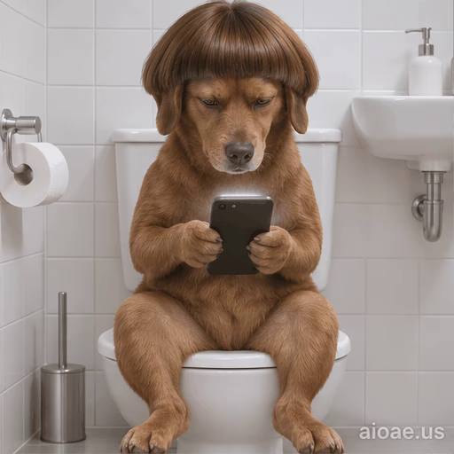

# 案例 106：碗蓋頭狗狗滑手機循環動畫精靈圖 | Case 106: Bowl Cut Dog Phone Loop Animation Sprite Sheet



碗蓋頭棕狗像人一樣坐在馬桶上滑手機，面無表情的冷面幽默，浴室白瓷磚與明亮光線反差強烈。

A bowl-cut brown dog sits on a toilet like a human, scrolling a phone with a deadpan stare — bright white-tiled bathroom, strong comic contrast.

## 完整提示詞 / Full Prompt

```
Create a single animation sprite sheet for a seamless looping GIF. A photorealistic brown dog with a bowl-cut hairstyle, a straight fringe across its forehead, sits upright on a white toilet like a human in a clean bathroom with white tiles and a white sink in the background, holding a smartphone in both front paws and looking down at the screen. A small watermark reading 'aioae.us' appears in the bottom-right corner of every panel, applied to each of the 6 frames individually at 70% transparency (30% opacity), identical in size, position, and wording in every frame. Exactly 6 sequential frames arranged in a precise 3-column by 2-row grid, read left-to-right and then top-to-bottom. Every panel has identical dimensions. Fixed front camera, consistent character identity, body proportions, fur, lighting, watermark, and background in every frame. Animation sequence: Frame 1: The dog sits on the toilet holding the phone in both paws, eyes on the screen, neutral expression. Frame 2: The dog scrolls the phone with one paw, head tilting slightly, focused. Frame 3: The dog's eyes widen at something on the screen, mouth opening slightly in surprise. Frame 4: The dog smirks and chuckles, scrolling faster, head bobbing. Frame 5: The dog looks up briefly with an annoyed expression, then glances back down at the phone. Frame 6: The dog settles back into scrolling calmly, expression relaxing, posture returning toward the first frame. Clear incremental head, paw, and facial movement between frames. Keep the camera, composition, and character scale fixed. Make the sixth frame transition smoothly toward the first for a looping animation. Photorealistic dog, highly detailed fur, bright bathroom lighting, deadpan and funny mood, polished digital artwork. No captions, no words, no numbers, no logos, no speech bubbles, no panel labels, no borders, no gutters. The only text in the image is the small 'aioae.us' watermark.
```

## 適用模型 / Recommended Models

擅長 6 格精靈圖與角色一致性的模型：GPT Image（Image2）、Flux Pro、即夢（建議固定種子）。

Models strong at 6-frame sprite sheets and character consistency: GPT Image (Image2), Flux Pro, Jimeng (fix the seed for best consistency).

## 修改說明 / How to Adapt

- 換主角：狗狗換成貓咪或熊貓，碗蓋頭髮型與坐姿描述整組換。
- 換場景：浴室換成客廳沙發或辦公室座位，背景瓷磚與水槽描述跟著換。
- 換情緒：從冷面滑手機換成看到好消息大笑，Frame 3–5 的表情逐幀改。

- Change the cast: swap the dog for a cat or a panda; replace the bowl-cut hairstyle and sitting pose as a set.
- Change the setting: swap the bathroom for a living-room sofa or an office chair; update the tile and sink background to match.
- Change the mood: swap deadpan scrolling for laughing at good news; rewrite the Frame 3–5 expressions frame by frame.

---
直達本案例 / Direct link: https://aioae.us/prompt?title=Bowl%20Cut%20Dog%20Phone%20Loop%20Animation%20Sprite%20Sheet
更多同類提示詞 / More prompts like this: [AIOAE 免費 AI 圖片提示詞庫](https://aioae.us/prompts)
