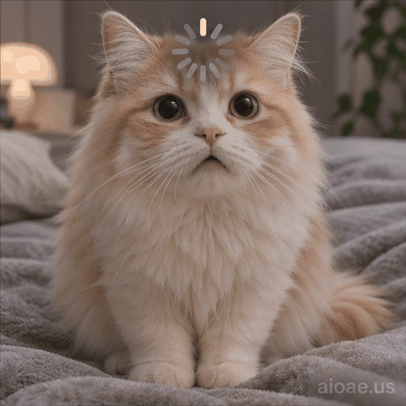

# 案例 107：載入中的貓咪循環動畫精靈圖 | Case 107: Loading Cat Loop Animation Sprite Sheet



奶油橘貓一臉困惑地盯著鏡頭，額頭上轉著灰色載入圈——「大腦載入中」的表情包既視感。

A fluffy cream-and-orange cat stares at the camera, puzzled, a grey loading spinner turning over its forehead — the perfect "brain still loading" sticker.

## 完整提示詞 / Full Prompt

```
Create a single animation sprite sheet for a seamless looping GIF. A photorealistic fluffy cream-and-orange cat with big dark eyes sits on a soft grey blanket on a bed, looking directly at the camera with a confused, slightly sad expression. A circular loading spinner icon in grey and white segments hovers over the cat's forehead. A small watermark reading 'aioae.us' appears in the bottom-right corner of every panel, applied to each of the 6 frames individually at 70% transparency (30% opacity), identical in size, position, and wording in every frame. Exactly 6 sequential frames arranged in a precise 3-column by 2-row grid, read left-to-right and then top-to-bottom. Every panel has identical dimensions. Fixed front camera, consistent character identity, body proportions, fur, lighting, watermark, and background in every frame. Animation sequence: Frame 1: The cat looks at the camera with a puzzled expression, the loading spinner small above its forehead. Frame 2: The loading spinner rotates a little further, the cat's eyes narrowing slightly. Frame 3: The cat tilts its head to one side, the spinner still turning, expression more confused. Frame 4: The cat's eyes droop sadly, the spinner keeps rotating, its ears flattening slightly. Frame 5: The cat stares blankly at the camera, the spinner spinning on, looking completely stuck. Frame 6: The cat blinks slowly and its expression softens, the spinner fading slightly, returning toward the first frame. Clear incremental head tilt, eye, and ear movement between frames, with the spinner rotating a little further in each frame. Keep the camera, composition, and character scale fixed. Make the sixth frame transition smoothly toward the first for a looping animation. Photorealistic cat, highly detailed fur, soft indoor lighting, confused and pitiful mood, polished digital artwork. No captions, no words, no numbers, no logos, no speech bubbles, no panel labels, no borders, no gutters. The only text in the image is the small 'aioae.us' watermark.
```

## 適用模型 / Recommended Models

擅長 6 格精靈圖與角色一致性的模型：GPT Image（Image2）、Flux Pro、即夢（建議固定種子）。

Models strong at 6-frame sprite sheets and character consistency: GPT Image (Image2), Flux Pro, Jimeng (fix the seed for best consistency).

## 修改說明 / How to Adapt

- 換主角：貓咪換成狗狗或倉鼠，毛色與表情描述整組換。
- 換圖示：額頭的載入圈換成問號或電池圖示，Frame 2–5 的旋轉描述改成對應變化。
- 換場景：床上灰毯換成沙發或窗台，背景光線描述跟著換。

- Change the cast: swap the cat for a dog or a hamster; replace the fur colour and expression as a set.
- Change the icon: swap the forehead loading spinner for a question mark or a battery icon; rewrite the Frame 2–5 rotation descriptions to match.
- Change the setting: swap the grey blanket on the bed for a sofa or a windowsill; update the background lighting to match.

---
直達本案例 / Direct link: https://aioae.us/prompt?title=Loading%20Cat%20Loop%20Animation%20Sprite%20Sheet
更多同類提示詞 / More prompts like this: [AIOAE 免費 AI 圖片提示詞庫](https://aioae.us/prompts)
