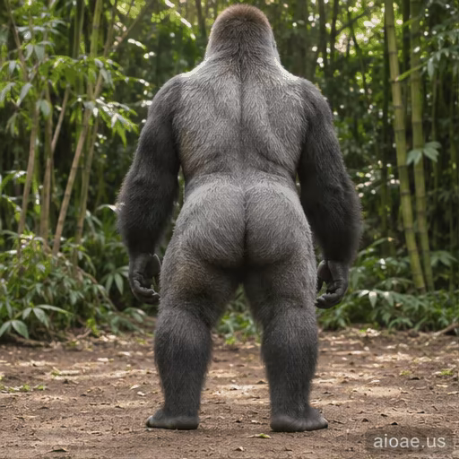

# 案例 108：跳舞大猩猩循環動畫精靈圖 | Case 108: Dancing Gorilla Loop Animation Sprite Sheet



銀背大猩猩背對鏡頭在竹林空地上扭腰跳舞，舌頭外伸、手臂張開，野性與喜感兼具。

A silverback gorilla dances with its back to the camera in a bamboo clearing — hips shaking, tongue out, arms wide, wild and hilarious at once.

## 完整提示詞 / Full Prompt

```
Create a single animation sprite sheet for a seamless looping GIF. A photorealistic large silverback gorilla in a jungle dirt clearing, shot from behind at a low angle, with bamboo and green foliage in the background. The gorilla dances playfully, shaking its hips, tongue sticking out, arms spread wide. A small watermark reading 'aioae.us' appears in the bottom-right corner of every panel, applied to each of the 6 frames individually at 70% transparency (30% opacity), identical in size, position, and wording in every frame. Exactly 6 sequential frames arranged in a precise 3-column by 2-row grid, read left-to-right and then top-to-bottom. Every panel has identical dimensions. Fixed low camera angle, consistent character identity, body proportions, fur, lighting, watermark, and background in every frame. Animation sequence: Frame 1: The gorilla stands calmly facing away, arms relaxed at its sides, tongue in. Frame 2: The gorilla starts swaying its hips gently side to side, arms lifting slightly. Frame 3: The gorilla shakes its hips harder, tongue sticking out, arms spreading wide. Frame 4: The gorilla bounces its hips in a full playful dance, arms out wide, tongue out, head tilted back joyfully. Frame 5: The gorilla shakes its hips to the other side, still grinning with its tongue out. Frame 6: The gorilla slows down, hips settling, tongue going back in, posture returning toward the first frame. Clear incremental hip, arm, and head movement between frames. Keep the camera, composition, and character scale fixed. Make the sixth frame transition smoothly toward the first for a looping animation. Photorealistic gorilla, highly detailed fur, natural jungle lighting, funny and energetic mood, polished digital artwork. No captions, no words, no numbers, no logos, no speech bubbles, no panel labels, no borders, no gutters. The only text in the image is the small 'aioae.us' watermark.
```

## 適用模型 / Recommended Models

擅長 6 格精靈圖與角色一致性的模型：GPT Image（Image2）、Flux Pro、即夢（建議固定種子）。

Models strong at 6-frame sprite sheets and character consistency: GPT Image (Image2), Flux Pro, Jimeng (fix the seed for best consistency).

## 修改說明 / How to Adapt

- 換主角：大猩猩換成熊貓或黑熊，銀背毛色與體型描述整組換。
- 換場景：竹林空地換成海灘或雪地，背景植物與光線描述跟著換。
- 換舞步：扭腰跳舞換成拍手或轉圈，Frame 2–5 的動作逐幀改。

- Change the cast: swap the gorilla for a panda or a black bear; replace the silverback fur and build as a set.
- Change the setting: swap the bamboo clearing for a beach or a snowy field; update the background plants and lighting to match.
- Change the dance: swap hip-shaking for clapping or spinning; rewrite the Frame 2–5 moves frame by frame.

---
直達本案例 / Direct link: https://aioae.us/prompt?title=Dancing%20Gorilla%20Loop%20Animation%20Sprite%20Sheet
更多同類提示詞 / More prompts like this: [AIOAE 免費 AI 圖片提示詞庫](https://aioae.us/prompts)
