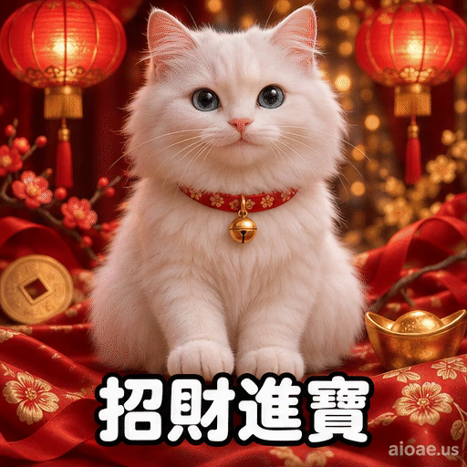

# 案例 109：招財白貓新年循環動畫精靈圖 | Case 109: Lucky White Cat Beckoning Chinese New Year Loop Animation Sprite Sheet



白貓戴紅項圈金鈴鐺，在紅金新年背景前揮爪招財，底部「招財進寶」大字，喜慶拉滿。

A white cat with a red collar and gold bell beckons luck against a festive red-and-gold New Year backdrop, bold "招財進寶" text at the bottom.

## 完整提示詞 / Full Prompt

```
Create a single animation sprite sheet for a seamless looping GIF. A photorealistic white cat with big blue eyes, pink nose, and soft fluffy fur sits upright facing the camera against a rich festive Chinese New Year background: deep red and gold tones, two glowing red paper lanterns hanging in the upper corners, gold coin motifs, red silk ribbons, and soft golden bokeh sparkles, identical in every frame. The cat wears a red collar with a small gold bell and has a subtly anthropomorphic friendly expression. A small gold ingot sits beside it. Large bold rounded white Chinese text reading '招財進寶' with a thick dark outline appears at the bottom center of every panel, identical in size, position, and wording in all 6 frames. A small watermark reading 'aioae.us' appears in the bottom-right corner of every panel, applied to each of the 6 frames individually at 70% transparency (30% opacity), identical in size, position, and wording in every frame. Exactly 6 sequential frames arranged in a precise 3-column by 2-row grid, read left-to-right and then top-to-bottom. Every panel has identical dimensions. Fixed front camera, consistent character identity, body proportions, fur, lighting, text, watermark, and background in every frame. Animation sequence: Frame 1: The cat sits calmly looking at the camera with a gentle smile, one paw resting down. Frame 2: The cat raises its right paw to chest height and smiles a little. Frame 3: The cat waves its raised paw in a beckoning motion, eyes bright, mouth open in a happy greeting. Frame 4: The cat waves higher with a big joyful smile, head tilting slightly, the gold bell glinting. Frame 5: The cat holds the beckoning wave with a warm happy expression, eyes crinkled in a smile. Frame 6: The cat slowly lowers its paw and its smile softens, posture returning toward the first frame. Clear incremental paw, head, and facial movement between frames. Keep the camera, composition, and character scale fixed. Make the sixth frame transition smoothly toward the first for a looping animation. Photorealistic cat with subtly anthropomorphic expressions, highly detailed fur, soft warm lighting, rich festive red-and-gold background, cheerful and lucky mood, polished digital artwork. No other captions, no other words, no numbers, no logos, no speech bubbles, no panel labels, no borders, no gutters. The only text in the image is '招財進寶' and the small 'aioae.us' watermark.
```

## 適用模型 / Recommended Models

擅長 6 格精靈圖與角色一致性的模型：GPT Image（Image2）、Flux Pro、即夢（建議固定種子）。

Models strong at 6-frame sprite sheets and character consistency: GPT Image (Image2), Flux Pro, Jimeng (fix the seed for best consistency).

## 修改說明 / How to Adapt

- 換文字：底部的「招財進寶」換成「新年快樂」或「大吉大利」，四字要與新年喜慶氛圍相配。
- 換主角：白貓換成橘貓或金魚，毛色與紅項圈描述整組換。
- 換背景：紅燈籠換成煙花或舞獅，背景裝飾描述跟著換。

- Change the text: swap the bottom "招財進寶" for "新年快樂" or "大吉大利" — keep four characters that fit the festive mood.
- Change the cast: swap the white cat for an orange cat or a goldfish; replace the fur colour and red collar as a set.
- Change the backdrop: swap the red lanterns for fireworks or a lion dance; update the background decorations to match.

---
直達本案例 / Direct link: https://aioae.us/prompt?title=Lucky%20White%20Cat%20Beckoning%20Chinese%20New%20Year%20Loop%20Animation%20Sprite%20Sheet
更多同類提示詞 / More prompts like this: [AIOAE 免費 AI 圖片提示詞庫](https://aioae.us/prompts)
