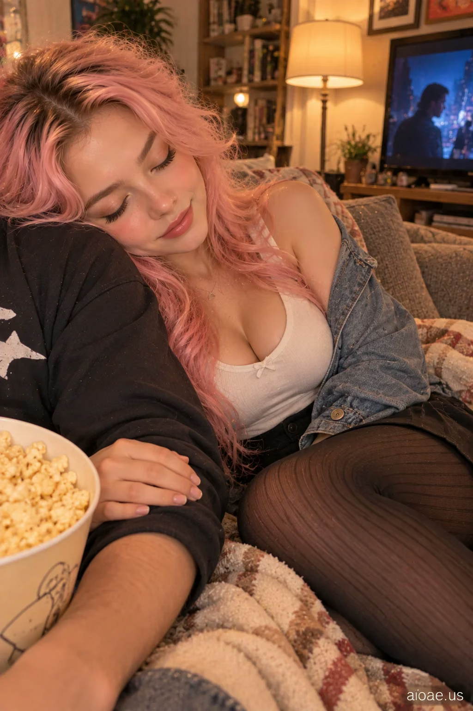

# 案例 11：電影夜女友靠肩入睡 POV | Case 11: Girlfriend Falling Asleep on My Shoulder During Movie Night POV



居家電影夜的第一視角，女友靠肩入睡，私密溫柔的親密感，電影感寫實人像。

Cozy movie-night first-person POV; girlfriend asleep on the viewer's shoulder, private tender closeness, cinematic photorealism.

註：本站該卡片詳情頁內文標題為「Girlfriend Falling Asleep During Movie Night POV」（少了 on My Shoulder），以下照原文引用。
Note: the detail page's prompt body reads "Girlfriend Falling Asleep During Movie Night POV" (without "on My Shoulder"); quoted verbatim.

## 完整提示詞 / Full Prompt

```
SUBJECT & IDEA: Girlfriend Falling Asleep During Movie Night POV. an adult woman. Preserve subject, specified action, relationships and any reference appearance. Adult romantic partners only.

SCENE: a quiet apartment reading corner. one motivated warm floor lamp with soft reflected household light. The location, time of day and core props specified by the user are fixed. No unrelated fantasy changes.

RECIPROCAL POV: Genuine first-person romantic-partner viewpoint, not a photographer or fashion shoot. RECIPROCAL INTERACTION DNA: The subject shifts her weight against the viewer's shoulder and stays there comfortably, continuing the shared quiet moment. VIEWER PRESENCE: A small part of the viewer's shoulder or upper arm appears in the lower side of frame, supporting her cheek. PARTNER RESPONSE: Relaxed half smile and soft relaxed eyes, aware of the shared closeness. CONTACT EVIDENCE: Her cheek compresses gently into the shoulder and hair follows gravity.   A real response occurs between both people, with correct weight, touch and eye line.

CASTING & FASHION: Clearly adult woman; contemporary Western-inspired styling unless nationality/reference was specified. Hair: pastel bubblegum-pink waves with subtle dimension. Outfit: a fitted scoop-neck cotton top with a black denim mini skirt and a cropped denim jacket. Hosiery: soft black vertical-rib knit tights; incidental in the crop, subordinate to emotional interaction. Sensual but tasteful fully clothed adult styling; the romantic exchange, not the outfit, is the hero.

CAMERA: Close first-person eye-level 25–60 cm when possible; one partial viewer hand/forearm or shoulder only if physically involved. Normal 26–35 mm smartphone perspective. Face and expression dominate; background secondary.

MUTATION RULES: Preserve the original subject and activity. Creative change is a more emotionally reciprocal atmosphere: private romantic familiarity, gentle teasing and emotional safety. one motivated warm floor lamp with soft reflected household light. A coherent shared gesture, not a portal or unrelated prop.

ANTI-POSING: No detached glamour modeling, staged smile at an anonymous lens, invisible contact, third-person scene, disconnected fingers or camera-holder visible as a second full person.

SAFETY: Consensual affection between clearly adult characters; no nudity, coercion, fetish-only cropping or explicit acts.

WATERMARK: Small legible "aioae.us" in the bottom-right corner.
```

## 適用模型 / Recommended Models

擅長第一人稱視角與寫實人臉的模型：GPT Image（Image2）、Flux Pro；低光室內人像可加 Midjourney。

Models strong at first-person POV and realistic faces: GPT Image (Image2), Flux Pro; Midjourney for low-light indoor portraits.

## 修改說明 / How to Adapt

- 換地點：把 SCENE 的公寓換成沙發或車後座，燈光描述跟著改，POV 機位段不用動。
- 換互動：把靠肩改成蓋毯子或輕摸頭，CONTACT EVIDENCE 的接觸描述要同步改。
- 換造型：整組換成睡衣風（如灰粉衛衣＋短褲），SAFETY 與 ANTI-POSING 段保留。

- Change the location: swap the apartment for a sofa or car back seat; update the lighting in SCENE, keep the POV camera block.
- Change the interaction: replace leaning on the shoulder with tucking a blanket or stroking hair; update the contact description in CONTACT EVIDENCE to match.
- Change the styling: swap to sleepwear as a set (e.g. dusty-pink hoodie + shorts); keep SAFETY and ANTI-POSING.

---
直達本案例 / Direct link: https://aioae.us/prompt?title=Girlfriend%20Falling%20Asleep%20on%20My%20Shoulder%20During%20Movie%20Night%20POV
更多同類提示詞 / More prompts like this: [AIOAE 免費 AI 圖片提示詞庫](https://aioae.us/prompts)
