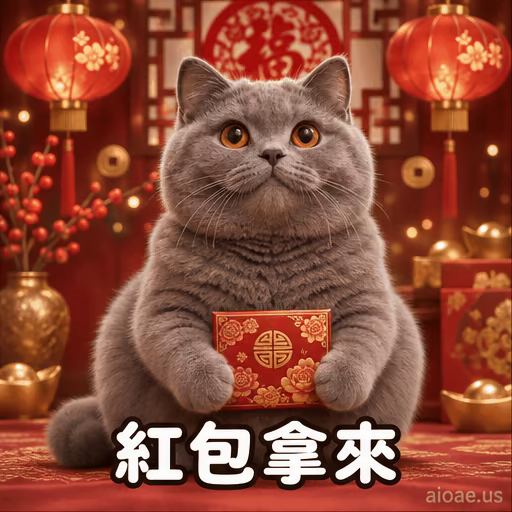

# 案例 110：灰貓紅包新年循環動畫精靈圖 | Case 110: Grey Cat Red Envelope Chinese New Year Loop Animation Sprite Sheet



灰色英短圓臉捧著紅包，在紅燈籠與窗花背景前討紅包，底部「紅包拿來」大字，討喜又應景。

A round-faced grey British Shorthair holds a red envelope against lanterns and paper-cut decorations, bold "紅包拿來" text — irresistible and festive.

## 完整提示詞 / Full Prompt

```
Create a single animation sprite sheet for a seamless looping GIF. A photorealistic grey British Shorthair cat with a round face, dense grey fur, and big copper eyes sits upright facing the camera against a rich festive Chinese New Year background: deep red and gold tones, two glowing red paper lanterns hanging in the upper corners, red paper-cut window decorations, gold coin motifs, and soft golden bokeh sparkles, identical in every frame. The cat holds a red envelope with gold patterns in both paws. Large bold rounded white Chinese text reading '紅包拿來' with a thick dark outline appears at the bottom center of every panel, identical in size, position, and wording in all 6 frames. A small watermark reading 'aioae.us' appears in the bottom-right corner of every panel, applied to each of the 6 frames individually at 70% transparency (30% opacity), identical in size, position, and wording in every frame. Exactly 6 sequential frames arranged in a precise 3-column by 2-row grid, read left-to-right and then top-to-bottom. Every panel has identical dimensions. Fixed front camera, consistent character identity, body proportions, fur, lighting, text, watermark, and background in every frame. Animation sequence: Frame 1: The cat sits upright with a quietly hopeful expression, the red envelope resting in its paws. Frame 2: The cat raises both paws and lifts the red envelope up expectantly, eyes bright. Frame 3: The cat holds the red envelope high above its head, eyes sparkling with delight. Frame 4: The cat brings the envelope close to its ear and shakes it gently, listening with a big smile. Frame 5: The cat hugs the red envelope tight to its chest, eyes closed happily. Frame 6: The cat lowers the envelope slightly and its smile softens, posture returning toward the first frame. Clear incremental paw, head, and facial movement between frames. Keep the camera, composition, and character scale fixed. Make the sixth frame transition smoothly toward the first for a looping animation. Photorealistic cat with subtly anthropomorphic expressions, highly detailed fur, soft warm lighting, rich festive red-and-gold background, joyful and festive mood, polished digital artwork. No other captions, no other words, no numbers, no logos, no speech bubbles, no panel labels, no borders, no gutters. The only text in the image is '紅包拿來' and the small 'aioae.us' watermark.
```

## 適用模型 / Recommended Models

擅長 6 格精靈圖與角色一致性的模型：GPT Image（Image2）、Flux Pro、即夢（建議固定種子）。

Models strong at 6-frame sprite sheets and character consistency: GPT Image (Image2), Flux Pro, Jimeng (fix the seed for best consistency).

## 修改說明 / How to Adapt

- 換文字：底部的「紅包拿來」換成「恭喜發財」或「年年有餘」，保持四字格式。
- 換主角：灰貓換成白貓或兔子，毛色與眼睛顏色描述整組換。
- 換道具：紅包換成金元寶或福袋，Frame 2–5 的捧、舉、抱動作跟著改。

- Change the text: swap the bottom "紅包拿來" for "恭喜發財" or "年年有餘" — keep the four-character format.
- Change the cast: swap the grey cat for a white cat or a rabbit; replace the fur and eye colours as a set.
- Change the prop: swap the red envelope for a gold ingot or a lucky pouch; update the Frame 2–5 hold, lift and hug actions to match.

---
直達本案例 / Direct link: https://aioae.us/prompt?title=Grey%20Cat%20Red%20Envelope%20Chinese%20New%20Year%20Loop%20Animation%20Sprite%20Sheet
更多同類提示詞 / More prompts like this: [AIOAE 免費 AI 圖片提示詞庫](https://aioae.us/prompts)
