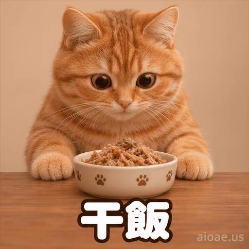

# 案例 111：橘貓乾飯循環動畫精靈圖 | Case 111: Orange Cat Mealtime Loop Animation Sprite Sheet



橘貓坐在小木桌前對著飯碗乾飯，底部「干飯」大字，治癒又接地氣的吃播表情包。

An orange tabby digs into its food bowl at a small wooden table, bold "干飯" text at the bottom — a cozy, relatable eating-meme sticker.

## 完整提示詞 / Full Prompt

```
Create a single animation sprite sheet for a seamless looping GIF. A photorealistic orange tabby cat with stripes, big round eyes, and a pink nose sits upright at a small wooden table with a bowl of food, against a plain warm beige background. Large bold rounded white Chinese text reading '干飯' with a thick dark outline appears at the bottom center of every panel, identical in size, position, and wording in all 6 frames. A small watermark reading 'aioae.us' appears in the bottom-right corner of every panel, applied to each of the 6 frames individually at 70% transparency (30% opacity), identical in size, position, and wording in every frame. Exactly 6 sequential frames arranged in a precise 3-column by 2-row grid, read left-to-right and then top-to-bottom. Every panel has identical dimensions. Fixed front camera, consistent character identity, body proportions, fur, lighting, text, watermark, and background in every frame. Animation sequence: Frame 1: The cat looks at the bowl with a quietly hopeful expression. Frame 2: The cat leans down toward the bowl and takes a first bite. Frame 3: The cat eats happily with puffed cheeks, eyes closed in enjoyment. Frame 4: The cat looks up with a few crumbs on its face, eyes wide and delighted. Frame 5: The cat licks its lips with a satisfied smile, one paw on its round belly. Frame 6: The cat sits back contentedly, expression relaxing, posture returning toward the first frame. Clear incremental head, paw, and facial movement between frames. Keep the camera, composition, and character scale fixed. Make the sixth frame transition smoothly toward the first for a looping animation. Photorealistic cat with subtly anthropomorphic expressions, highly detailed fur, soft warm lighting, clean simple background, joyful and cozy mood, polished digital artwork. No other captions, no other words, no numbers, no logos, no speech bubbles, no panel labels, no borders, no gutters. The only text in the image is '干飯' and the small 'aioae.us' watermark.
```

## 適用模型 / Recommended Models

擅長 6 格精靈圖與角色一致性的模型：GPT Image（Image2）、Flux Pro、即夢（建議固定種子）。

Models strong at 6-frame sprite sheets and character consistency: GPT Image (Image2), Flux Pro, Jimeng (fix the seed for best consistency).

## 修改說明 / How to Adapt

- 換文字：底部的「干飯」換成「好香」或「再來一碗」，保持醒目大字。
- 換主角：橘貓換成白貓或柴犬，毛色與碗中食物描述整組換。
- 換場景：米色背景換成廚房或餐廳，桌面與光線描述跟著換。

- Change the text: swap the bottom "干飯" for "好香" or "再來一碗" — keep it bold and prominent.
- Change the cast: swap the orange cat for a white cat or a Shiba Inu; replace the fur colour and the food in the bowl as a set.
- Change the setting: swap the beige background for a kitchen or a restaurant; update the table and lighting to match.

---
直達本案例 / Direct link: https://aioae.us/prompt?title=Orange%20Cat%20Mealtime%20Loop%20Animation%20Sprite%20Sheet
更多同類提示詞 / More prompts like this: [AIOAE 免費 AI 圖片提示詞庫](https://aioae.us/prompts)
