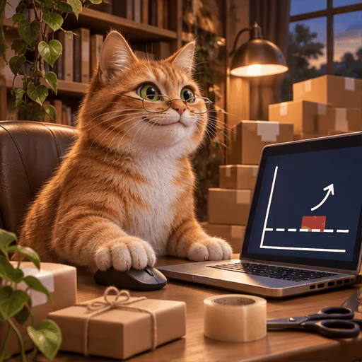

# 案例 112：薑黃貓假折扣循環動畫精靈圖 | Case 112: Ginger Cat Fake Discount Loop Animation Sprite Sheet



戴小眼鏡的薑黃貓在迷你家庭辦公室盯著筆電，價格先漲後「打折」回原價，假折扣的無奈全寫在臉上。

A ginger cat in tiny reading glasses watches a laptop as the price climbs, then a "discount" slashes it back to where it started — the fake-discount frustration, face and all.

## 完整提示詞 / Full Prompt

```
Create a single animation sprite sheet for a seamless looping GIF.

A photorealistic ginger cat shops in a cozy miniature home office, sitting upright in a chair at a wooden desk with a laptop. The cat has detailed orange fur, white chest fur, expressive green eyes, and wears tiny reading glasses. One paw rests on the mouse. On the desk are a laptop, a small stack of parcels, tape, scissors, and a trailing green plant. Behind the desk are tall stacks of delivery boxes, a bookshelf, a window with evening light, and a warm desk lamp.

Exactly 6 sequential frames arranged in a precise 3-column by 2-row grid, read left-to-right and then top-to-bottom. Every panel has identical dimensions. Fixed front three-quarter camera, consistent character identity, body proportions, desk, laptop, clothing, lighting, and background in every frame.

Animation sequence:

Frame 1: The cat sits upright and looks at the laptop screen with a quietly hopeful expression, paw on the mouse, a price bar shown rising on screen.

Frame 2: The cat notices the price bar climbing higher and slowly leans forward, ears flattening slightly, looking worried.

Frame 3: Its green eyes widen, and its mouth opens slightly in shock as a discount banner slashes the price bar back down to exactly where it started.

Frame 4: Its face crumples, eyes squeeze shut, and its head droops in disbelief, paw sliding off the mouse.

Frame 5: Large cartoon tears stream down both cheeks as the cat cries over the fake discount, one paw pressed to its chest.

Frame 6: The cat quietly wipes away its tears with one paw while looking toward the laptop. Its expression begins to relax and its posture starts returning toward the first frame.

Clear incremental facial, head, ear, paw, and tear movement between frames. Keep the camera, composition, object placement, and character scale fixed. Make the sixth frame transition smoothly toward the first for a looping animation.

Photorealistic cat with subtly anthropomorphic expressions, highly detailed fur, cinematic warm lighting, cozy miniature home-office atmosphere, humorous and sympathetic mood, polished digital artwork.

No captions, no words, no numbers, no logos, no watermark, no speech bubbles, no panel labels, no borders, no gutters.
```

## 適用模型 / Recommended Models

擅長 6 格精靈圖與角色一致性的模型：GPT Image（Image2）、Flux Pro、即夢（建議固定種子）。

Models strong at 6-frame sprite sheets and character consistency: GPT Image (Image2), Flux Pro, Jimeng (fix the seed for best consistency).

## 修改說明 / How to Adapt

- 換梗：假折扣換成「限時搶購」或「買一送一」，Frame 1–3 的價格條變化描述跟著改。
- 換主角：薑黃貓換成倉鼠或兔子，毛色與眼鏡描述整組換。
- 換場景：迷你家庭辦公室換成書房或咖啡館，桌上道具描述跟著換。

- Change the joke: swap the fake discount for a "flash sale" or "buy one get one free"; rewrite the Frame 1–3 price-bar changes to match.
- Change the cast: swap the ginger cat for a hamster or a rabbit; replace the fur colour and glasses as a set.
- Change the setting: swap the miniature home office for a study or a café; update the desk props to match.

---
直達本案例 / Direct link: https://aioae.us/prompt?title=Ginger%20Cat%20Fake%20Discount%20Loop%20Animation%20Sprite%20Sheet
更多同類提示詞 / More prompts like this: [AIOAE 免費 AI 圖片提示詞庫](https://aioae.us/prompts)
