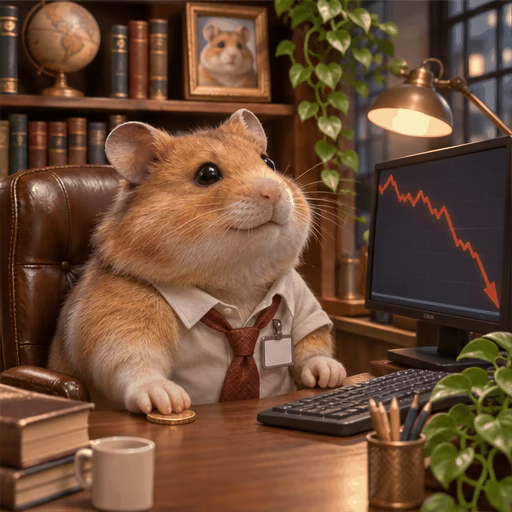

# 案例 113：倉鼠股災循環動畫精靈圖 | Case 113: Hamster Stock Crash Loop Animation Sprite Sheet



胖倉鼠穿襯衫打領帶坐在迷你辦公室，盯著暴跌的紅色 K 線護住最後一枚硬幣，幽默又令人心疼。

A chubby hamster in a shirt and tie guards its last coin in a miniature office, watching the red stock chart plunge — funny and oddly sympathetic.

## 完整提示詞 / Full Prompt

```
Create a single animation sprite sheet for a seamless looping GIF.

A photorealistic chubby hamster works in a cozy miniature office, sitting upright in a brown leather chair at a wooden desk. The hamster has detailed golden-brown fur, round ears, expressive dark eyes, and tiny pink paws. It wears a white office shirt collar, a loosened red tie, and a small blank employee badge. One paw rests protectively on its last coin beneath the desk. In front of the hamster, a computer monitor displays a clearly plunging red stock-market line chart. A keyboard, a miniature coffee mug, pencils, books, and a trailing green plant sit on the desk. In the background are bookshelves, a globe, a framed hamster picture, a window, and a warm desk lamp.

Exactly 6 sequential frames arranged in a precise 3-column by 2-row grid, read left-to-right and then top-to-bottom. Every panel has identical dimensions. Fixed front three-quarter camera, consistent character identity, body proportions, desk, monitor, clothing, lighting, and background in every frame.

Animation sequence:

Frame 1: The hamster sits upright and looks at the monitor with a quietly hopeful expression, one paw resting on the coin.

Frame 2: The hamster notices the chart falling and slowly leans forward, ears drooping, looking worried.

Frame 3: Its dark eyes widen, and its mouth opens slightly in shock as it stares at the plunging chart.

Frame 4: Its face crumples, eyes squeeze shut, and its head droops in sadness, cheeks puffing out.

Frame 5: Large cartoon tears stream down both cheeks as the hamster cries over its last coin, tiny shoulders shaking.

Frame 6: The hamster quietly wipes away its tears with one paw while looking toward the monitor. Its expression begins to relax and its posture starts returning toward the first frame.

Clear incremental facial, head, ear, paw, and tear movement between frames. Keep the camera, composition, object placement, and character scale fixed. Make the sixth frame transition smoothly toward the first for a looping animation.

Photorealistic hamster with subtly anthropomorphic expressions, highly detailed fur, cinematic warm lighting, cozy miniature office atmosphere, humorous and sympathetic mood, polished digital artwork.

No captions, no words, no numbers, no logos, no watermark, no speech bubbles, no panel labels, no borders, no gutters.
```

## 適用模型 / Recommended Models

擅長 6 格精靈圖與角色一致性的模型：GPT Image（Image2）、Flux Pro、即夢（建議固定種子）。

Models strong at 6-frame sprite sheets and character consistency: GPT Image (Image2), Flux Pro, Jimeng (fix the seed for best consistency).

## 修改說明 / How to Adapt

- 換梗：股災換成「加班」或「房租上漲」，螢幕上的 K 線改成對應畫面。
- 換主角：倉鼠換成貓咪或兔子，毛色與襯衫領帶描述整組換。
- 換情緒：從欲哭無淚換成淡定喝茶，Frame 4–6 的表情逐幀改。

- Change the joke: swap the stock crash for "overtime" or "rent going up"; replace the plunging chart on the monitor with a matching screen.
- Change the cast: swap the hamster for a cat or a rabbit; replace the fur colour and the shirt-and-tie outfit as a set.
- Change the mood: swap tears for calmly sipping tea; rewrite the Frame 4–6 expressions frame by frame.

---
直達本案例 / Direct link: https://aioae.us/prompt?title=Hamster%20Stock%20Crash%20Loop%20Animation%20Sprite%20Sheet
更多同類提示詞 / More prompts like this: [AIOAE 免費 AI 圖片提示詞庫](https://aioae.us/prompts)
