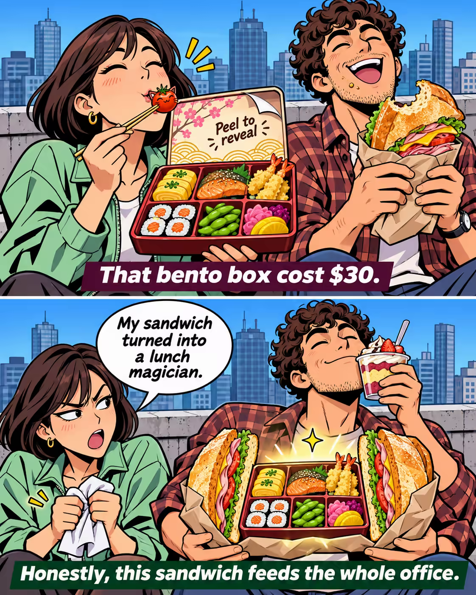

# 案例 114：屋頂便當遇上三明治魔法 | Case 114: Rooftop Bento Meets Sandwich Magic



屋頂上 $30 便當對上巨型三明治，三明治竟像變魔術般夾住便當餵飽全辦公室，雙格漫畫笑點密集。

On a rooftop, a $30 bento meets a giant sandwich that magically multiplies to feed the whole office — a two-panel comic packed with jokes.

## 完整提示詞 / Full Prompt

```
Create a two-panel comic meme image, split vertically with a thin white gutter, in a bold modern comic style with clean linework, flat colors, and a white background. Keep the same two characters consistent in both panels. In the TOP panel, show a bright city skyline with a blue gradient sky and soft light, skyscrapers in muted blues and grays behind two friends sitting on a rooftop ledge. One friend, a young woman with a bob hairstyle and a mint green jacket, opens a fancy bento box with a lid that reads "Peel to reveal" in a playful way; she slurps a tiny tomato as a pet, holding chopsticks with a lunchbox full of tamagoyaki, salmon, sushi, tempura, edamame, and pickled vegetables. The other friend, a curly-haired man with a plaid shirt, holds a huge sandwich lunchbox in a paper wrapper, with a huge bite taken out of it. Label the TOP panel in a bold white comic-style text as "That bento box cost $30." In the BOTTOM panel, show a new, funny moment: the curly-haired friend now holds a single sandwich that has magically multiplied into two, sandwiching the bento box between them, holding a dessert cup in front of his face. The other friend holds a napkin and squeezes it like a towel, looking at him as if he committed a crime, and says, "My sandwich turned into a lunch magician." The bento box is now a prop for a magic trick, glowing softly with a cartoon sparkle. Add the bold white text at the bottom: "Honestly, this sandwich feeds the whole office." Ensure a 2-panel vertical layout, vibrant colors, comic styling with consistent characters across panels.
```

## 適用模型 / Recommended Models

擅長雙格漫畫與梗圖的模型：GPT Image（Image2）、Flux Pro、Midjourney。

Models strong at two-panel comics and meme images: GPT Image (Image2), Flux Pro, Midjourney.

## 修改說明 / How to Adapt

- 換食物：便當與三明治換成火鍋與披薩，上下格的食物與對白整組換。
- 換對白：上下格的 "That bento box cost $30." 與 "Honestly, this sandwich feeds the whole office." 換成另一組價格反差對白。
- 換場景：屋頂換成辦公室茶水間或野餐草坪，背景天際線描述跟著換。

- Change the food: swap the bento and sandwich for hot pot and pizza; replace the food and dialogue in both panels as a set.
- Change the dialogue: swap "That bento box cost $30." and "Honestly, this sandwich feeds the whole office." for another price-contrast pair of lines.
- Change the setting: swap the rooftop for an office pantry or a picnic lawn; update the skyline background to match.

---
直達本案例 / Direct link: https://aioae.us/prompt?title=Rooftop%20Bento%20Meets%20Sandwich%20Magic
更多同類提示詞 / More prompts like this: [AIOAE 免費 AI 圖片提示詞庫](https://aioae.us/prompts)
