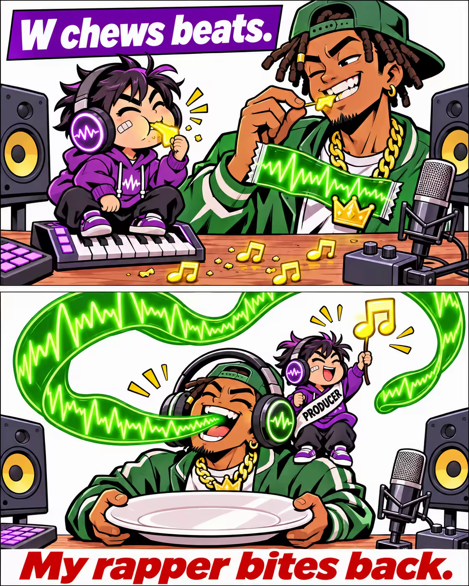

# 案例 115：饒舌歌手反擊了 | Case 115: When the Rapper Bites Back



迷你製作人把發光音符當零食啃，饒舌歌手反過來把整條綠色波形當麵條吃——上下兩格角色互換，笑點就在「誰吃誰」的反轉裡。

A mini producer snacks on glowing musical notes while the rapper bites back, slurping a whole green waveform like spaghetti — a two-panel comic whose joke is the role reversal.

## 完整提示詞 / Full Prompt

```
Create a two-panel comic meme image, split vertically with a thin white gutter, in a bold modern comic style with clean linework, flat colors, and a white background. Keep the same two characters consistent in both panels. In the TOP panel, show a small studio: a mini producer with big circular headphones, perched on a tiny keyboard, mid-chew with crunch lines, biting a glowing mini musical note as a cereal-like snack, while a rapper with a fake bling chain, holding the waveform like a snack wrapper, nibbles a tiny musical note from a bass-line rope. Place both characters on a small wooden studio desk around the tiny keyboard, with studio speakers, a mic, and scattered musical notes and snack crumbs on the desk. Label the TOP panel in a bold white comic-style text as "W chews beats." In the BOTTOM panel, show the rapper entirely pocket-sized, wearing oversized headphones, joyfully biting a giant green waveform like a plate of spaghetti on his head, while the mini producer sits on his shoulder, raising a smaller glowing note like a victory flag, wearing a "PRODUCER" sash. The rapper is holding a huge empty plate like a pro and laughing to the viewer. In the BOTTOM panel, add the bold red text at the bottom: "My rapper bites back." Ensure a 2-panel vertical layout, vibrant colors, comic styling with consistent characters across panels.
```

## 適用模型 / Recommended Models

擅長雙格漫畫與梗圖的模型：GPT Image（Image2）、Flux Pro、Midjourney。

Models strong at two-panel comics and meme images: GPT Image (Image2), Flux Pro, Midjourney.

## 修改說明 / How to Adapt

- 換職業：製作人與饒舌歌手換成主播與廚師，道具（鍵盤、波形）跟著換成麥克風與食材。
- 換對白：上下格的 "W chews beats." 與 "My rapper bites back." 換成另一組反差對白。
- 換食物：音符換成金幣或愛心，上下格的吃法與表情跟著換。

- Change the jobs: swap the producer and rapper for a streamer and a chef; swap the props (keyboard, waveform) for a mic and ingredients.
- Change the dialogue: swap "W chews beats." and "My rapper bites back." for another contrast pair of lines.
- Change the food: swap the musical notes for gold coins or hearts; update how each panel eats them.

---
直達本案例 / Direct link: https://aioae.us/prompt?title=When%20the%20Rapper%20Bites%20Back
更多同類提示詞 / More prompts like this: [AIOAE 免費 AI 圖片提示詞庫](https://aioae.us/prompts)
