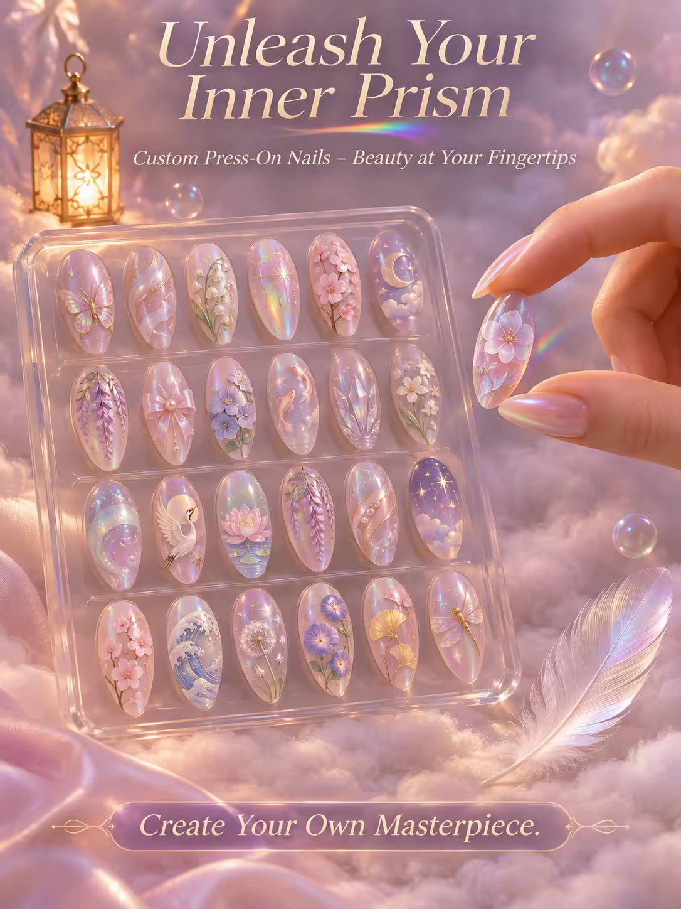

# 案例 116：釋放內在稜鏡：穿戴甲海報 | Case 116: Unleash Your Inner Prism Press On Nails Poster



玻璃手指握住一枚稜鏡穿戴甲，甲片化作半透明花朵，粉彩世界裡羽毛與虹光氣泡緩緩飄落，夢幻又高級的電商海報。

A glass hand holds a prism press-on nail that blooms into a translucent flower, as a feather drifts through a pastel world of iridescent bubbles — a dreamy, high-end e-commerce poster.

## 完整提示詞 / Full Prompt

```
SUBJECT & IDEA: Custom Press-On Nails Poster. A surreal, dreamlike scene where a single hand, with fingers elongated into shimmering glass, holds a delicate, custom press-on nail, its surface a miniature prism that refracts light into a rainbow of colors, while the nail itself morphs into a blooming flower, its petals made of translucent, iridescent material.
HERO PRODUCT VISIBILITY: Center the custom press-on nails as a set of 24, almond-shaped, hand-painted designs, each nail a tiny work of art, with intricate details that catch the light and shimmer.
PRODUCT VALUE STRATEGY: Emphasize the nails' customizable designs, the long-lasting wear, and the easy, damage-free application.
PRODUCT ATMOSPHERE: Dreamlike, ethereal.
CHARACTER: A single, elegant hand with long, slender fingers, gently holding a press-on nail, its fingertips adorned with a delicate, shimmering polish.
SCENE: Show the nails as the centerpiece of a dreamlike, pastel-colored world, where a single, translucent feather drifts down from a sky filled with floating, iridescent bubbles, landing softly on a bed of soft, white clouds, while a tiny, glowing lantern floats nearby, casting a warm, golden light.
ON-IMAGE AD COPY: Main headline: 'Unleash Your Inner Prism'. Body/CTA: 'Create Your Own Masterpiece.'. Sub-headline: 'Custom Press-On Nails – Beauty at Your Fingertips'.
STYLE: Dreamlike, ethereal, soft, pastel, vibrant, photorealistic, 35mm lens, shallow depth of field, 400 ISO, subtle, natural, high-end.
CAMERA: Use a 35mm lens with a wide focal length and a wide aperture of f/2.8. Keep subjects and forms sharp and legible.
WATERMARK: Invisible watermark.
AVOID: Keep the layout free of random branding, random logos and random words. Do not place the title or large text over the product.
```

## 適用模型 / Recommended Models

擅長電商海報與產品文案排版的模型：GPT Image（Image2）、Flux Pro、Ideogram。

Models strong at e-commerce posters and ad-copy layout: GPT Image (Image2), Flux Pro, Ideogram.

## 修改說明 / How to Adapt

- 換產品：穿戴甲換成香水或口紅，中央產品描述與價值賣點整組換。
- 換色調：粉彩換成冷調金屬或深色夜光，場景氛圍跟著改。
- 換文案：主標題、副標題與 CTA 整組換，產品名同步改。

- Change the product: swap the press-on nails for perfume or lipstick; replace the hero-product description and value points as a set.
- Change the palette: swap pastel for cool metallic or dark neon tones; update the atmosphere to match.
- Change the copy: swap the headline, sub-headline and CTA as a set; update the product name too.

---
直達本案例 / Direct link: https://aioae.us/prompt?title=Unleash%20Your%20Inner%20Prism%20Press%20On%20Nails%20Poster
更多同類提示詞 / More prompts like this: [AIOAE 免費 AI 圖片提示詞庫](https://aioae.us/prompts)
