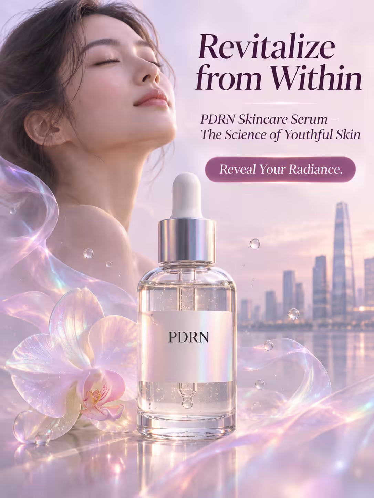

# 案例 117：由內煥活：PDRN 精華海報 | Case 117: Revitalize from Within PDRN Serum Poster



半透明精華瓶立於虹光霧氣中央，瓶中液體如水銀般流轉，霧氣凝成一張發光的臉，蘭花在光霧中綻放，奢華夢幻。

A translucent serum vial stands at the centre of iridescent mist, its liquid swirling like mercury as the mist coalesces into a radiant face, an orchid blooming in the glow — luxurious and dreamlike.

## 完整提示詞 / Full Prompt

```
SUBJECT & IDEA: PDRN Skincare Serum Poster. A surreal, dreamlike scene where a single, translucent vial of PDRN serum sits at the center of a luminous, iridescent mist, its liquid glowing like mercury as it swirls and shimmers, while the mist coalesces into a flawless, radiant human face, its skin glowing with a soft, ethereal light.
HERO PRODUCT VISIBILITY: Center the PDRN serum as a 30ml, clear glass bottle with a sleek, minimalist design, its label a simple, elegant white with a subtle, iridescent shimmer.
PRODUCT VALUE STRATEGY: Emphasize the serum's PDRN (polydeoxyribonucleotide) ingredient, its skin-regenerating properties, and the luxurious, lightweight texture.
PRODUCT ATMOSPHERE: Luxurious, ethereal.
CHARACTER: A single, serene woman with flawless, glowing skin, her face softly lit and her eyes closed in a moment of peaceful tranquility.
SCENE: Show the serum as the centerpiece of a dreamlike, pastel-colored world, where a single, translucent orchid blooms in the center of a glowing, iridescent mist, its petals made of delicate, shimmering material, while a distant, futuristic cityscape rises in the background, its buildings made of glass and steel, their surfaces reflecting the soft, pastel light.
ON-IMAGE AD COPY: Main headline: 'Revitalize from Within'. Body/CTA: 'Reveal Your Radiance.'. Sub-headline: 'PDRN Skincare Serum – The Science of Youthful Skin'.
STYLE: Luxurious, ethereal, soft, pastel, vibrant, photorealistic, 35mm lens, shallow depth of field, 400 ISO, subtle, natural, high-end.
CAMERA: Use a 35mm lens with a wide focal length and a wide aperture of f/2.8. Keep subjects and forms sharp and legible.
WATERMARK: Invisible watermark.
AVOID: Keep the layout free of random branding, random logos and random words. Do not place the title or large text over the product.
```

## 適用模型 / Recommended Models

擅長電商海報與產品文案排版的模型：GPT Image（Image2）、Flux Pro、Ideogram。

Models strong at e-commerce posters and ad-copy layout: GPT Image (Image2), Flux Pro, Ideogram.

## 修改說明 / How to Adapt

- 換成分：PDRN 換成維 C 或玻尿酸，價值賣點與副標題同步改。
- 換花：蘭花換成玫瑰或櫻花，場景花卉描述跟著換。
- 換場景：未來城市換成海邊日出或森林晨霧，背景描述跟著改。

- Change the ingredient: swap PDRN for vitamin C or hyaluronic acid; update the value points and sub-headline to match.
- Change the flower: swap the orchid for a rose or cherry blossom; update the scene description.
- Change the setting: swap the futuristic cityscape for a seaside sunrise or forest mist; update the background.

---
直達本案例 / Direct link: https://aioae.us/prompt?title=Revitalize%20from%20Within%20PDRN%20Serum%20Poster
更多同類提示詞 / More prompts like this: [AIOAE 免費 AI 圖片提示詞庫](https://aioae.us/prompts)
