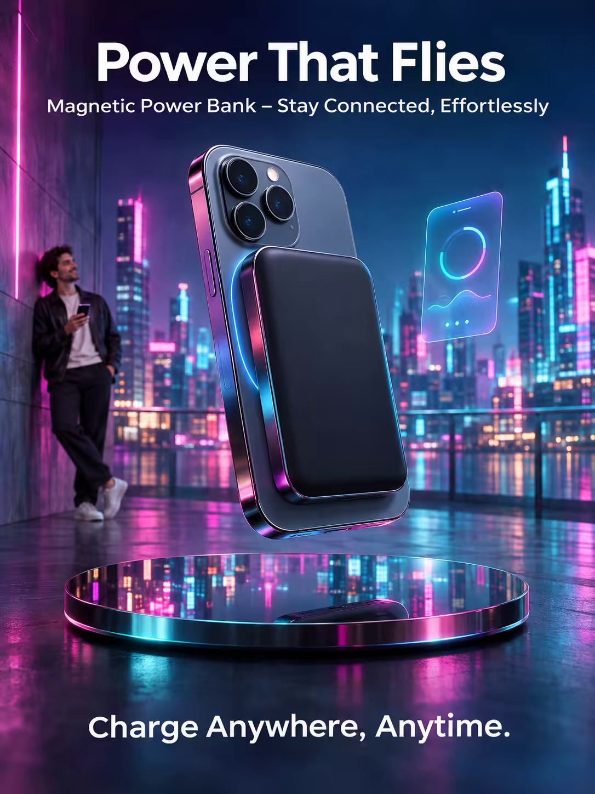

# 案例 118：會飛的電力：磁吸行動電源海報 | Case 118: Power That Flies Magnetic Power Bank Poster



磁吸行動電源懸浮於鏡面地板之上，鉻面映著霓虹城市與全息手機介面，創新前衛的科技感拉滿。

A magnetic power bank levitates above a mirrored floor, its chrome surface reflecting a neon-soaked cityscape and a floating holographic phone interface — cutting-edge tech energy.

## 完整提示詞 / Full Prompt

```
SUBJECT & IDEA: Magnetic Power Bank Poster. A surreal, dreamlike scene where a magnetic power bank sits on a sleek, futuristic charging pad, its surface a smooth, chrome finish that ripples like water, with a magnetic strip glowing softly along its edge, and the bank levitates above a mirrored floor that reflects a city skyline.
HERO PRODUCT VISIBILITY: Center the magnetic power bank as a 5-inch long, 3-inch wide rectangle with a matte black finish, its surface smooth and cool, with a glowing magnetic ring around its edge.
PRODUCT VALUE STRATEGY: Emphasize the magnetic attachment, the fast-charging capability, and the sleek, minimalist design.
PRODUCT ATMOSPHERE: Innovative, cutting-edge.
CHARACTER: A single, relaxed figure leaning against a wall, phone in hand, looking at the glowing power bank with a sense of ease and anticipation.
SCENE: Show the power bank as the centerpiece of a futuristic, neon-soaked cityscape, its chrome surface reflecting the vibrant colors of a digital ad billboard, with a holographic map of a smartphone interface floating above it.
ON-IMAGE AD COPY: Main headline: 'Power That Flies'. Body/CTA: 'Charge Anywhere, Anytime.'. Sub-headline: 'Magnetic Power Bank – Stay Connected, Effortlessly'.
STYLE: Futuristic, neon-soaked, glossy, soft, vibrant, photorealistic, 35mm lens, shallow depth of field, 400 ISO, subtle, natural, high-end.
CAMERA: Use a 35mm lens with a wide focal length and a wide aperture of f/2.8. Keep subjects and forms sharp and legible.
WATERMARK: Invisible watermark.
AVOID: Keep the layout free of random branding, random logos and random words. Do not place the title or large text over the product.
```

## 適用模型 / Recommended Models

擅長電商海報與產品文案排版的模型：GPT Image（Image2）、Flux Pro、Ideogram。

Models strong at e-commerce posters and ad-copy layout: GPT Image (Image2), Flux Pro, Ideogram.

## 修改說明 / How to Adapt

- 換產品：行動電源換成耳機或手錶，產品尺寸與價值賣點整組換。
- 換城市：霓虹都市換成日系街景或太空站，場景反射描述跟著改。
- 換文案：主標題、副標題與 CTA 整組換，產品名同步改。

- Change the product: swap the power bank for earbuds or a smartwatch; replace the dimensions and value points as a set.
- Change the city: swap the neon cityscape for a Japanese street scene or a space station; update the reflections.
- Change the copy: swap the headline, sub-headline and CTA as a set; update the product name too.

---
直達本案例 / Direct link: https://aioae.us/prompt?title=Power%20That%20Flies%20Magnetic%20Power%20Bank%20Poster
更多同類提示詞 / More prompts like this: [AIOAE 免費 AI 圖片提示詞庫](https://aioae.us/prompts)
