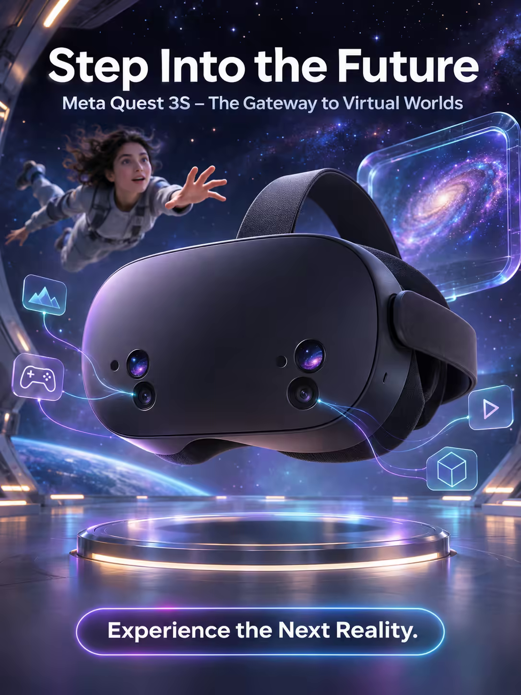

# 案例 119：踏入未來：Meta Quest 3S 海報 | Case 119: Step Into the Future Meta Quest 3S Poster



零重力房間裡，一台 Meta Quest 3S 懸浮半空，鏡片折射出旋轉星系，牆面化作星空，物理與虛擬世界無縫銜接。

In a zero-gravity room, a Meta Quest 3S floats mid-air, its lenses refracting a swirling galaxy as the walls dissolve into a starry expanse — physical and virtual worlds blending seamlessly.

## 完整提示詞 / Full Prompt

```
SUBJECT & IDEA: Meta Quest 3S VR Headset Poster. In a futuristic, zero-gravity room, a single Meta Quest 3S headset floats mid-air, its lenses refracting a swirling galaxy as it hovers above a gleaming, anti-gravity platform, while the room's walls morph into a starry expanse, creating a seamless transition between the physical and virtual worlds.
HERO PRODUCT VISIBILITY: Center the Meta Quest 3S as a sleek, black headset with a smooth, curved design, its front-facing sensors glowing softly, dominating 75% of the composition.
PRODUCT VALUE STRATEGY: Emphasize the Meta Quest 3S's immersive, high-resolution display, its advanced tracking system, and its lightweight, ergonomic design.
PRODUCT ATMOSPHERE: Futuristic, immersive.
CHARACTER: A single person, floating weightlessly, reaching out to touch the headset, eyes wide with wonder as the galaxy swirls around them.
SCENE: Show the headset in a zero-gravity environment, surrounded by floating holographic icons and translucent vines of neon circuitry that snake through the air, connecting to the headset's sensors, while its screen displays a vibrant, futuristic world.
ON-IMAGE AD COPY: Main headline: 'Step Into the Future'. Body/CTA: 'Experience the Next Reality.'. Sub-headline: 'Meta Quest 3S – The Gateway to Virtual Worlds'.
STYLE: Futuristic, immersive, vivid, sharp, detailed, photorealistic, 35mm lens, shallow depth of field, 400 ISO, soft, natural, high-end.
CAMERA: Use a 35mm lens with a wide focal length and a wide aperture of f/2.8. Keep subjects and forms sharp and legible.
WATERMARK: Invisible watermark.
AVOID: Keep the layout free of random branding, random logos and random words. Do not place the title or large text over the product.
```

## 適用模型 / Recommended Models

擅長電商海報與產品文案排版的模型：GPT Image（Image2）、Flux Pro、Ideogram。

Models strong at e-commerce posters and ad-copy layout: GPT Image (Image2), Flux Pro, Ideogram.

## 修改說明 / How to Adapt

- 換設備：Quest 3S 換成 AR 眼鏡或遊戲手柄，產品描述與價值賣點整組換。
- 換場景：星系換成深海或雲端城市，漂浮的全息圖示跟著改。
- 換文案：主標題、副標題與 CTA 整組換，產品名同步改。

- Change the device: swap the Quest 3S for AR glasses or a game controller; replace the product description and value points as a set.
- Change the scene: swap the galaxy for a deep sea or a cloud city; update the floating holographic icons.
- Change the copy: swap the headline, sub-headline and CTA as a set; update the product name too.

---
直達本案例 / Direct link: https://aioae.us/prompt?title=Step%20Into%20the%20Future%20Meta%20Quest%203S%20Poster
更多同類提示詞 / More prompts like this: [AIOAE 免費 AI 圖片提示詞庫](https://aioae.us/prompts)
