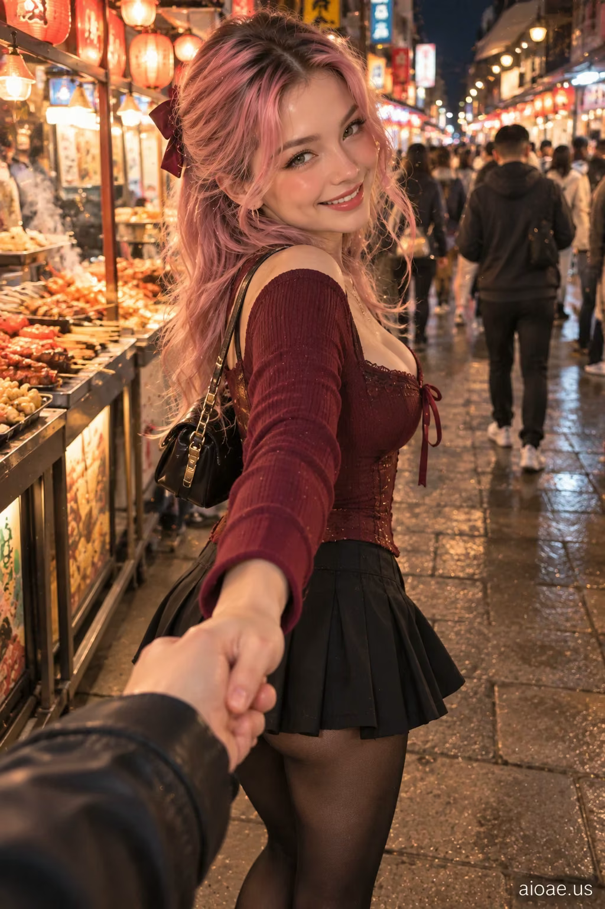

# 案例 12：牽女友逛深夜小吃街 POV | Case 12: Girlfriend Leading Me Through a Night Snack Street POV



深夜小吃街牽手逛街的第一視角，動態牽手＋回頭笑，煙火氣十足，電影感寫實人像。

First-person POV strolling a night snack street hand in hand; mid-step turn-back smile, full of street life, cinematic photorealism.

註：本站該卡片詳情頁內文開頭標題為「Girlfriend Drawing a Heart on My Palm POV」，與卡片標題不一致，以下照原文引用。
Note: the detail page's prompt body opens with "Girlfriend Drawing a Heart on My Palm POV", differing from the card title; quoted verbatim.

## 完整提示詞 / Full Prompt

```
SUBJECT & IDEA: Girlfriend Drawing a Heart on My Palm POV. an adult woman. Preserve subject, specified action, relationships and any reference appearance. Adult romantic partners only.

SCENE: a lively pedestrian snack street after dark. warm stall lighting complemented by subtle ambient street illumination. The location, time of day and core props specified by the user are fixed. No unrelated fantasy changes.

RECIPROCAL POV: Genuine first-person romantic-partner viewpoint, not a photographer or fashion shoot. RECIPROCAL INTERACTION DNA: The subject leads the viewer forward by one hand while turning her head back mid-step, staying in motion. VIEWER PRESENCE: One camera-side hand stretches naturally from the lower frame into her hand. PARTNER RESPONSE: Her eyes check that the viewer is following; she laughs in response. CONTACT EVIDENCE: Movement aligns with a realistic hand pull, clear contact and natural walking gait.   A real response occurs between both people, with correct weight, touch and eye line.

CASTING & FASHION: Clearly adult woman; contemporary Western-inspired styling unless nationality/reference was specified. Hair: soft rose-pink hair with natural darker roots and loose face-framing layers. Outfit: a structured burgundy corset-inspired fashion top over a modest inner layer, paired with a pleated black skirt. Hosiery: matte opaque black tights with a smooth, even knit texture; incidental in the crop, subordinate to emotional interaction. Sensual but tasteful fully clothed adult styling; the romantic exchange, not the outfit, is the hero.

CAMERA: Close first-person eye-level 55–115 cm when possible; one partial viewer hand/forearm or shoulder only if physically involved. Normal 26–35 mm smartphone perspective. Face and expression dominate; background secondary.

MUTATION RULES: Preserve the original subject and activity. Creative change is a more emotionally reciprocal atmosphere: spontaneous joy and mischievous shared laughter rather than glamour. warm stall lighting complemented by subtle ambient street illumination. A coherent shared gesture, not a portal or unrelated prop.

ANTI-POSING: No detached glamour modeling, staged smile at an anonymous lens, invisible contact, third-person scene, disconnected fingers or camera-holder visible as a second full person.

SAFETY: Consensual affection between clearly adult characters; no nudity, coercion, fetish-only cropping or explicit acts.

WATERMARK: Small legible "aioae.us" in the bottom-right corner.
```

## 適用模型 / Recommended Models

擅長第一人稱視角、動態構圖與寫實人臉的模型：GPT Image（Image2）、Flux Pro；夜景街景可加 Midjourney。

Models strong at first-person POV, dynamic composition and realistic faces: GPT Image (Image2), Flux Pro; Midjourney for night street scenes.

## 修改說明 / How to Adapt

- 換地點：把 SCENE 的小吃街換成夜市或江邊步道，燈光描述跟著改，POV 機位段不用動。
- 換互動：把牽手逛街改成投餵小吃或合照，CONTACT EVIDENCE 的手部軌跡要同步改。
- 換造型：上衣＋裙裝整組換（如白 T＋牛仔短裙），SAFETY 與 ANTI-POSING 段保留。

- Change the location: swap the snack street for a night market or riverside promenade; update the lighting in SCENE, keep the POV camera block.
- Change the interaction: replace hand-in-hand strolling with feeding snacks or taking a selfie; update the hand trajectory in CONTACT EVIDENCE to match.
- Change the styling: swap top and skirt as a set (e.g. white tee + denim mini skirt); keep SAFETY and ANTI-POSING.

---
直達本案例 / Direct link: https://aioae.us/prompt?title=Girlfriend%20Leading%20Me%20Through%20a%20Night%20Snack%20Street%20POV
更多同類提示詞 / More prompts like this: [AIOAE 免費 AI 圖片提示詞庫](https://aioae.us/prompts)
