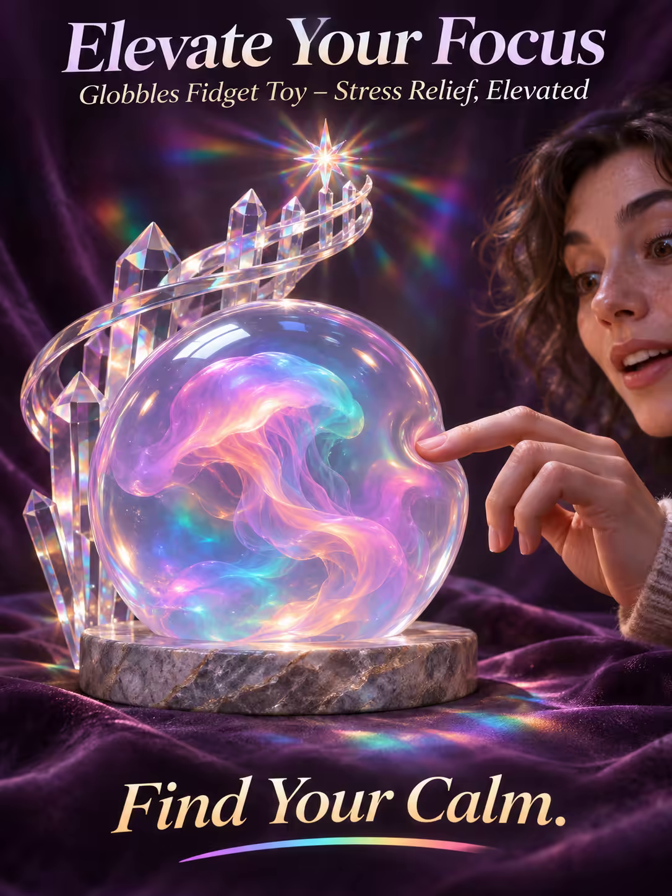

# 案例 120：提升專注力：Globbles 解壓玩具海報 | Case 120: Elevate Your Focus Globbles Fidget Toy Poster



半透明凝膠球在萬花筒漩渦中央脈動如水母，晶格螺旋上升折射出稜鏡光斑，玩味、迷幻又療癒。

A translucent gel orb pulses like a jellyfish at the centre of a kaleidoscopic vortex, a crystalline lattice spiralling upward and refracting prismatic light — playful, mesmerising and soothing.

## 完整提示詞 / Full Prompt

```
SUBJECT & IDEA: Globbles Fidget Toy Poster. A mesmerizing scene where a single, translucent orb of swirling, semi-solid gel sits at the center of a kaleidoscopic vortex, its interior pulsing like a living jellyfish, connected to a crystalline, glass-like lattice that spirals upward, mimicking a frozen explosion of colorful spheres.
HERO PRODUCT VISIBILITY: Center the globbal as a 12-inch diameter, clear, translucent sphere with a subtle hint of iridescent, colorful gel inside, its surface smooth and reflective.
PRODUCT VALUE STRATEGY: Emphasize the globbal's tactile, squishy texture, its mesmerizing visual swirls, and the soothing, repetitive motion it allows, perfect for stress relief and focus enhancement.
PRODUCT ATMOSPHERE: Playful, mesmerizing, soothing.
CHARACTER: A single, curious figure reaching towards the orb, fingers just brushing the gel's surface, eyes wide with wonder.
SCENE: Place the globbal in a kaleidoscopic vortex where an 8-inch, solid quartz lattice rises from a circular stone base, stretching up to 10 feet in a starburst of lines radiating outwards, refracting light and creating a prismatic pattern on the dark velvet backdrop.
ON-IMAGE AD COPY: Main headline: 'Elevate Your Focus'. Body/CTA: 'Find Your Calm.'. Sub-headline: 'Globbles Fidget Toy – Stress Relief, Elevated'.
STYLE: Whimsical, surreal, glossy, soft, vibrant, photorealistic, 35mm lens, shallow depth of field, 400 ISO, subtle, natural, high-end.
CAMERA: Use a 35mm lens with a wide focal length and a narrow aperture of f/5.6. Keep subjects and forms sharp and legible.
WATERMARK: Invisible watermark.
AVOID: Keep the layout free of random branding, random logos and random words. Do not place the title or large text over the product.
```

## 適用模型 / Recommended Models

擅長電商海報與產品文案排版的模型：GPT Image（Image2）、Flux Pro、Ideogram。

Models strong at e-commerce posters and ad-copy layout: GPT Image (Image2), Flux Pro, Ideogram.

## 修改說明 / How to Adapt

- 換產品：凝膠球換成指尖陀螺或捏捏樂，產品描述與價值賣點整組換。
- 換色調：繽紛彩色換成單色莫蘭迪或黑金，場景光斑跟著改。
- 換文案：主標題、副標題與 CTA 整組換，產品名同步改。

- Change the product: swap the gel orb for a fidget spinner or a squishy toy; replace the product description and value points as a set.
- Change the palette: swap the vivid colours for muted Morandi tones or black and gold; update the light patterns.
- Change the copy: swap the headline, sub-headline and CTA as a set; update the product name too.

---
直達本案例 / Direct link: https://aioae.us/prompt?title=Elevate%20Your%20Focus%20Globbles%20Fidget%20Toy%20Poster
更多同類提示詞 / More prompts like this: [AIOAE 免費 AI 圖片提示詞庫](https://aioae.us/prompts)
