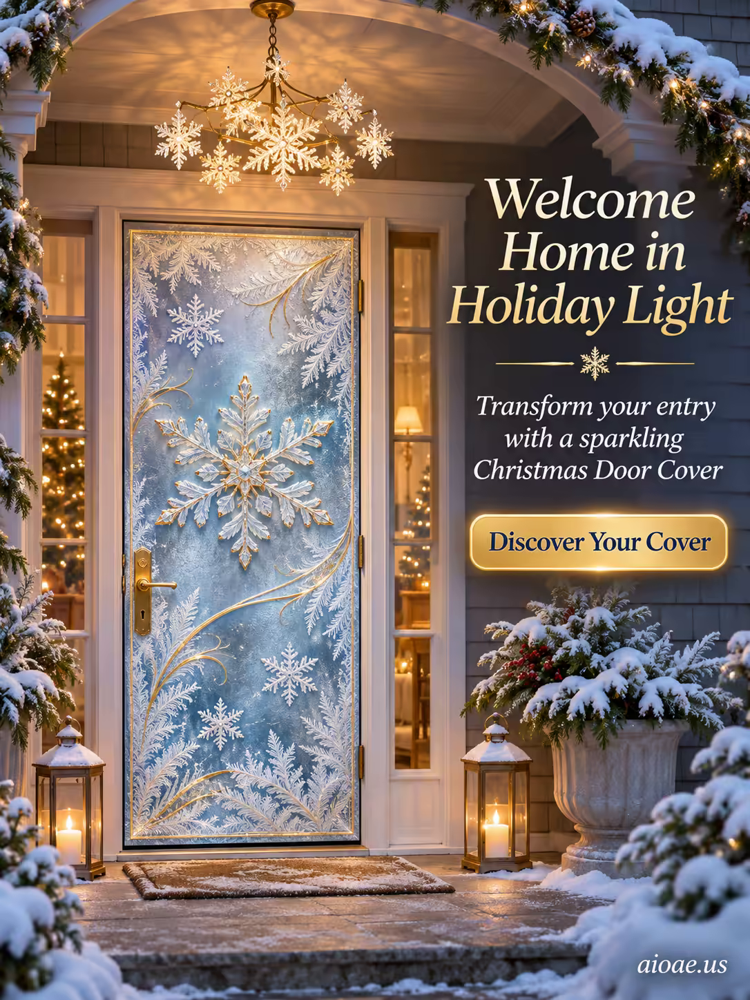

# 案例 121：節日燈光迎回家：聖誕門簾海報 | Case 121: Welcome Home in Holiday Light Christmas Door Cover Poster



暮色藍白配金色點綴，磨砂玻璃質感與雪花圖案把門框成一道發光的節日入口，溫暖而高級的聖誕氛圍。

Soft twilight blue-white with gold accents, frosted-glass texture and crisp snow motifs frame the door as a luminous festive portal — warm, premium Christmas atmosphere.

## 完整提示詞 / Full Prompt

```
SUBJECT & IDEA: Christmas Door Cover Poster. Preserve named subject, requested relationships, main action and format.

CAMPAIGN CASTING: No people This controls whether people appear; preserve any explicitly requested cast.

SCENE: one continuous believable setting suited to the subject and brief. Maintain clear foreground, midground and background with a single coherent physical logic.

ON-IMAGE AD COPY: Exact headline "Welcome Home in Holiday Light"; exact subheadline "Transform your entry with a sparkling Christmas Door Cover"; exact CTA "Discover Your Cover". Keep the lettering legible and organized in negative space. Distinct typographic scale and hierarchy; no other invented brand, prices or specifications. CAMPAIGN ATMOSPHERE & ART DIRECTION: Soft twilight lighting, cool blue‑white palette with gold accents, a gentle glow from a glass snowflake chandelier. The frosted glass texture and crisp snow motifs frame the door as a luminous portal, creating a warm, festive entrance.

STYLE: coherent premium visual storytelling with readable subject geometry and motivated light. Lighting and color should respond to the actual setting rather than unrelated stock effects.

CAMERA: subject-first coherent perspective. Preserve perspective and realistic scale.

WATERMARK: Add a small, subtle and readable "aioae.us" in the bottom-right corner.

AVOID: generic random genre backgrounds, contradictory lighting, product identity substitution, extra fingers, duplicate characters, disjointed composition, unintended copy and unsupported factual claims.
```

## 適用模型 / Recommended Models

擅長電商海報與產品文案排版的模型：GPT Image（Image2）、Flux Pro、Ideogram。

Models strong at e-commerce posters and ad-copy layout: GPT Image (Image2), Flux Pro, Ideogram.

## 修改說明 / How to Adapt

- 換節日：聖誕換成新年或萬聖節，文案與配色同步改。
- 換門型：單扇門換成雙開門或拱門，構圖描述跟著改。
- 換文案：主標題、副標題與 CTA 整組換，產品名同步改。

- Change the holiday: swap Christmas for New Year or Halloween; update the copy and palette to match.
- Change the door: swap the single door for double doors or an arched doorway; update the composition.
- Change the copy: swap the headline, sub-headline and CTA as a set; update the product name too.

---
直達本案例 / Direct link: https://aioae.us/prompt?title=Welcome%20Home%20in%20Holiday%20Light%20Christmas%20Door%20Cover%20Poster
更多同類提示詞 / More prompts like this: [AIOAE 免費 AI 圖片提示詞庫](https://aioae.us/prompts)
