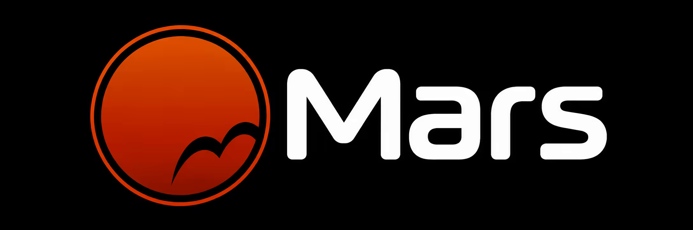

# 案例 122：緋紅火星軌道標誌 | Case 122: Crimson Mars Orbit Logo



緋紅漸變圓形火星配一條細軌道線，右下隕石坑留白暗藏字母 M，旁邊是乾淨現代的 Mars 字標，黑底高對比、扁平俐落。

A crimson-gradient Mars disc with a thin orbit line, a crater's negative space hiding the letter M, beside a clean modern Mars wordmark — flat, crisp and high-contrast on black.

## 完整提示詞 / Full Prompt

```
LOGO CONCEPT: A bold, flat icon of Mars rendered as a stylised planet with a thin orbit line and a subtle crater, combined with a clean, modern sans‑serif wordmark.

SYMBOL & GEOMETRY: The planet is a perfect circle (radius 1 unit) filled with a gradient of deep crimson to a lighter scarlet at the top, giving a subtle 3‑D effect while remaining flat. A thin, 0.15 unit thick orbit line encircles the planet at a 0.2 unit offset, drawn with a sharp, crisp edge. A single, stylised crater is represented by a shallow, 0.3 unit wide arc in the lower‑right quadrant, its inner edge cut out to create a negative space that subtly forms a stylised ‘M’ when viewed from above. The wordmark is placed to the right, aligned vertically centre with the planet’s centre. The type is a custom sans‑serif with rounded terminals, 0.1 unit letter‑spacing, and the ‘a’ and ‘r’ share a unified tail to reinforce cohesion.

LETTERING: Custom typeface: Mars – all caps, medium weight, slightly condensed. The ‘A’ has a subtle notch at the apex to echo the planet’s crater, while the ‘R’ has a small tail that mirrors the orbit line. Letter heights are 1.2 units, width 0.9 units, ensuring optical balance with the symbol. The font is designed to be legible at small sizes and to maintain its distinctive character when scaled up.

COLOR: Primary: #C1440E (Mars red). Secondary: #A62300 (deep orange). Accent: #FFFFFF (white) for negative space. Background: #000000 (black) for high contrast, but the mark works on light backgrounds as well with inverted tones.

COMPOSITION: The symbol sits left of the wordmark, with a horizontal gutter of 0.3 units. The overall bounding box is 2.5 units wide and 1.5 units tall. The planet and orbit are centred vertically on the baseline. The wordmark’s baseline aligns with the planet’s centreline, ensuring a unified visual anchor. The negative space crater forms a subtle ‘M’ that ties the symbol to the brand name.

EXACT LOGO TEXT: "Mars". Preserve its spelling and case.

OUTPUT: One original logo, isolated on a clean background, crisp flat vector-style shapes and optically balanced edges. No presentation board, mockup, scene, slogans, stock icons or watermark unless explicitly requested. The core silhouette and counterforms remain legible in a one-color rendition and at small sizes.
```

## 適用模型 / Recommended Models

擅長標誌設計與文字排版的模型：GPT Image（Image2）、Ideogram、Flux Pro。

Models strong at logo design and typography: GPT Image (Image2), Ideogram, Flux Pro.

## 修改說明 / How to Adapt

- 換行星：火星換成月球或土星，色號與隕石坑描述同步改。
- 換字標：Mars 換成品牌名，字母細節（A 的缺口、R 的尾巴）跟著改。
- 換配色：緋紅換成深藍或墨綠，COLOR 段的色號整組換。

- Change the planet: swap Mars for the Moon or Saturn; update the colour codes and crater description.
- Change the wordmark: swap Mars for the brand name; update the letter details (the notched A, the tailed R).
- Change the palette: swap crimson for deep blue or dark green; replace the whole COLOR block.

---
直達本案例 / Direct link: https://aioae.us/prompt?title=Crimson%20Mars%20Orbit%20Logo
更多同類提示詞 / More prompts like this: [AIOAE 免費 AI 圖片提示詞庫](https://aioae.us/prompts)
