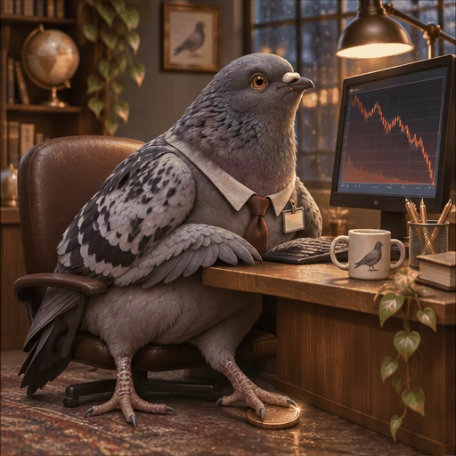

# 案例 123：心碎鴿子看著股市崩盤動畫精靈圖 | Case 123: Heartbroken Pigeon Watching a Stock Crash Animation Sprite Sheet



灰鴿子穿襯衫打領帶坐在迷你辦公室，盯著暴跌的紅色 K 線，從期待、擔心、震驚到落淚、擦淚，共 6 幀首尾相接，可無縫循環。

A gray pigeon in a shirt and loosened tie sits in a miniature office, watching a plunging red stock chart through six frames — hopeful, worried, shocked, heartbroken, tearful, then wiping its tears — looping seamlessly back to the start.

## 完整提示詞 / Full Prompt

```
Create a single animation sprite sheet for a seamless looping GIF.

A photorealistic gray pigeon works in a cozy miniature office, sitting upright in a brown leather chair at a wooden desk. The pigeon has detailed gray feathers, black-and-white patterned wings, an iridescent green and purple neck, expressive orange eyes, and pink feet. It wears a white office shirt collar, a loosened red tie, and a small blank employee badge.

One foot rests protectively on its last coin beneath the desk. In front of the pigeon, a computer monitor displays a clearly plunging red stock-market line chart. A keyboard, a ceramic pigeon mug, pencils, books, and a trailing green plant sit on the desk. In the background are bookshelves, a globe, a framed bird picture, a window, and a warm desk lamp.

Exactly 6 sequential frames arranged in a precise 3-column by 2-row grid, read left-to-right and then top-to-bottom. Every panel has identical dimensions. Fixed front three-quarter camera, consistent character identity, body proportions, desk, monitor, clothing, lighting, and background in every frame.

Animation sequence:

Frame 1: The pigeon sits upright and looks at the monitor with a quietly hopeful expression, one foot resting on the coin.

Frame 2: The pigeon notices the chart falling and slowly lowers its head, looking worried.

Frame 3: Its orange eyes widen, and its beak opens slightly in shock as it stares at the plunging chart.

Frame 4: Its face crumples, eyes squeeze shut, and its head droops in sadness.

Frame 5: Large cartoon tears stream down both cheeks as the pigeon cries over its last coin.

Frame 6: The pigeon quietly wipes away its tears with one wing while looking toward the monitor. Its expression begins to relax and its posture starts returning toward the first frame.

Clear incremental facial, head, wing, and tear movement between frames. Keep the camera, composition, object placement, and character scale fixed. Make the sixth frame transition smoothly toward the first for a looping animation.

Photorealistic pigeon with subtly anthropomorphic expressions, highly detailed feathers, cinematic warm lighting, cozy miniature office atmosphere, humorous and sympathetic mood, polished digital artwork.

No captions, no words, no numbers, no logos, no watermark, no speech bubbles, no panel labels, no borders, no gutters.
```

## 適用模型 / Recommended Models

擅長精靈圖與連續分格的模型：GPT Image（Image2）、Flux Pro、Midjourney。

Models strong at sprite sheets and sequential frames: GPT Image (Image2), Flux Pro, Midjourney.

## 修改說明 / How to Adapt

- 換主角：鴿子換成貓或倉鼠，辦公室小物（馬克杯、領帶）跟著改。
- 換走勢：暴跌換成暴漲，六幀的表情反過來，從絕望變狂喜。
- 換幀數：6 幀換成 9 幀 3×3 網格，每幀描述編號寫清；若出圖只有單格、沒有網格，在提示詞開頭再強調 Exactly 6 frames in a 3×2 grid。

- Change the character: swap the pigeon for a cat or a hamster; update the office props (mug, tie) to match.
- Change the trend: swap the crash for a rally; reverse the six frames' expressions from despair to euphoria.
- Change the frame count: swap 6 frames for 9 in a 3×3 grid and number every frame; if the output comes out as a single frame with no grid, restate "Exactly 6 frames in a 3×2 grid" at the top of the prompt.

---
直達本案例 / Direct link: https://aioae.us/prompt?title=Heartbroken%20Pigeon%20Watching%20a%20Stock%20Crash%20Animation%20Sprite%20Sheet
更多同類提示詞 / More prompts like this: [AIOAE 免費 AI 圖片提示詞庫](https://aioae.us/prompts)
