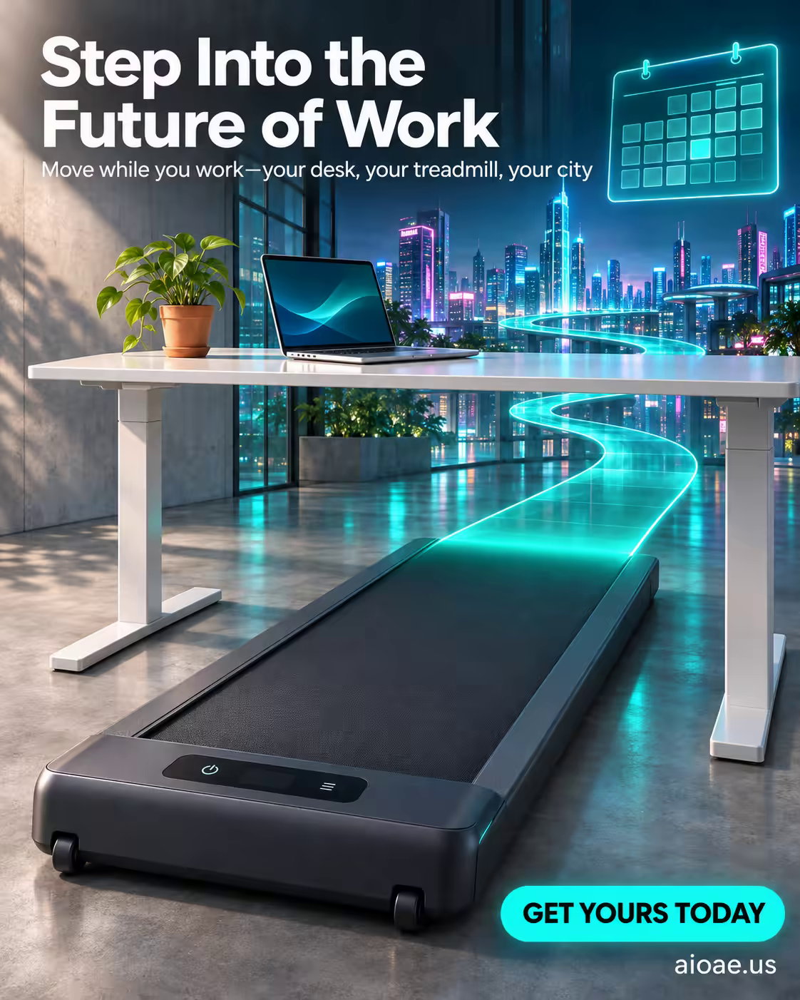

# 案例 124：踏入未來辦公：桌下跑步機海報 | Case 124: Step Into the Future of Work Under Desk Treadmill Poster



半透明光帶跑步機穿過融化成霓虹城市的辦公室，全息日曆漂浮在桌上，邊走邊工作的未來辦公想像，動感又輕盈。

A translucent ribbon of light winds through an office melting into a neon cityscape, a holographic calendar floating above the desk — a kinetic vision of walking while working.

## 完整提示詞 / Full Prompt

```
SUBJECT & IDEA: Under Desk Treadmill. A sleek under‑desk treadmill, its runner a translucent ribbon of light, winding through a hyper‑real office that melts into an endless cityscape of neon skyscrapers. The treadmill’s footplate glows faintly, echoing the pulse of the city, while a floating holographic calendar scrolls above the desk, reminding users that every step counts toward a healthier day. The surreal setting transforms the mundane office into a dynamic, kinetic playground, inviting the viewer to picture themselves walking while working.

PRODUCT: The product is a compact, low‑profile treadmill that slides beneath a standard office desk. Its running surface is a smooth, dark gray metal with a subtle matte finish, flanked by two discreet wheels that allow it to be easily positioned and moved. The treadmill’s motor is silent and quiet, its controls minimal—just a touchpad for speed and a small LED display. The design emphasizes portability and integration into a typical work environment.

SCENE: The scene is set in a modern office corner, but the walls and floor dissolve into a glowing, stylized cityscape that stretches beyond the frame. In the foreground, a sleek white desk sits on a gray concrete floor. Beneath it, the under desk treadmill is visible through a translucent, shimmering pane of glass that shows its moving belt in motion. Above the desk, a floating hologram displays a calendar and a motivational quote, casting soft blue light. To the right, a glass window opens onto a skyline of neon-lit skyscrapers, their lights reflected on the treadmill’s surface. The desk and treadmill are positioned slightly off‑center, drawing the eye toward the glowing ribbon of the running surface. A small plant in a terracotta pot sits on the desk, adding a touch of life.

LIGHTING & COLOR: Soft, diffused studio lighting from a high‑angle source creates a gentle rim of light around the treadmill, emphasizing its glossy surface. The holographic calendar emits a cool blue glow that reflects onto the desk and the treadmill, while the cityscape beyond the window provides a subtle backlit glow that gives depth to the scene. Shadows are minimal and soft, with the main source of light coming from above and slightly to the left, creating a balanced, airy atmosphere.

CAMERA: A slightly low‑angle, 30° tilt shot captures the treadmill and desk from the front, giving prominence to the moving belt. The depth of field is shallow, with the treadmill in sharp focus and the cityscape slightly blurred, creating a sense of motion and distance. The camera is positioned to include the holographic calendar in the upper right, ensuring the viewer sees both the product and its surreal surroundings.

ON-IMAGE COPY: Headline "Step Into the Future of Work"; subheadline "Move while you work—your desk, your treadmill, your city"; CTA "Get Yours Today". The headline is placed in the top left corner in a bold, modern sans-serif font, white against a dark gray overlay that matches the treadmill’s color. The subheadline sits just below, in a lighter weight of the same font, slightly smaller. The CTA button is located in the bottom right, a bright teal rectangle with rounded corners, containing the text in white, capital letters. Negative space around the product allows the headline and CTA to stand out without clutter.

WATERMARK: Small readable "aioae.us" in the bottom-right corner.
```

## 適用模型 / Recommended Models

擅長電商海報與產品文案排版的模型：GPT Image（Image2）、Flux Pro、Ideogram。

Models strong at e-commerce posters and ad-copy layout: GPT Image (Image2), Flux Pro, Ideogram.

## 修改說明 / How to Adapt

- 換產品：跑步機換成升降桌或人體工學椅，產品描述與場景整組換。
- 換場景：霓虹城市換成森林或海邊，窗外風景與光線描述跟著改。
- 換文案：主標題、副標題與 CTA 整組換，產品名同步改。

- Change the product: swap the treadmill for a standing desk or an ergonomic chair; replace the product description and scene as a set.
- Change the setting: swap the neon cityscape for a forest or a seaside view; update the window view and lighting.
- Change the copy: swap the headline, sub-headline and CTA as a set; update the product name too.

---
直達本案例 / Direct link: https://aioae.us/prompt?title=Step%20Into%20the%20Future%20of%20Work%20Under%20Desk%20Treadmill%20Poster
更多同類提示詞 / More prompts like this: [AIOAE 免費 AI 圖片提示詞庫](https://aioae.us/prompts)
