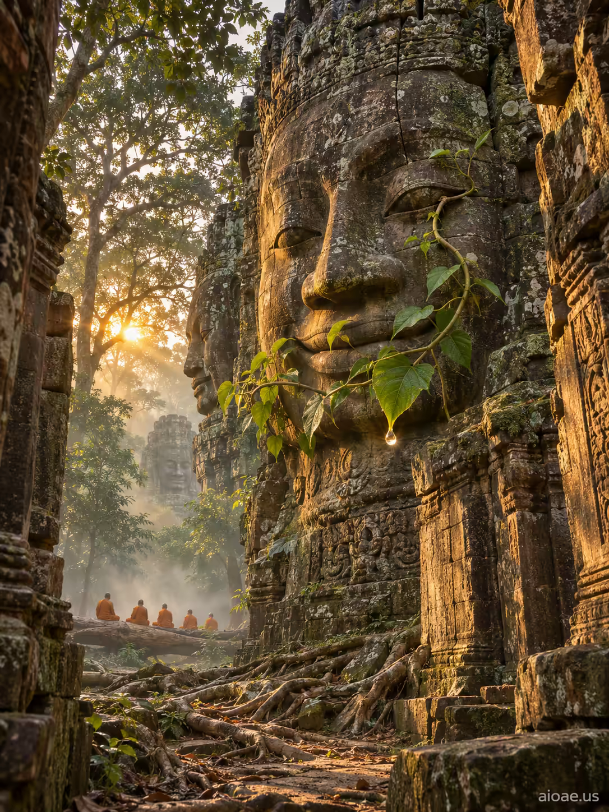

# 案例 125：巴戎寺石面 | Case 125: A Stone Face on Bayon Temple



巴戎寺清晨：千年石面微笑，嫩綠藤蔓爬上眼角，一滴水珠懸在葉尖；霧氣裡一排僧侶剪影靜坐，晨光穿過叢林，寫實中帶著詭異的美感。

Dawn at Bayon: a thousand-year-old stone face smiles as a tender green vine climbs past its eye, a single droplet hanging from a leaf tip; in the mist, a row of monk silhouettes sits in stillness while morning light filters through the jungle - photorealistic with a haunting beauty.

## 完整提示詞 / Full Prompt

```
SUBJECT: A stone face on Bayon temple

SCENE: In the early morning, a narrow, sunlit corridor of the Bayon temple opens into a dense jungle. A stone face, its smile carved in stone, sits at the center of the frame. One of its eyes has just begun to sprout a thin green vine that curls upward, its leaves unfurling to cover the mouth, leaving a single droplet of water hanging from a leaf edge. Below, in the mist, a row of tiny monks' silhouettes rests in the driftwood of a temple corridor flooded with morning light.

STYLE & LIGHT: Photorealistic with haunting beauty: low-angle direct sunlight on weathered sandstone, juxtaposing the carved faces with the wild growth of the jungle, emphasizing soft morning haze and lush green vegetation.

CAMERA: Wide-angle low shot at dawn, showing the stone faces looming over a root-covered path with mist between the trees.

WATERMARK: Use the exact string 'aioae.us' in a small, clean, low-contrast sans-serif font at the very bottom-right corner of the image, placed naturally as if part of the scene, without any artifact or unusual stroke. The watermark text must be legible and crisp while blending into the image, not floating or distorted, and the text must be the exact string 'aioae.us'.
```

## 適用模型 / Recommended Models

擅長寫實風景與古蹟質感的模型：GPT Image（Image2）、Flux Pro、Midjourney（建議加 `--ar 3:4`）。

Models strong at photorealistic landscapes and ancient stone textures: GPT Image (Image2), Flux Pro, Midjourney (add `--ar 3:4`).

## 修改說明 / How to Adapt

- 換時間：清晨換成黃昏，陽光改成斜射暖金色，霧氣改成暮色，石面神情不變。
- 換植物：藤蔓換成盛開的雞蛋花或青苔，葉片與水珠的細節跟著改。
- 換人物：霧中的僧侶剪影換成揹包遊客或當地孩童，剪影數量與位置不動。

- Change the time: swap dawn for dusk, the sunlight for slanted warm gold and the morning mist for evening haze; the stone face stays the same.
- Change the plant: swap the vine for frangipani blossoms or moss, and update the leaf and droplet details to match.
- Change the figures: swap the monk silhouettes in the mist for backpackers or local children, keeping their count and positions.

---
直達本案例 / Direct link: https://aioae.us/prompt?title=A%20Stone%20Face%20on%20Bayon%20Temple
更多同類提示詞 / More prompts like this: [AIOAE 免費 AI 圖片提示詞庫](https://aioae.us/prompts)
