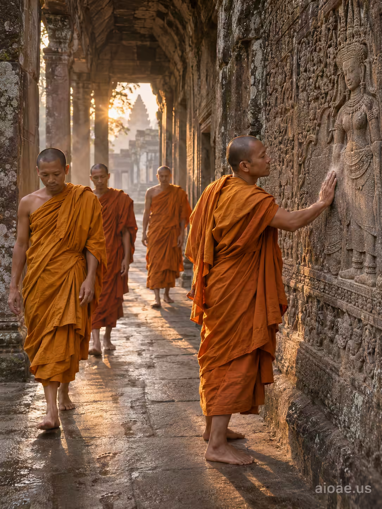

# 案例 126：晨光中的藏紅袍僧侶 | Case 126: Buddhist Monks in Saffron Robes



吳哥寺廊黎明：暖琥珀色晨光穿過石拱，藏紅袍僧侶緩步前行，衣袂輕擺，一人駐足輕觸浮雕，電影感敘事，幾何構圖清晰。

Dawn in an Angkor corridor: warm amber light filters through stone arches as saffron-robed monks walk at a measured pace, robes rippling softly; one pauses to touch a carved relief - premium cinematic storytelling with clear geometry.

## 完整提示詞 / Full Prompt

```
SUBJECT: Buddhist monks in saffron robes

SCENE: At dawn, a narrow corridor of the Angkor temple complex unfolds with warm amber light filtering through stone arches. A small group of monks, each wearing simple saffron robes, walk at a measured, relaxed pace. Their feet leave faint impressions on the cool, slightly damp stone floor, and the subtle ripple of their robes follows their slow motion. A single monk pauses to touch a carved relief, his hand resting against the stone; the contact leaves a faint, translucent smear of dust on the surface, visibly marking the interaction. The corridor's high vaulted ceilings cast long, soft shadows across the marble, and distant morning light glows behind the monks, creating a gentle halo effect. The scene is framed so the monks occupy the foreground, the corridor recedes into mid-ground, and the ancient temple walls rise into a misty background.

STYLE & LIGHT: Premium cinematic storytelling with clear geometry, natural dawn lighting, and warm saffron tones.

CAMERA: Medium-wide, subject-first perspective with a shallow depth of field that keeps the monks in sharp focus while softly blurring the distant stone walls.

WATERMARK: Add the exact text "aioae.us" in the bottom-right corner at 70% transparency (30% opacity), with enough contrast to remain readable.
```

## 適用模型 / Recommended Models

擅長電影感敘事與人物群像的模型：GPT Image（Image2）、Flux Pro、Midjourney（建議加 `--ar 3:4`）。

Models strong at cinematic storytelling and group portraits: GPT Image (Image2), Flux Pro, Midjourney (add `--ar 3:4`).

## 修改說明 / How to Adapt

- 換人數：僧侶小組換成單人或長隊列，隊形與步伐節奏跟著改。
- 換動作：觸摸浮雕改成合掌或托缽，手部與石面的接觸細節要寫清楚。
- 換光線：黎明暖光換成午後斜陽，影子拉長、色溫轉冷，氛圍更肅穆。

- Change the group: swap the small group of monks for a single monk or a long procession, and adjust the formation and pace.
- Change the gesture: swap touching the relief for palms joined in prayer or holding an alms bowl, and describe the hand-to-stone contact clearly.
- Change the light: swap dawn warmth for slanting afternoon sun, longer shadows and a cooler tone for a more solemn mood.

---
直達本案例 / Direct link: https://aioae.us/prompt?title=Buddhist%20Monks%20in%20Saffron%20Robes
更多同類提示詞 / More prompts like this: [AIOAE 免費 AI 圖片提示詞庫](https://aioae.us/prompts)
