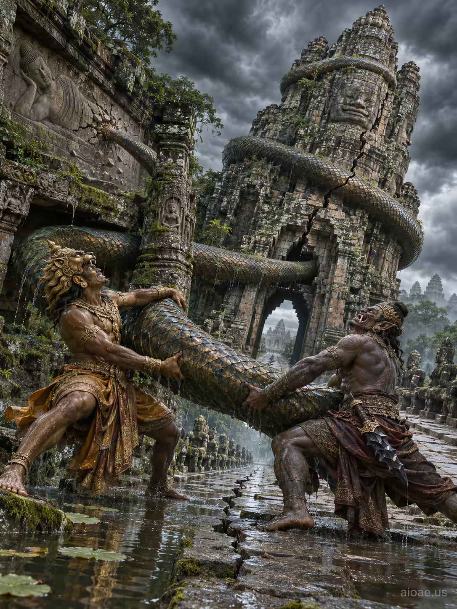

# 案例 127：神魔共拉那伽巨蛇 | Case 127: God and Demon Tugging a Naga Serpent at Angkor Thom



吳哥城南門：青銅神祇與手持黑曜刃的惡魔合力拉扯巨蛇那伽，石塔被蛇身壓得傾斜開裂，暴風雨雲低垂，神話張力拉滿。

At Angkor Thom's South Gate, a bronze god and a demon with an obsidian blade haul a massive naga serpent upward, the stone tower tilting and cracking under its weight as storm clouds loom - mythic drama in deep greens, grays and warm ochre.

## 完整提示詞 / Full Prompt

```
SUBJECT: A god and a demon tugging a massive naga serpent that has unhinged the stone gate tower of Angkor Thom's South Gate

SCENE: The stone causeway of Angkor Thom's South Gate rises from a wet, moss-covered moat. In the foreground, a bronze-colored god with a lion-like headdress and a demon bearing a jagged, obsidian blade pull the naga's coiled body upward. The serpent's scaled body, previously resting across the gate's lintel, now wraps around the central stone pillar, its tail snapping against the carved bas-relief of a reclining Buddha. The stone tower, once upright, is tilted by the serpent's weight, its granite steps cracking and a fissure running along the stone's face. Dark storm clouds loom overhead, casting diffused, gray light that highlights the wet stone and the glint on the serpent's scales, while distant temple towers are obscured by low mist.

STYLE & LIGHT: The image employs a dramatic, high-contrast palette of deep greens, muted grays, and warm ochre to emphasize the ancient stone textures and the metallic sheen of the deity figures. Light originates from the storm clouds, creating soft rim lighting around the figures and a subtle glow on the serpent's scales. The composition is grounded in realistic proportions, with clear shadows and reflective water surfaces to anchor the mythic drama in a believable sett

CAMERA: A low-angle, slightly tilted perspective places the causeway and the towering gate in the foreground, drawing the viewer's eye toward the central action of the god and demon pulling the serpent. The camera is positioned just above the waterline, capturing the full extent of the stone structure, the dynamic tension of the tug, and the atmo

WATERMARK: Add the exact text "aioae.us" in the bottom-right corner at 70% transparency (30% opacity), with enough contrast to remain readable.
```

## 適用模型 / Recommended Models

擅長神話場景與戲劇光影的模型：GPT Image（Image2）、Flux Pro、Midjourney（建議加 `--ar 3:4`）。

Models strong at mythic scenes and dramatic lighting: GPT Image (Image2), Flux Pro, Midjourney (add `--ar 3:4`).

## 修改說明 / How to Adapt

- 換主角：神與惡魔換成兩位武士或神獸，武器與頭飾跟著改，拉蛇的動作不變。
- 換天氣：暴風雨雲換成晴空萬里，光線改成正午直射，石面與鱗片反光更強。
- 換視角：低角度水面視角換成高空俯瞰，護城河與石道全貌入鏡。

- Change the leads: swap the god and demon for two warriors or mythical beasts, updating weapons and headdresses while keeping the pulling action.
- Change the weather: swap the storm clouds for a clear sky, the light for harsh midday sun, and the reflections on stone and scales get stronger.
- Change the angle: swap the low waterline view for a high aerial shot taking in the moat and the full causeway.

---
直達本案例 / Direct link: https://aioae.us/prompt?title=God%20and%20Demon%20Tugging%20a%20Naga%20Serpent%20at%20Angkor%20Thom
更多同類提示詞 / More prompts like this: [AIOAE 免費 AI 圖片提示詞庫](https://aioae.us/prompts)
