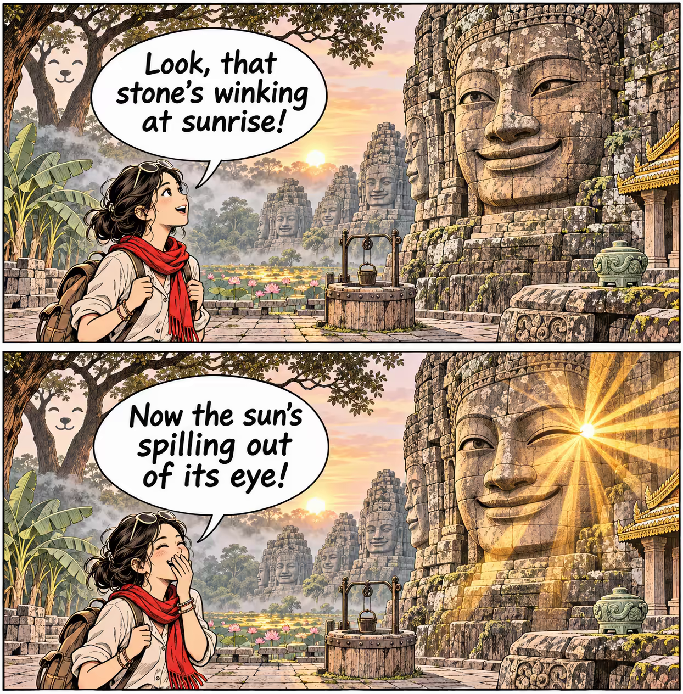

# 案例 128：日出時眨眼的巴戎石面 | Case 128: Bayon Temple Stone Face Winks at Sunrise



兩格漫畫：遊客仰望巴戎巨面石塔，石面在日出時俏皮一眨眼，陽光從閉合的眼角迸出，輕鬆幽默的文化梗圖。

A two-panel comic: a young tourist gazes up at Bayon's giant smiling faces, and one stone face winks at sunrise, sunlight bursting from its closed eye - a light, playful cultural meme.

## 完整提示詞 / Full Prompt

```
SUBJECT: Original TWO-PANEL comic about "Bayon temple: giant smiling stone faces, one face winks at sunrise, jungle, morning light, two-panel comic meme". Subject: young adult tourist viewing an ancient stone-face tower, and the playful wink of the stone.

STRUCTURE:

[Panel A] A young woman stands before a massive stone tower covered in giant smiling faces, looking up in wonder. Morning sunlight floods the stone, the jungle steaming behind her. Speech bubble: "Look, that stone's winking at sunrise!"

[Panel B] The SAME stone face winks and the sun bursts from the corner of the closed eye. Sunbeams fan across the panel and the woman laughs, hand over her mouth. Speech bubble: "Now the sun's spilling out of its eye!"

One short sentence in each panel: the first panel explains, the second panel shows the context shift. Same setting and same characters, same aspect ratio. Keep the speech balloons readable.

VISUAL STYLE: Use a charming animal silhouette: tree trunks replaced by a friendly animal expression, in black-and-white animation with a red accent. A stone-age courtyard, dark brown wood against the clouds, a deep well of street iron, leading to a stepped golden roof, nature, jade artifacts, green banana groves, and a lotus pond in the background rendered via flowing golden iridescence. Image is crisp warm palette and personal note.
```

## 適用模型 / Recommended Models

擅長雙格漫畫與對話氣泡的模型：GPT Image（Image2）、Flux Pro、即夢。

Models strong at two-panel comics and speech bubbles: GPT Image (Image2), Flux Pro, Jimeng.

## 修改說明 / How to Adapt

- 換對白：兩格的對話換成其他語言或笑點，氣泡位置與字數要短。
- 換主角：女遊客換成小和尚或攝影師，仰望的姿勢不變。
- 換時間：日出換成月夜，石面眨眼時月光從眼角流出，色調轉冷。

- Change the dialogue: swap the two speech bubbles for another language or joke, keeping the bubbles short and well placed.
- Change the lead: swap the young woman tourist for a young monk or a photographer, keeping the upward gaze.
- Change the time: swap sunrise for moonlight, moonbeams spilling from the winking eye, and cool the palette.

---
直達本案例 / Direct link: https://aioae.us/prompt?title=Bayon%20Temple%20Stone%20Face%20Winks%20at%20Sunrise
更多同類提示詞 / More prompts like this: [AIOAE 免費 AI 圖片提示詞庫](https://aioae.us/prompts)
