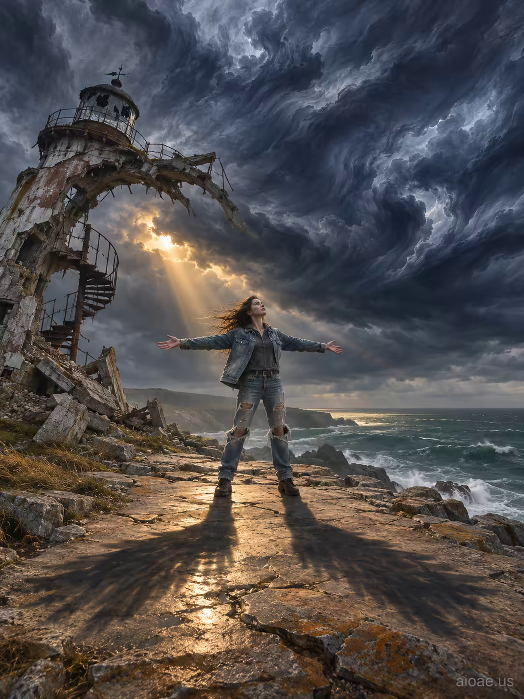

# 案例 129：廢墟燈塔前的牛仔女子 | Case 129: Woman in Denim Jacket Before a Ruined Lighthouse



廢棄燈塔前的女子：牛仔外套、破洞牛仔褲，張開雙臂迎向暴風雨，金色時刻的光束穿透烏雲，影子在裂石上展成翅膀，油畫筆觸粗獷有力。

A woman in a faded denim jacket and ripped jeans stands arms wide before a ruined lighthouse, a golden-hour shaft breaking through a storm cloud bank, her shadow spreading across cracked stone like wings - sweeping oil strokes, raw and dramatic.

## 完整提示詞 / Full Prompt

```
A adult woman aged 18 or older, age eighteen, stands on a weather-worn stone ridge overlooking a jagged, abandoned lighthouse that has collapsed into a jagged ruin. The sun is low, casting a golden hour glow that bathes the scene in warm, elongated light. A massive, dark cloud bank rises above the ridge, its edges sharp and foreboding, filling the sky with an ominous, stormy atmosphere. The girl, wearing a faded denim jacket and ripped jeans, holds her arms out wide, her face turned upward, eyes lifted toward the sky as if summoning the wind. Her shadow stretches across the cracked stone, forming a winged shape that mirrors the clouds above. The collapsed lighthouse, once towering, has now been transformed into a twisted, skeletal arch that leans toward the girl, its broken walls reflecting the storm's gray light and casting a faint, eerie glow on her determined expression.

A vast cloud bank rises over a tiny ridge, shoreline or ruined tower. The requested subject confronts a large natural force in the same continuous space. Any adult figure is small against the weather yet retains an expressive silhouette. A break in the storm sends one warm shaft across a dark valley. Indigo cloud, raw sienna ground, cold sea green and pale gold. Sweeping oil strokes in sky contrast with rough rock and wet fabric. A low horizon yields most of the frame to turbulent sky and diagonal weather.
```

## 適用模型 / Recommended Models

擅長寫實人像與油畫質感的模型：GPT Image（Image2）、Flux Pro、Midjourney（建議加 `--ar 3:4`）。

Models strong at realistic portraits and painterly texture: GPT Image (Image2), Flux Pro, Midjourney (add `--ar 3:4`).

## 修改說明 / How to Adapt

- 換服裝：牛仔外套換成風衣或皮夾克，布料與光澤的描述跟著改。
- 換場景：廢棄燈塔換成斷橋或荒廢城堡，人物迎風的姿勢不變。
- 換天氣：暴風雨換成晴空薄雲，影子縮短、色調轉暖，氛圍更輕鬆。

- Change the outfit: swap the denim jacket for a trench coat or leather jacket, and update the fabric and sheen descriptions.
- Change the setting: swap the ruined lighthouse for a broken bridge or an abandoned castle, keeping the arms-wide pose.
- Change the weather: swap the storm for a clear sky with thin clouds, shorter shadows and a warmer palette for a lighter mood.

---
直達本案例 / Direct link: https://aioae.us/prompt?title=Woman%20in%20Denim%20Jacket%20Before%20a%20Ruined%20Lighthouse
更多同類提示詞 / More prompts like this: [AIOAE 免費 AI 圖片提示詞庫](https://aioae.us/prompts)
