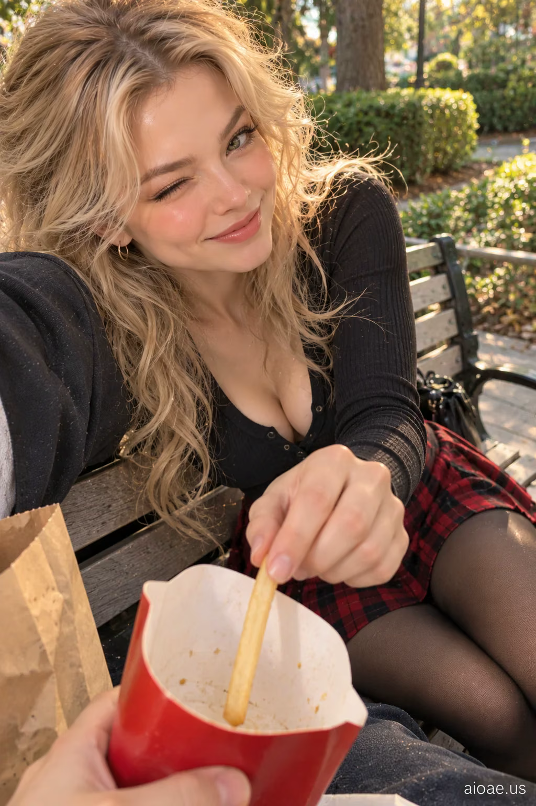

# 案例 13：公園長椅上搶薯條的女友 POV | Case 13: Girlfriend Stealing My Last French Fry POV on a Park Bench



公園長椅上的第一視角，搶最後一根薯條的羞澀甜蜜，電影感寫實人像。

First-person POV on a park bench; stealing the last french fry, shy sweet tenderness, cinematic photorealism.

## 完整提示詞 / Full Prompt

```
SUBJECT & IDEA: Girlfriend Stealing My Last French Fry POV. an adult woman. Preserve subject, specified action, relationships and any reference appearance. Adult romantic partners only.

SCENE: a quiet park bench surrounded by greenery. fresh diffused late-afternoon light and delicate reflected highlights. The location, time of day and core props specified by the user are fixed. No unrelated fantasy changes.

RECIPROCAL POV: Genuine first-person romantic-partner viewpoint, not a photographer or fashion shoot. RECIPROCAL INTERACTION DNA: The subject shifts her weight against the viewer's shoulder and stays there comfortably, continuing the shared quiet moment. VIEWER PRESENCE: A small part of the viewer's shoulder or upper arm appears in the lower side of frame, supporting her cheek. PARTNER RESPONSE: Relaxed half smile and soft relaxed eyes, aware of the shared closeness. CONTACT EVIDENCE: Her cheek compresses gently into the shoulder and hair follows gravity.   A real response occurs between both people, with correct weight, touch and eye line.

CASTING & FASHION: Clearly adult woman; contemporary Western-inspired styling unless nationality/reference was specified. Hair: ash-blonde face-framing layers with airy volume. Outfit: a fitted black long-sleeve top and a red-and-black plaid pleated skirt. Sensual but tasteful fully clothed adult styling; the romantic exchange, not the outfit, is the hero.

CAMERA: Close first-person eye-level 25–60 cm when possible; one partial viewer hand/forearm or shoulder only if physically involved. Normal 26–35 mm smartphone perspective. Face and expression dominate; background secondary.

MUTATION RULES: Preserve the original subject and activity. Creative change is a more emotionally reciprocal atmosphere: shy delight, private tenderness and authentic surprise. fresh diffused late-afternoon light and delicate reflected highlights. A coherent shared gesture, not a portal or unrelated prop.

ANTI-POSING: No detached glamour modeling, staged smile at an anonymous lens, invisible contact, third-person scene, disconnected fingers or camera-holder visible as a second full person.

SAFETY: Consensual affection between clearly adult characters; no nudity, coercion, fetish-only cropping or explicit acts.

WATERMARK: Small legible "aioae.us" in the bottom-right corner.
```

## 適用模型 / Recommended Models

擅長第一人稱視角與寫實人臉的模型：GPT Image（Image2）、Flux Pro；戶外自然光人像可加 Midjourney。

Models strong at first-person POV and realistic faces: GPT Image (Image2), Flux Pro; Midjourney for natural-light outdoor portraits.

## 修改說明 / How to Adapt

- 換地點：把 SCENE 的公園長椅換成湖邊或天台，光線描述跟著改，POV 機位段不用動。
- 換互動：把搶薯條改成搶奶茶或最後一塊蛋糕，CONTACT EVIDENCE 的接觸描述要同步改。
- 換造型：格紋裙整組換成其他學院風穿搭，SAFETY 與 ANTI-POSING 段保留。

- Change the location: swap the park bench for a lakeside or rooftop; update the lighting in SCENE, keep the POV camera block.
- Change the interaction: replace stealing the fry with stealing bubble tea or the last cake slice; update the contact description in CONTACT EVIDENCE to match.
- Change the styling: swap the plaid skirt for another preppy outfit; keep SAFETY and ANTI-POSING.

---
直達本案例 / Direct link: https://aioae.us/prompt?title=Girlfriend%20Stealing%20My%20Last%20French%20Fry%20POV%20on%20a%20Park%20Bench
更多同類提示詞 / More prompts like this: [AIOAE 免費 AI 圖片提示詞庫](https://aioae.us/prompts)
