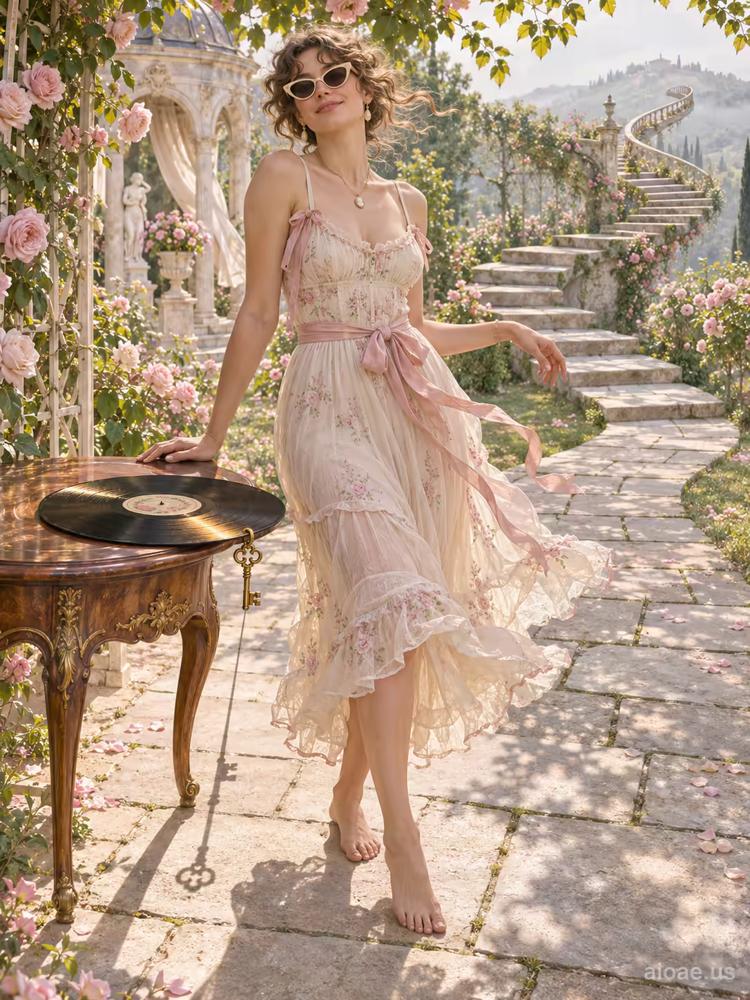

# 案例 130：玫瑰園碎花洋裝的艾蜜莉 | Case 130: Emily in a Floral Sundress in a Rose Garden



玫瑰園裡的艾蜜莉：赤腳走在彎成螺旋的石徑上，碎花洋裝、貓眼墨鏡，黑膠唱片擱在木桌上，粉紅、青瓷、象牙白與淡金的柔和畫面。

Emily stands barefoot on a garden path curling into a spiral, in a light sundress and cat-eye sunglasses, a vinyl record resting on a wooden table - powder pink, celadon, ivory and light gold in soft, painted-silk tones.

## 完整提示詞 / Full Prompt

```
Emily stands barefoot on a sunlit stone path that curls through a vibrant garden, the path itself visibly bending into a graceful spiral as the stone pavers shift upward, forming a miniature staircase that rises toward a distant, misty hill. She wears a light, airy sundress and cat-eye sunglasses, her hair styled in a soft, smoke-curl fringe that frames her relaxed, half-smiling face. Beside her, a vintage vinyl record lies open on a polished wooden table, its grooves reflecting the golden afternoon light that filters through flowering trellises. The record's edge is gently turned by a small, decorative brass key that now hangs from the table's rim, its polished surface catching the light and casting a subtle, elongated shadow across the path. The garden's atmosphere blends warm, dappled sunlight with cool, cool breezes that ripple the petals of nearby roses, creating a harmonious contrast of light and shadow.

Curving garden paths lead through flowering trellises and pale stone pavilions. A playful outdoor exchange sits among foliage and small decorative objects. Adult figures wear airy layered garments and graceful, relaxed hand gestures. Dappled afternoon light travels across flowers, silk and a pale face. Powder pink, celadon, ivory and light gold. Painted silk, feathered foliage and chalky stone soften every edge. Sweeping S-curve paths guide the eye through clustered figures and greenery.
```

## 適用模型 / Recommended Models

擅長寫實人像與柔和花園場景的模型：GPT Image（Image2）、Flux Pro、Midjourney（建議加 `--ar 3:4`）。

Models strong at realistic portraits and soft garden scenes: GPT Image (Image2), Flux Pro, Midjourney (add `--ar 3:4`).

## 修改說明 / How to Adapt

- 換主角：艾蜜莉換成其他名字與造型，洋裝顏色與墨鏡款式跟著改。
- 換道具：黑膠唱片換成一本書或一束花，桌上的小物件跟著換。
- 換季節：玫瑰盛放換成秋日落葉，石徑與光影的描述轉成暖褐色調。

- Change the lead: swap Emily for another name and look, updating the dress colour and sunglasses style.
- Change the prop: swap the vinyl record for a book or a bouquet, and update the small objects on the table.
- Change the season: swap roses in bloom for autumn leaves, shifting the path and light descriptions to warm browns.

---
直達本案例 / Direct link: https://aioae.us/prompt?title=Emily%20in%20a%20Floral%20Sundress%20in%20a%20Rose%20Garden
更多同類提示詞 / More prompts like this: [AIOAE 免費 AI 圖片提示詞庫](https://aioae.us/prompts)
