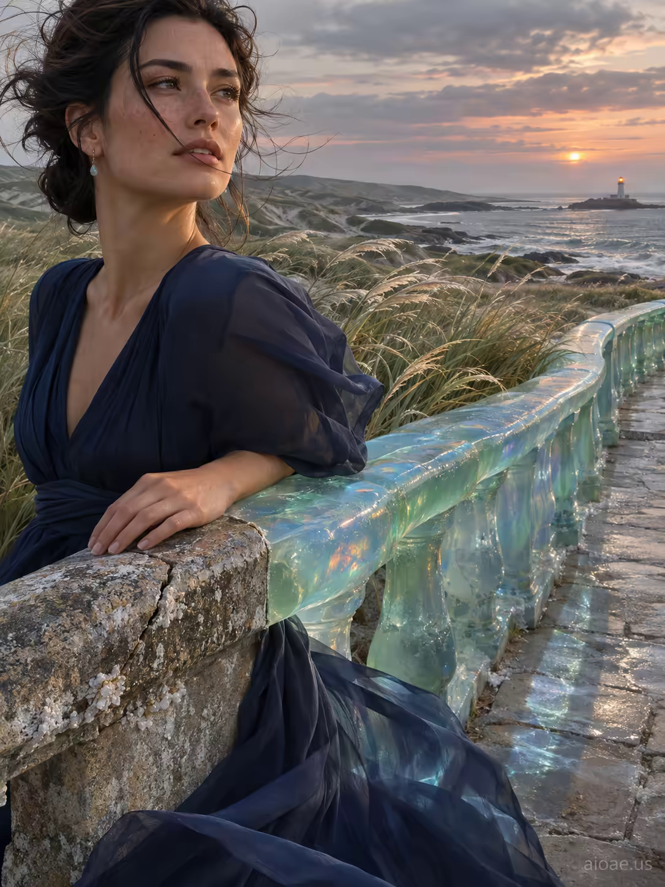

# 案例 131：海岸步道上的艾瑪 | Case 131: Emma in a Navy Dress on a Coastal Walkway at Sunset



海岸步道上的艾瑪：藏青長裙、海風揚起的髮絲，半透明蛋白石玻璃欄杆映著天空，遠處燈塔暖光閃爍，鹽灰、珊瑚、海玻璃綠與柔金交織。

Emma in a flowing navy dress on a weathered coastal walkway, wind lifting a strand of hair, a translucent opalescent glass railing mirroring the sky, a distant lighthouse glowing warm - salt grey, faded coral, sea-glass green and soft gold.

## 完整提示詞 / Full Prompt

```
A weathered coastal walkway of rough stone tiles stretches toward a silver horizon, its surface slick with salt spray. Emma, a 28-year-old woman in a flowing navy dress, stands on the far edge of the path, her left hand resting on a cracked granite railing. A gust of wind lifts her dark hair, sending a single strand across her face toward the camera while simultaneously bending the sea-grass behind the railing into elegant, curling waves. The railing itself has undergone a dramatic transformation: its weathered stone has been replaced by a translucent, opalescent glass that mirrors the sky, creating a sharp, reflective boundary between the past and present. Emma looks away, her gaze fixed on a distant lighthouse that flickers with a steady, warm glow, while the glass railing casts a cool, blue-tinted shadow across her dress, contrasting with the warm light of the lighthouse.

A weathered coastal walkway overlooks layered dunes, sea grass and a narrow silver horizon. Wind pulls one strand of hair across the near side of an adult face; the same wind bends grass behind the railing. The adult subject grips a sun-warmed rail and turns toward the viewer with a legible expression and believable body weight. Low sun grazes the cheek and casts the rail shadow across pale stone; the sea remains cooler and dimmer. Salt grey, faded coral, sea-glass green and soft golden highlights. Salt-marked stone, fine windblown cloth and scratched painted metal add tactile scale. A close eye-level portrait with face first, rail in the near foreground and horizon well below the eye line.
```

## 適用模型 / Recommended Models

擅長寫實人像與海岸光影的模型：GPT Image（Image2）、Flux Pro、Midjourney（建議加 `--ar 3:4`）。

Models strong at realistic portraits and coastal light: GPT Image (Image2), Flux Pro, Midjourney (add `--ar 3:4`).

## 修改說明 / How to Adapt

- 換服裝：藏青長裙換成白色亞麻裙，欄杆上的冷色倒影跟著改。
- 換時間：日落換成清晨薄霧，海面更冷、燈塔光更淡。
- 換視角：平視特寫換成背影遠景，髮絲與欄杆的細節讓給海天全景。

- Change the outfit: swap the navy dress for a white linen dress, and update the cool reflections on the railing.
- Change the time: swap sunset for early-morning mist, a colder sea and a fainter lighthouse glow.
- Change the angle: swap the eye-level close portrait for a distant rear view, letting the hair and railing details give way to the full seascape.

---
直達本案例 / Direct link: https://aioae.us/prompt?title=Emma%20in%20a%20Navy%20Dress%20on%20a%20Coastal%20Walkway%20at%20Sunset
更多同類提示詞 / More prompts like this: [AIOAE 免費 AI 圖片提示詞庫](https://aioae.us/prompts)
