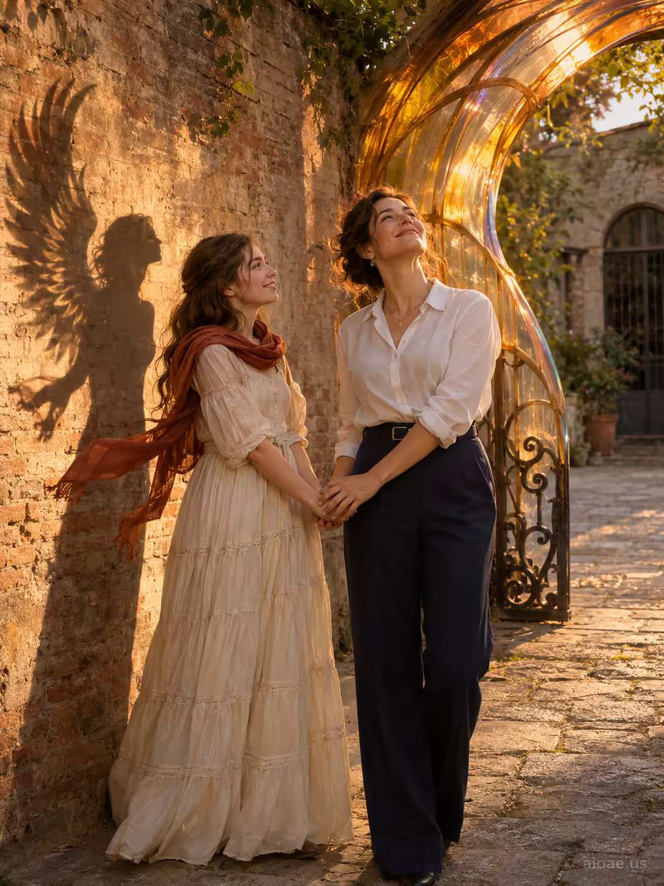

# 案例 132：金色時刻牽手的瑪麗亞 | Case 132: Maria and a Young Woman Holding Hands at Golden Hour



金色時刻的瑪麗亞：白色襯衫與藏青長褲的瑪麗亞牽著年輕女子的手，鐵門化作透光暖琥珀拱門，翼形影子落在磚牆上，溫柔而充滿希望。

Golden-hour portrait: Maria in a crisp white blouse and navy trousers holds a young woman's hand as an old iron gate turns into a glowing amber arch, a winged shadow falling on the brick wall - tender, hopeful, serene.

## 完整提示詞 / Full Prompt

```
SUBJECT & IDEA: A clearly adult person aged 18 or older. girl photo

SCENE: A photorealistic golden-hour portrait shows Maria, a 34-year-old woman in a crisp white blouse and tailored navy trousers, standing beside a adult woman aged 18 or older in a long cream-tiered cotton dress with a rust-red scarf fluttering in the breeze. Maria holds the girl's hand, her face turned toward the sky with a gentle smile. The girl's small body casts a dramatic winged shadow on the weathered brick wall behind them, the shadow's edges curling like a feathered wing, symbolizing aspiration. A nearby antique iron gate, once rigid and closed, has transformed into a sweeping, translucent arch that glows with warm amber light, allowing a soft, filtered sunbeam to spill onto Maria's face. The scene blends the serene, hopeful light of the setting sun with the cool, reflective glow of the gate, creating two complementary atmospheres that highlight the transformation and the tender connection between mother and adult person aged 18 or older.

SOURCE BRIEF: girl photo

CAST & SAFETY: Every depicted person, including background figures, is clearly 18 or older. Keep the portrait non-explicit, consensual and respectful; no sexual acts, sexualized minors or deceptive non-consensual intimate likeness.

WATERMARK: Add the exact text "aioae.us" in the bottom-right corner at 70% transparency (30% opacity), with enough contrast to remain readable.
```

## 適用模型 / Recommended Models

擅長寫實雙人像與金色時刻光影的模型：GPT Image（Image2）、Flux Pro、Midjourney（建議加 `--ar 3:4`）。

Models strong at realistic double portraits and golden-hour light: GPT Image (Image2), Flux Pro, Midjourney (add `--ar 3:4`).

## 修改說明 / How to Adapt

- 換關係：母女牽手換成閨蜜或祖孫，服裝與互動細節跟著改。
- 換道具：鐵門拱門換成花架或舊木門，透光效果與色溫跟著改。
- 換時間：金色時刻換成藍調時刻，暖琥珀光改成冷藍光，氛圍轉靜謐。

- Change the relationship: swap mother and daughter for close friends or grandmother and granddaughter, updating outfits and interaction details.
- Change the prop: swap the iron-gate arch for a flower trellis or an old wooden door, and update the light transmission and colour temperature.
- Change the time: swap golden hour for blue hour, the warm amber glow for cool blue light, and the mood turns quiet.

---
直達本案例 / Direct link: https://aioae.us/prompt?title=Maria%20and%20a%20Young%20Woman%20Holding%20Hands%20at%20Golden%20Hour
更多同類提示詞 / More prompts like this: [AIOAE 免費 AI 圖片提示詞庫](https://aioae.us/prompts)
