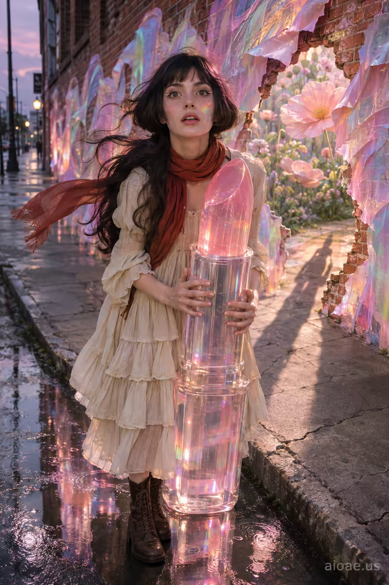

# 案例 134：巨型透明口紅女孩 | Case 134: Girl Holding a Giant Translucent Lipstick Tube



巨型透明口紅：26 歲女孩抱著比人還高的透明口紅管站在雨後街道，塗鴉牆撕開一道粉彩花園傳送門，虹彩光斑在她臉上跳舞，超現實又夢幻。

A young woman clutches a giant translucent lipstick tube on a rain-slick street at twilight, a graffiti wall tearing open into a pastel flower-garden portal, prismatic light dancing across her face - surreal, dreamy, cinematic.

## 完整提示詞 / Full Prompt

```
SUBJECT & IDEA: young girl, age 26, pale skin, large expressive eyes, slight freckling, long dark hair in a daring French new-wave bob, cream tiered cotton dress, rust-red scarf, brown lace-up boots, pale eyeliner clings with both hands to the handle of a gigantic, translucent lipstick tube while standing on a cracked concrete sidewalk

SCENE: Foreground: a shallow puddle of rain-slick asphalt reflecting the glittering lipstick tube. Midground: the girl faces the camera, her face the focal point, eyes wide, eyeliner sharp, holding the tube with splayed fingers. Background: a deserted city street at twilight, a brick wall covered in luminous, translucent graffiti that bleeds into a swirling pastel portal. The portal opens onto a lush garden of oversized pastel flowers, visible through a painted cut-out in the wall. The paint tear is physically visible, and the girl's shadow stretches into the garden, merging with the floral backdrop. the translucent graffiti paint physically tears the wall, creating a portal that projects a soft, diffused light onto the girl, causing her hair to ripple as if caught in a gentle breeze, and the lipstick tube's glow refracts into a prism of pastel colors that dance across her face

ATMOSPHERE & LIGHT:

CAMERA: f/1.4, 35mm, ISO 200, shallow depth of field, natural street light with a warm rim from the graffiti glow

SOURCE BRIEF: girl photo

WATERMARK: Add the exact text "aioae.us" in the bottom-right corner at 70% transparency (30% opacity), with enough contrast to remain readable.
```

## 適用模型 / Recommended Models

擅長超現實場景與透明材質的模型：GPT Image（Image2）、Flux Pro、Midjourney（建議加 `--ar 3:4`）。

Models strong at surreal scenes and translucent materials: GPT Image (Image2), Flux Pro, Midjourney (add `--ar 3:4`).

## 修改說明 / How to Adapt

- 換產品：巨型口紅換成巨型香水瓶或粉餅盒，透明材質與反光跟著改。
- 換場景：塗鴉傳送門換成櫥窗或地鐵站，粉彩花園的出口跟著改。
- 換色調：粉彩換成霓虹紫藍，街燈與倒影的顏色整組換。

- Change the product: swap the giant lipstick for a giant perfume bottle or powder compact, and update the translucent material and reflections.
- Change the setting: swap the graffiti portal for a shop window or a subway station, and update the pastel garden beyond.
- Change the palette: swap the pastels for neon purple-blue, and change the street lights and reflections as a set.

---
直達本案例 / Direct link: https://aioae.us/prompt?title=Girl%20Holding%20a%20Giant%20Translucent%20Lipstick%20Tube
更多同類提示詞 / More prompts like this: [AIOAE 免費 AI 圖片提示詞庫](https://aioae.us/prompts)
