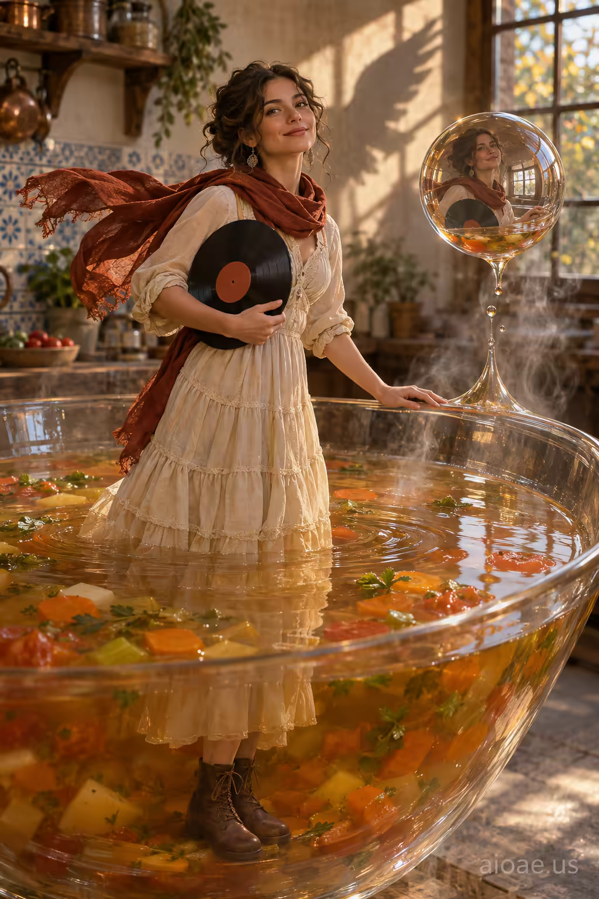

# 案例 135：巨型蔬菜湯碗中的黑膠唱片女孩 | Case 135: Girl Standing in a Giant Vegetable Soup Bowl Holding a Vinyl Record



蔬菜湯碗裡的女孩：奶油色層疊棉裙、鏽紅圍巾、棕色繫帶靴，站在半透明的巨型湯碗裡舉著一張黑膠唱片；湯碗突然化作懸浮的玻璃球，映出她的臉與唱片，歐式廚房的晚霞從窗外灑進來。

A girl in a cream tiered cotton dress and rust-red scarf stands inside a giant translucent bowl of vegetable soup, holding a vinyl record; the bowl morphs into a floating glass sphere mirroring her face and the record, late-afternoon gold spilling in from a rustic European kitchen window.

## 完整提示詞 / Full Prompt

```
SUBJECT & IDEA: young girl in a long cream tiered cotton dress, flowing rust‑red scarf, brown lace‑up boots, face turned slightly left with a gentle smile holds a vinyl record in one hand, the other hand resting on a giant translucent vegetable soup bowl

SCENE: A bright, translucent bowl of vegetable soup fills the foreground, its surface rippling like a mirror. The girl stands inside, her torso just above the rim, the vinyl record glowing faintly against the liquid. Beyond the bowl, a soft‑focused European kitchen with rustic tiles and a window lets in late‑afternoon golden light. The kitchen's window frame casts a wing‑shaped silhouette behind the girl. The bowl's rim acts as a seamless portal, steam curling upward where liquid meets air, visually merging the two layers. the translucent soup bowl suddenly morphs into a floating, translucent glass sphere that levitates above the girl's hand, its surface reflecting her face and the vinyl record, creating a literal mirror of her image that hangs in midair beside her

ATMOSPHERE & LIGHT:

CAMERA: eye‑level, face‑dominant, 50mm lens, f/1.8, ISO 200, 1/200s

SOURCE BRIEF: girl photo

WATERMARK: Add the exact text "aioae.us" in the bottom-right corner at 70% transparency (30% opacity), with enough contrast to remain readable.
```

## 適用模型 / Recommended Models

擅長寫實人像與超現實場景的模型：GPT Image（Image2）、Flux Pro、Midjourney（建議加 `--ar 3:4`）。

Models strong at realistic portraits and surreal scenes: GPT Image (Image2), Flux Pro, Midjourney (add `--ar 3:4`).

## 修改說明 / How to Adapt

- 換道具：黑膠唱片換成一本書或一束花，手部與湯碗邊緣的接觸細節跟著改。
- 換場景：歐式廚房換成日式小餐館或野餐草地，窗光與磁磚的描述跟著換。
- 換變形：玻璃球換成肥皂泡或水晶球，倒影與漂浮高度的描述跟著改。

- Change the prop: swap the vinyl record for a book or a bouquet, and update the hand-to-rim contact details.
- Change the setting: swap the European kitchen for a small Japanese diner or a picnic meadow, and update the window light and tile descriptions.
- Change the morph: swap the glass sphere for a soap bubble or a crystal ball, and update the reflection and levitation height.

---
直達本案例 / Direct link: https://aioae.us/prompt?title=Girl%20Standing%20in%20a%20Giant%20Vegetable%20Soup%20Bowl%20Holding%20a%20Vinyl%20Record
更多同類提示詞 / More prompts like this: [AIOAE 免費 AI 圖片提示詞庫](https://aioae.us/prompts)
