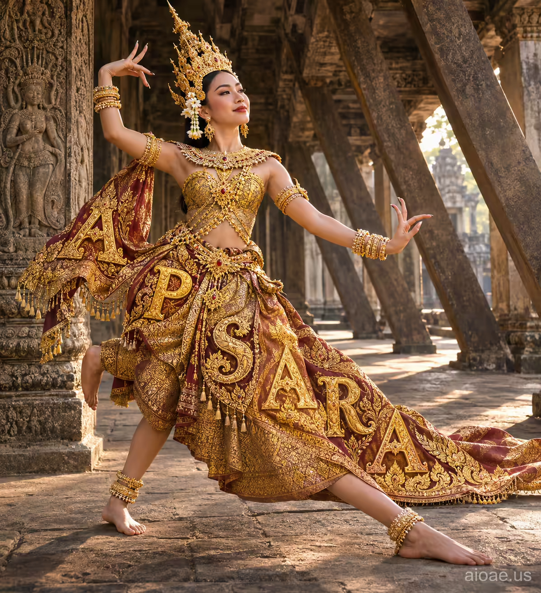

# 案例 136：高棉寺廟金色仙女 | Case 136: Golden Apsara in a Khmer Temple



高棉寺廟大殿裡的金色仙女：金衣舞者擺出優雅舞姿，身體沿淺斜線伸展，雙腿伸向粗獷的廟樑，字母排版般的構圖讓名字本身成為畫面的一部分，莊嚴又充滿動感。

A golden Apsara dancer in a Khmer temple hall holds a graceful pose, body on a shallow forward-right diagonal, legs stretched toward the temple's angular support beams - a literal letter-positioning composition where the name itself becomes part of the image, solemn yet full of motion.

## 完整提示詞 / Full Prompt

```
SUBJECT & IDEA: Apsara dancer in golden Khmer costume, temple hall, graceful pose. Preserve named subject, requested relationships, main action and format. Visual idea: Show Apsara dancer in golden Khmer costume, temple hall, graceful pose with literal positioning behavior — letter-positioning: the name isn't just a name: spread its letters across the image and let their size, color and layout physically reflect the Apsara dancer, its details, its material or its theme. The most prominent visual target should feature the dancer's raised legs, the temple's support beams as reinforcing sight lines, and body positioning behavior: body aligned on a shallow forward-right diagonal, legs stretched along the floor toward the angular log-groove-like supporting beams. Keep the subject and action absolutely clear and intact; the change must occur within or around the subject itself, not as a disconnected background graphic or caption. Add one adjective exactly once to describe a one-of-a-kind pose. Keep all subject and action rules intact and stay strictly on-brief. Treat it as the costume of a hero caught in a meaningful moment.

SCENE: one continuous believable setting suited to the subject and brief. Maintain clear foreground, midground and background with a single coherent physical logic. Keep the specified setting continuous and stage the change around the stated action.

STYLE: coherent premium visual storytelling with readable subject geometry and motivated light. Lighting and color should respond to the actual setting rather than unrelated stock effects.

CAMERA: subject-first coherent perspective. Preserve the user-requested camera and crop; allow the selected mutation to alter apparent scale or perspective when that is its actual mechanism, and make the change physically legible.

WATERMARK: Add the exact text "aioae.us" in the bottom-right corner at 70% transparency (30% opacity), with enough contrast to remain readable.

AVOID: generic random genre backgrounds, contradictory lighting, product identity substitution, extra fingers, duplicate characters, disjointed composition, unintended copy and unsupported factual claims.
```

## 適用模型 / Recommended Models

擅長人物舞姿與古蹟場景的模型：GPT Image（Image2）、Flux Pro、Midjourney（建議加 `--ar 3:4`）。

Models strong at dance poses and ancient temple scenes: GPT Image (Image2), Flux Pro, Midjourney (add `--ar 3:4`).

## 修改說明 / How to Adapt

- 換舞者：仙女換成敦煌飛天或芭蕾舞者，服飾與頭飾的描述跟著改。
- 換場景：高棉寺廟換成石窟或宮殿大殿，樑柱與光影的描述跟著改。
- 換姿態：伸展雙腿換成單腿獨立或迴旋，身體斜線的角度跟著改。

- Change the dancer: swap the Apsara for a Dunhuang flying apsara or a ballet dancer, and update the costume and headdress descriptions.
- Change the setting: swap the Khmer temple for a grotto or a palace hall, and update the beams and lighting descriptions.
- Change the pose: swap the stretched legs for a one-legged balance or a spin, and adjust the body's diagonal angle.

---
直達本案例 / Direct link: https://aioae.us/prompt?title=Golden%20Apsara%20in%20a%20Khmer%20Temple
更多同類提示詞 / More prompts like this: [AIOAE 免費 AI 圖片提示詞庫](https://aioae.us/prompts)
