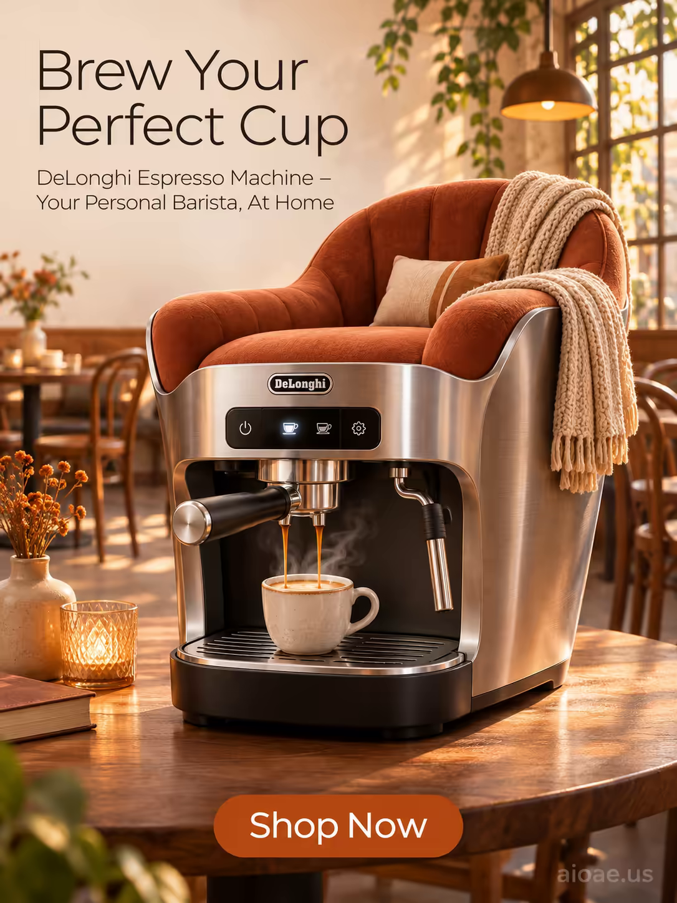

# 案例 137：DeLonghi 義式咖啡機海報 | Case 137: DeLonghi Espresso Machine



DeLonghi 義式咖啡機化身溫馨咖啡館：不鏽鋼機身變成柔軟的扶手椅，毛毯與抱枕環繞，暖橙暖黃的晨光灑落，現代家電與居家暖意無縫融合。

A DeLonghi espresso machine turns into a cozy cafe: its stainless steel body becomes a soft, plush armchair wrapped in blankets and pillows, warm orange and yellow morning light filling the room - modern appliance and homely warmth blended seamlessly.

## 完整提示詞 / Full Prompt

```
SUBJECT & IDEA: DeLonghi Espresso Machine Poster. The DeLonghi Espresso Machine is transformed into a cozy, inviting cafe, where the machine becomes a part of the cafe's decor, blending seamlessly with the furniture and creating a warm, welcoming atmosphere.

PRODUCT: The DeLonghi Espresso Machine is a sleek, modern appliance designed to make delicious espresso at home. It has a stainless steel exterior with a black plastic base, and a digital display on the front that shows the brewing status and other settings. The machine is about 12 inches tall and 10 inches wide, with a large, removable water tank that can hold up to 60 ounces of water. It has a built-in grinder that can grind fresh coffee beans, and a milk frother that can create creamy, frothy milk for lattes and cappuccinos. The machine is designed to be easy to use and maintain, with a simple one-touch operation and a self-cleaning function. It also has a quiet operation, making it ideal for use in kitchens, offices, and other spaces where noise is a concern.

SCENE: In a cozy cafe, the DeLonghi Espresso Machine has been transformed into a warm, inviting space, where the machine becomes a part of the cafe's decor. The machine's sleek stainless steel exterior has become a soft, plush armchair, with a warm, inviting texture that invites you to sit down and relax. The armchair is surrounded by a variety of cozy blankets and pillows, creating a warm and welcoming atmosphere. The background is a soft, warm gradient of oranges and yellows, with a hint of sunlight filtering through the windows, creating a sense of tranquility and peace. The scene is both modern and cozy, with the DeLonghi Espresso Machine's sleek design complementing the warmth and comfort of the cafe.

LIGHTING & COLOR: Soft, warm light from above, with a warm, golden glow that fills the room. The colors are warm and inviting, with a focus on oranges, yellows, and reds, creating a sense of warmth and comfort. The lighting is soft and diffused, with a warm, golden glow that fills the room.

CAMERA: Wide-angle, slightly low angle to capture the full height of the armchair; the lens is set to a focal length of 35mm, creating a slight depth of field that keeps the entire armchair sharp while blurring the distant background.

ON-IMAGE COPY: Headline "Brew Your Perfect Cup"; subheadline "DeLonghi Espresso Machine – Your Personal Barista, At Home"; CTA "Shop Now". Modern sans serif, thin weight for headline area, positioned in the upper left corner. The font is a cool charcoal color, contrasting with the white background. Subheadline appears in a smaller size directly beneath the headline, both left-aligned. All text is crisp, with a subtle drop shadow for legibility.

WATERMARK: Add the exact text "aioae.us" in the bottom-right corner at 70% transparency (30% opacity), with enough contrast to remain readable.
```

## 適用模型 / Recommended Models

擅長產品海報與溫暖室內場景的模型：GPT Image（Image2）、Flux Pro、Midjourney（建議加 `--ar 3:4`）。

Models strong at product posters and warm interiors: GPT Image (Image2), Flux Pro, Midjourney (add `--ar 3:4`).

## 修改說明 / How to Adapt

- 換產品：義式咖啡機換成手沖壺或法式壓濾壺，機身與咖啡香氣的描述跟著改。
- 換變形：扶手椅換成吊床或搖椅，毛毯與抱枕的搭配跟著改。
- 換色調：暖橙黃換成冷藍綠，晨光改成午後斜陽，氛圍轉清爽。

- Change the product: swap the espresso machine for a pour-over kettle or a French press, and update the body and coffee-aroma descriptions.
- Change the morph: swap the armchair for a hammock or a rocking chair, and update the blankets and pillows.
- Change the palette: swap the warm oranges and yellows for cool blues and greens, the morning light for afternoon sun, and the mood turns fresh.

---
直達本案例 / Direct link: https://aioae.us/prompt?title=DeLonghi%20Espresso%20Machine
更多同類提示詞 / More prompts like this: [AIOAE 免費 AI 圖片提示詞庫](https://aioae.us/prompts)
