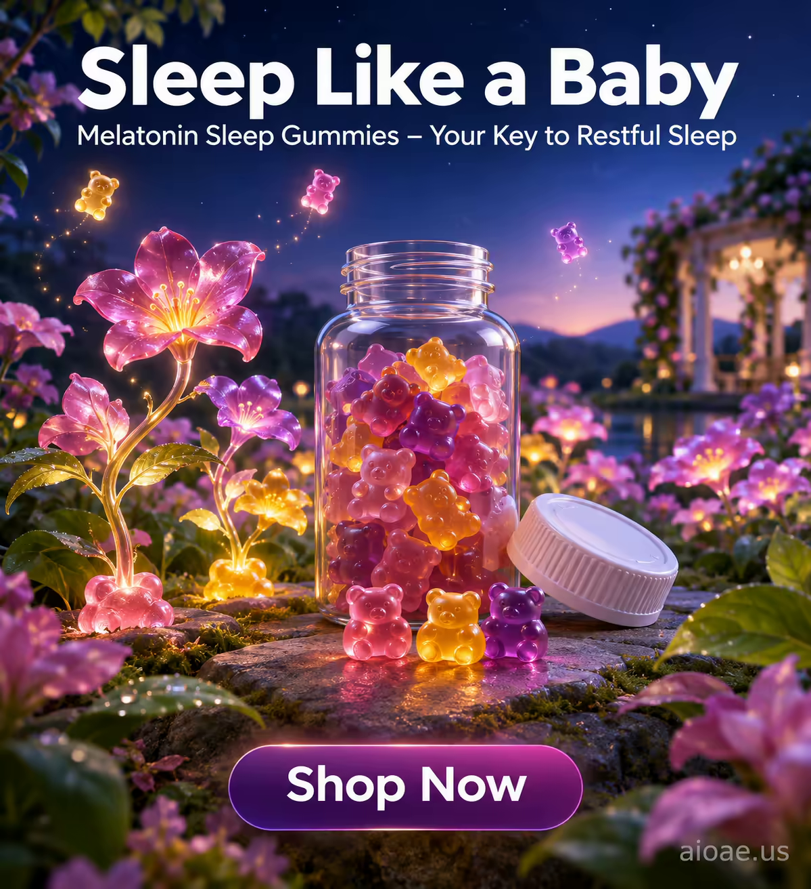

# 案例 138：褪黑素軟糖夢幻花園 | Case 138: Melatonin Gummies Bloom in a Dreamy Garden



褪黑素軟糖化作夢幻花園：小熊軟糖變成發光的小精靈，糖果的粉紫色彩開成一朵朵夜光花，深藍夜空下星光閃爍，柔和、寧靜、充滿睡意。

Melatonin gummies bloom into a dreamy garden: bear-shaped gummies become small glowing creatures, their pink and purple hues opening into luminous night flowers under a deep blue starry sky - soft, peaceful, sleepy.

## 完整提示詞 / Full Prompt

```
MUTATION RULES: 2: The object (Melatonin Sleep Gummies) mutates into a dreamlike, otherworldly scene. 3: The gummies become a source of light and magic, illuminating the night. 4: The product's form becomes a part of the natural world, blending seamlessly with the environment. 5: The gummies' colors and textures transform into a vibrant, living landscape.

MAIN SUBJECT LOCK: Melatonin Sleep Gummies. The gummies are small, soft, and chewy, with a sweet, fruity flavor. They are shaped like small, round bears, with a soft, pillowy texture and a vibrant, colorful appearance. The gummies are made with natural ingredients, including melatonin, which helps to promote restful sleep. They come in a variety of flavors, including strawberry, cherry, and mixed berry, and are packaged in a sleek, modern bottle with a child-resistant cap. The gummies are designed to be easy to take, with a simple, one-a-day dosage that makes it easy to incorporate into your nightly routine. They are also vegan, gluten-free, and non-GMO, making them a healthy and safe choice for anyone looking to improve their sleep.

ON-IMAGE AD COPY: Make the exact on-image copy part of the rendered image. Headline "Sleep Like a Baby"; subheadline "Melatonin Sleep Gummies – Your Key to Restful Sleep"; CTA "Shop Now". Use a modern sans-serif font for the headline and subheadline, with a clean and simple design. The headline should be in a large, bold font, positioned at the top of the image, with the subheadline in a smaller font below it. The CTA should be in a contrasting color, positioned at the bottom of the image, with a clear and concise message. Do not add extra copy.

SCENE: In a dreamlike, twilight garden, the Melatonin Sleep Gummies have transformed into a magical, glowing landscape. The gummies' vibrant colors have become a series of glowing flowers, their petals a soft, pastel pink and purple, illuminating the night with a gentle, soothing light. The gummies' bear shapes have become small, glowing creatures, their soft, pillowy bodies a warm, golden color, floating gently through the air. The background is a deep, dark blue, with stars twinkling in the distance, creating a sense of wonder and magic. The scene is both dreamlike and peaceful, with the gummies' soft, glowing light creating a sense of calm and relaxation.

LIGHTING & COLOR: Soft, gentle light from the gummies, with a warm, golden glow that fills the garden. The colors are soft and soothing, with a focus on pastels, pinks, and purples, creating a sense of calm and relaxation. The background is a deep, dark blue, with stars twinkling in the distance, creating a sense of wonder and magic. The lighting is soft and diffused, with a warm, golden glow that fills the garden.

CAMERA: Wide-angle, slightly low angle to capture the full height of the garden; the lens is set to a focal length of 35mm, creating a slight depth of field that keeps the entire garden sharp while blurring the distant background.

WATERMARK: Add the exact text "aioae.us" in the bottom-right corner at 70% transparency (30% opacity), with enough contrast to remain readable.
```

## 適用模型 / Recommended Models

擅長產品海報與夢幻夜景的模型：GPT Image（Image2）、Flux Pro、Midjourney（建議加 `--ar 3:4`）。

Models strong at product posters and dreamy night scenes: GPT Image (Image2), Flux Pro, Midjourney (add `--ar 3:4`).

## 修改說明 / How to Adapt

- 換產品：褪黑素軟糖換成維他命軟糖或水果糖，口味與包裝的描述跟著改。
- 換變形：夜光花換成螢火蟲或發光蘑菇，漂浮小精靈的造型跟著改。
- 換色調：粉紫換成薄荷綠與湖藍，夜空改成黎明微光，氛圍轉清新。

- Change the product: swap the melatonin gummies for vitamin gummies or fruit candy, and update the flavour and packaging descriptions.
- Change the morph: swap the glowing flowers for fireflies or luminous mushrooms, and update the floating creatures.
- Change the palette: swap the pinks and purples for mint green and lake blue, the night sky for dawn light, and the mood turns fresh.

---
直達本案例 / Direct link: https://aioae.us/prompt?title=Melatonin%20Gummies%20Bloom%20in%20a%20Dreamy%20Garden
更多同類提示詞 / More prompts like this: [AIOAE 免費 AI 圖片提示詞庫](https://aioae.us/prompts)
