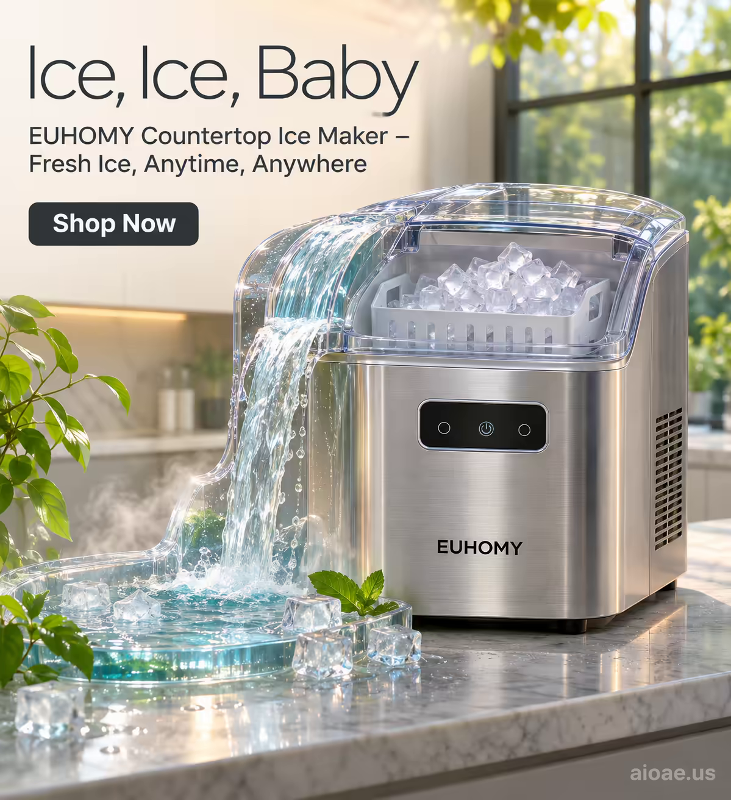

# 案例 139：EUHOMY 製冰機瀑布海報 | Case 139: Cascading Chill EUHOMY Ice Maker



EUHOMY 製冰機化作瀑布：透明上蓋變成傾瀉而下的水流，數位顯示化作一串微光，藍綠暖陽交織的廚房裡，清涼與潔淨撲面而來。

An EUHOMY ice maker turns into a waterfall: its transparent lid becomes cascading water, its digital display a string of small glowing lights, in a kitchen washed in blues, greens and warm sunlight - cool, clean, refreshing.

## 完整提示詞 / Full Prompt

```
SUBJECT & IDEA: EUHOMY Countertop Ice Maker Poster. The EUHOMY Countertop Ice Maker is transformed into a waterfall, its sleek design and modern features blending seamlessly with the natural beauty of the waterfall.

PRODUCT: The EUHOMY Countertop Ice Maker is a compact and modern appliance designed to produce ice quickly and efficiently. It has a sleek, stainless steel exterior with a transparent lid that allows you to see the ice-making process. The machine is about 12 inches tall and 10 inches wide, with a digital display on the front that shows the ice-making status and other settings. It has a large, removable ice basket that can hold up to 26 pounds of ice, and a water reservoir that can be filled with tap water. The ice maker is designed to be easy to use and maintain, with a simple one-touch operation and a self-cleaning function. It also has a quiet operation, making it ideal for use in kitchens, offices, and other spaces where noise is a concern.

SCENE: In a modern kitchen, the EUHOMY Countertop Ice Maker has been transformed into a waterfall, its sleek stainless steel exterior blending seamlessly with the natural beauty of the waterfall. The machine's transparent lid has become a cascading waterfall, with water flowing down from the top of the machine and into a pool below. The ice maker's digital display has become a series of small, glowing lights that illuminate the waterfall, creating a mesmerizing effect. The background is a soft, warm gradient of blues and greens, with a hint of sunlight filtering through the trees, creating a sense of tranquility and peace. The scene is both modern and natural, with the ice maker's sleek design complementing the beauty of the waterfall.

LIGHTING & COLOR: Soft, natural light from above, with a warm, golden glow that fills the room. The colors are cool and refreshing, with a focus on blues, greens, and whites, creating a sense of cleanliness and purity. The lighting is soft and diffused, with a warm, golden glow that fills the room.

CAMERA: Wide-angle, slightly low angle to capture the full height of the waterfall; the lens is set to a focal length of 35mm, creating a slight depth of field that keeps the entire waterfall sharp while blurring the distant background.

ON-IMAGE COPY: Headline "Ice, Ice, Baby"; subheadline "EUHOMY Countertop Ice Maker – Fresh Ice, Anytime, Anywhere"; CTA "Shop Now". Modern sans serif, thin weight for headline area, positioned in the upper left corner. The font is a cool charcoal color, contrasting with the white background. Subheadline appears in a smaller size directly beneath the headline, both left-aligned. All text is crisp, with a subtle drop shadow for legibility.

WATERMARK: Add the exact text "aioae.us" in the bottom-right corner at 70% transparency (30% opacity), with enough contrast to remain readable.
```

## 適用模型 / Recommended Models

擅長產品海報與清涼自然場景的模型：GPT Image（Image2）、Flux Pro、Midjourney（建議加 `--ar 3:4`）。

Models strong at product posters and cool natural scenes: GPT Image (Image2), Flux Pro, Midjourney (add `--ar 3:4`).

## 修改說明 / How to Adapt

- 換產品：製冰機換成淨水器或氣泡水機，透明上蓋與水流的描述跟著改。
- 換變形：瀑布換成冰川或噴泉，水花與池面的細節跟著改。
- 換色調：藍綠換成銀白與冰藍，暖陽改成冷調天光，氛圍更清冽。

- Change the product: swap the ice maker for a water purifier or a sparkling-water maker, and update the transparent lid and water descriptions.
- Change the morph: swap the waterfall for a glacier or a fountain, and update the spray and pool details.
- Change the palette: swap the blues and greens for silver-white and ice blue, the warm sun for cool skylight, and the mood turns crisper.

---
直達本案例 / Direct link: https://aioae.us/prompt?title=Cascading%20Chill%20EUHOMY%20Ice%20Maker
更多同類提示詞 / More prompts like this: [AIOAE 免費 AI 圖片提示詞庫](https://aioae.us/prompts)
