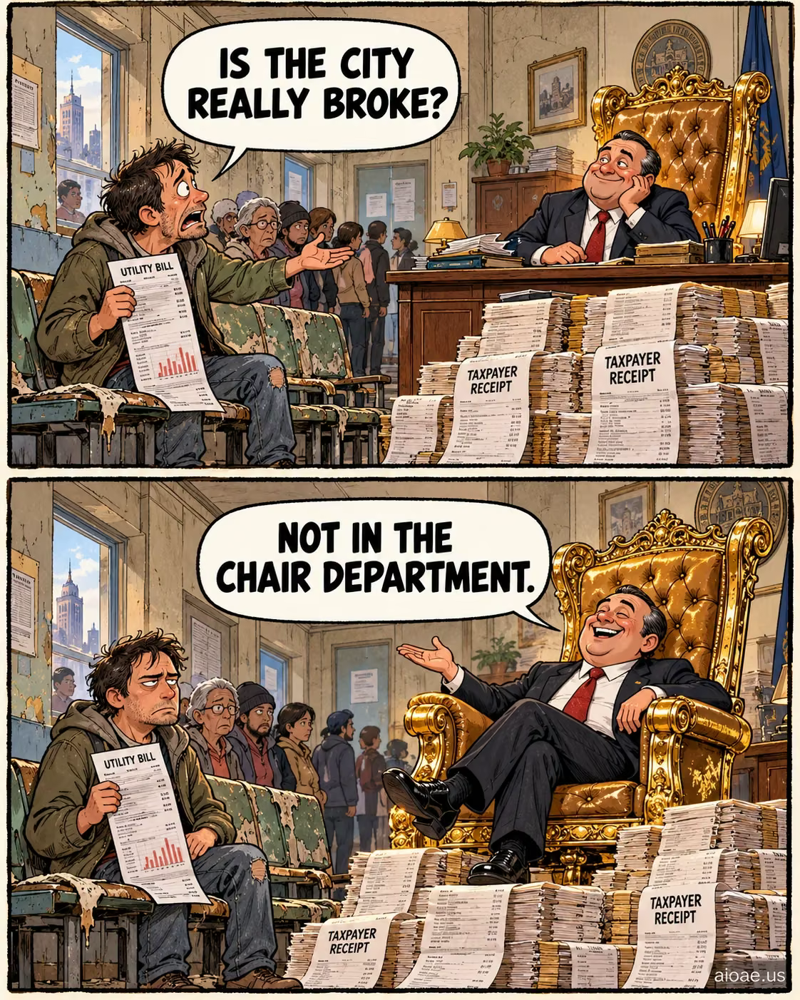

# 案例 14：政治諷刺雙格漫畫：椅子部門 | Case 14: Political Comic Meme Not in the Chair Department



手繪報紙風雙格政治諷刺漫畫，精準對白＋神反轉，結構嚴謹的雙格敘事。

Hand-drawn newspaper-style two-panel political satire comic; verbatim dialogue balloons, a tight punchline, rigorous two-panel structure.

## 完整提示詞 / Full Prompt

```
SUBJECT: Original TWO-PANEL comic meme about "Political dark humor meme about government spending on luxury office chairs". Keep the actual named topic, subject, props and relationship; do not substitute a generic unrelated joke.
LAYOUT: ONE portrait 4:5 illustration with EXACTLY TWO horizontal rectangular panels STACKED TOP TO BOTTOM, same size, thin off-white gutter and rough dark ink borders. Never render two separate pictures or a third panel.
STYLE: Hand-drawn newspaper comic, warm muted colors, thick confident ink outlines, expressive cartoon faces/gestures, subtle old-paper texture. Original visual composition; not a glossy advertisement or an imitation of a copyrighted comic image.
CAST & CONTINUITY: Speaker A = an ordinary citizen holding an unpaid public-service bill. Speaker B = a fictional city official on an ostentatious gilded office chair. BOTH visible in BOTH panels. Same costumes, anatomy, furniture, objects, background and camera viewpoint: The same small municipal office with cracked public benches and one colossal gleaming chair made from taxpayer receipts..
TOP PANEL — SETUP: The citizen points toward the broken waiting benches and holds up a bill. A smiling official behind a desk acts concerned.. Show Speaker A's clear expression and Speaker B listening/reacting. Topic focus: Political government spending on luxury office chairs.
TOP PANEL TEXT: ONE large white dialogue balloon with its tail pointing ONLY to Speaker A. RENDER VERBATIM in bold readable black capitals: "IS THE CITY REALLY BROKE?"
BOTTOM PANEL — PUNCHLINE: The official proudly rolls forward on a ridiculously oversized gold chair, overshadowing the broken benches; the citizen gives a deadpan stare.. Same two characters and space, but a noticeably new expression/gesture visibly proves the comeback.
BOTTOM PANEL TEXT: ONE large white dialogue balloon with its tail pointing ONLY to Speaker B. RENDER VERBATIM in bold readable black capitals: "NOT IN THE CHAIR DEPARTMENT."
JOKE LOGIC: A figure uses an idiom or cliched claim; the reply takes it literally using a physical trait, prop or setting that exists in the requested topic. The punchline must be meaningful, not random nonsense. A tight verbal comeback turns the visible first-panel assumption upside down.. Specific clever retort, wordplay or pointed irony; avoid meaningless insult trading. The image AND words must agree.
COMIC TIMING: Setup above, surprising comeback below. Two bubbles TOTAL, one per panel, positioned above their speaker without obstructing faces. No other speech, captions, typography, fake labels or misspelled text.
POLITICAL SATIRE: Visibly fictional cartoon about actions or institutions, never fabricated real-person quotations, phony current news or invented allegations.
DARK COMEDY: Dry macabre wit is fine; exclude gore, victim mockery and hateful stereotyping.
ORIGINALITY: Borrow only abstract humor structures, never replicate the reference artwork, characters, distinctive dialogue or meme screenshot.
WATERMARK: Small clear "aioae.us" at bottom-right outside speech balloons.
AVOID: extra panels, photo collage, unrelated portals, generic jokes, confusing bubble tails, duplicate panel poses, extra text, busy unrelated backgrounds.
```

## 適用模型 / Recommended Models

擅長文字渲染與分鏡控制的模型：GPT Image（Image2）、Ideogram；對白必須逐字渲染，拼寫零容忍。

Models strong at text rendering and panel control: GPT Image (Image2), Ideogram; dialogue must render verbatim, zero tolerance for misspelling.

## 修改說明 / How to Adapt

- 換議題：把椅子換成其他公共開支議題，SUBJECT、CAST & CONTINUITY 與 JOKE LOGIC 整段換。
- 換對白：兩句 RENDER VERBATIM 的對白一起換，保持字數相近、上下呼應。
- 換畫風：報紙風換成扁平插畫風，STYLE 段整組換，AVOID 段保留。

- Change the topic: swap the chair for another public-spending topic; rewrite SUBJECT, CAST & CONTINUITY and JOKE LOGIC as a set.
- Change the dialogue: replace both RENDER VERBATIM lines together; keep similar length and a setup–punchline echo.
- Change the art style: swap newspaper style for flat illustration; rewrite STYLE as a set, keep AVOID.

---
直達本案例 / Direct link: https://aioae.us/prompt?title=Political%20Comic%20Meme%20Not%20in%20the%20Chair%20Department
更多同類提示詞 / More prompts like this: [AIOAE 免費 AI 圖片提示詞庫](https://aioae.us/prompts)
