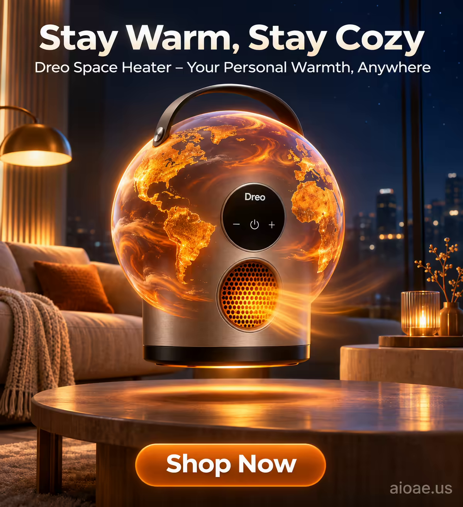

# 案例 140：Dreo 暖風機溫馨星球海報 | Case 140: Dreo Heater a Cozy Planet



Dreo 暖風機化作一顆溫暖星球：圓柱機身變成漂浮的半透明球體，暖橙暖黃的表面緩緩旋轉，出風口化作發光的環形山，未來感客廳裡暈開一圈金色光暈。

A Dreo space heater becomes a cozy planet: its cylindrical body turns into a floating translucent sphere of warm orange and yellow, slowly rotating, its air vents glowing craters, a halo of golden light warming a futuristic living room.

## 完整提示詞 / Full Prompt

```
MUTATION RULES: 2: The object (Dreo Space Heater) mutates into a world-like sphere. 3: The heat radiates and the sphere emits warm light. 4: The product's form becomes a planet, its design elements transformed into continents and oceans. 5: The heater's air vents become the planet's craters, emitting a soft, warm glow.

MAIN SUBJECT LOCK: Dreo Space Heater. This is a small, sleek and modern space heater with a cylindrical shape and a smooth, matte finish. It has a large, circular display on the front, showing the temperature and other settings. The heater is about 12 inches tall and 8 inches wide, with a handle on top for easy carrying. The heater's design is minimalist and elegant, with a focus on functionality and style. It has a brushed aluminum body and a black plastic base, with a small, circular air vent on the front. The heater is designed to provide warmth and comfort in any room, with a range of features that make it easy to use and control. It has a touch screen display, a timer, and a remote control, allowing you to adjust the temperature and settings from anywhere in the room. The heater is also energy-efficient, with a low power consumption and a quiet operation, making it ideal for use in bedrooms, living rooms, and offices.

ON-IMAGE AD COPY: Make the exact on-image copy part of the rendered image. Headline "Stay Warm, Stay Cozy"; subheadline "Dreo Space Heater – Your Personal Warmth, Anywhere"; CTA "Shop Now". Use a modern sans-serif font for the headline and subheadline, with a clean and simple design. The headline should be in a large, bold font, positioned at the top of the image, with the subheadline in a smaller font below it. The CTA should be in a contrasting color, positioned at the bottom of the image, with a clear and concise message. Do not add extra copy.

SCENE: In a futuristic living room, the Dreo Space Heater has transformed into a floating, translucent sphere, its surface a swirling mix of warm orange and yellow hues. The sphere is surrounded by a halo of soft, golden light, casting a warm glow on the surrounding furniture. The heater's air vents have become the planet's craters, emitting a soft, warm glow that illuminates the room. The sphere is rotating slowly, its surface a dynamic mix of colors and patterns, creating a mesmerizing effect. The background is a deep, dark blue, with stars twinkling in the distance, creating a sense of wonder and awe. The scene is both futuristic and cozy, with the heater's warm light creating a sense of comfort and relaxation.

LIGHTING & COLOR: Warm, golden light from the sphere, with a soft, diffused glow that fills the room. The colors are warm and inviting, with a focus on oranges, yellows, and golds, creating a sense of warmth and comfort. The background is a deep, dark blue, with stars twinkling in the distance, creating a sense of wonder and awe. The lighting is soft and diffused, with a warm, golden glow that fills the room.

CAMERA: Wide-angle, slightly low angle to capture the full height of the sphere; the lens is set to a focal length of 35mm, creating a slight depth of field that keeps the entire sphere sharp while blurring the distant background.

WATERMARK: Add the exact text "aioae.us" in the bottom-right corner at 70% transparency (30% opacity), with enough contrast to remain readable.
```

## 適用模型 / Recommended Models

擅長產品海報與未來感場景的模型：GPT Image（Image2）、Flux Pro、Midjourney（建議加 `--ar 3:4`）。

Models strong at product posters and futuristic scenes: GPT Image (Image2), Flux Pro, Midjourney (add `--ar 3:4`).

## 修改說明 / How to Adapt

- 換產品：暖風機換成加濕器或空氣清淨機，圓柱機身與出風口的描述跟著改。
- 換變形：星球換成小太陽或燈籠，旋轉表面與光暈的描述跟著改。
- 換色調：暖橙黃換成暖粉與蜜桃色，客廳改成臥室，氛圍更柔和。

- Change the product: swap the space heater for a humidifier or an air purifier, and update the cylindrical body and vent descriptions.
- Change the morph: swap the planet for a small sun or a lantern, and update the rotating surface and halo.
- Change the palette: swap the warm oranges and yellows for warm pink and peach, the living room for a bedroom, and the mood turns softer.

---
直達本案例 / Direct link: https://aioae.us/prompt?title=Dreo%20Heater%20a%20Cozy%20Planet
更多同類提示詞 / More prompts like this: [AIOAE 免費 AI 圖片提示詞庫](https://aioae.us/prompts)
