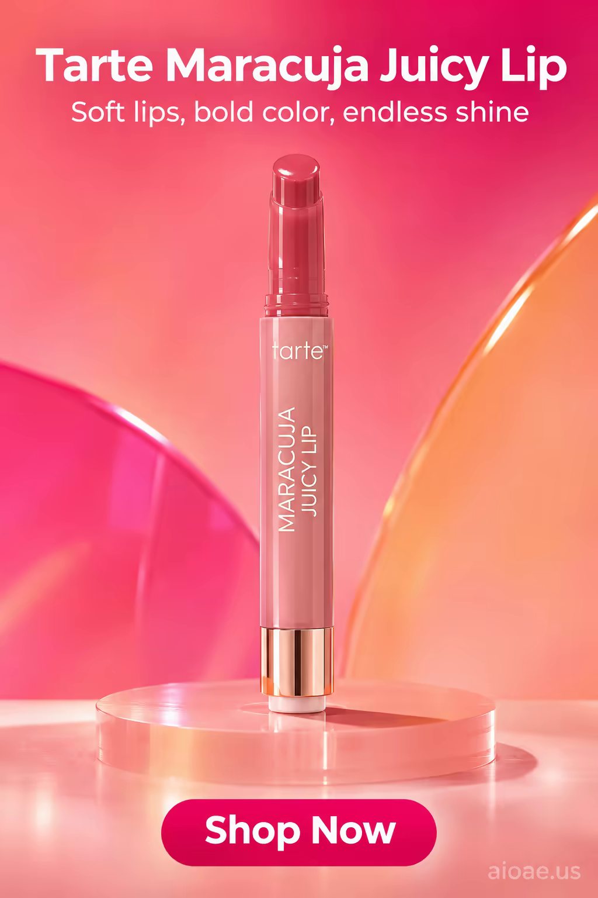

# 案例 141：Tarte Maracuja 豐盈唇彩海報 | Case 141: Tarte Maracuja Juicy Lip



Tarte Maracuja 豐盈唇彩：無人物、純產品主角，寫實產品攝影，活力四射的青春氛圍，柔唇、濃彩、無盡光澤，廣告版式乾淨俐落。

Tarte Maracuja Juicy Lip: no people, the product alone is the hero - photorealistic product photography in a vibrant, energetic, youthful mood: soft lips, bold color, endless shine, with a clean advertising layout.

## 完整提示詞 / Full Prompt

```
SUBJECT & IDEA: Tarte Maracuja Juicy Lip Poster. Preserve named subject, requested relationships, main action and format.

CAMPAIGN CASTING: No people. Do not add characters, hands, faces or animals. The product remains the sole hero.

SCENE: indoor. Maintain clear foreground subject, readable mid-ground and simple background so the product stays dominant.

ON-IMAGE AD COPY: Make the exact on-image copy part of the rendered image. Headline "Tarte Maracuja Juicy Lip"; subheadline "Soft lips, bold color, endless shine"; CTA "Shop Now". Use a single clear sans-serif headline, with smaller subheadline and CTA copy, positioned in empty space without covering the product. The headline should be 40-60pt; subheadline 16-24pt; CTA 12-16pt. The copy's color should contrast with the background, ensuring legibility and a clean advertising layout. Do not add extra copy.

CAMPAIGN ATMOSPHERE: A vibrant, energetic atmosphere evokes a feeling of excitement, joy and playfulness in the viewer, creating a lively and fun mood. The overall mood should be energetic, fun and youthful.

STYLE: photorealistic product photography with a vibrant, energetic look and feel.

CAMERA: eye-level, hero product straight-on, subject-first coherent perspective. Keep the product upright, centred, proportionally natural and fully visible.

WATERMARK: Add the exact text "aioae.us" in the bottom-right corner at 70% transparency (30% opacity), with enough contrast to remain readable.
```

## 適用模型 / Recommended Models

擅長產品攝影與廣告版式的模型：GPT Image（Image2）、Flux Pro、Midjourney（建議加 `--ar 3:4`）。

Models strong at product photography and ad layouts: GPT Image (Image2), Flux Pro, Midjourney (add `--ar 3:4`).

## 修改說明 / How to Adapt

- 換產品：唇彩換成唇膏或唇蜜，管身與質地的描述跟著改。
- 換氛圍：活力青春換成優雅成熟，色調轉深、字體改細，氛圍更沉穩。
- 換背景：純色背景換成花瓣或絲綢，產品倒影與光澤的描述跟著改。

- Change the product: swap the lip gloss for a lipstick or a lip balm, and update the tube and texture descriptions.
- Change the mood: swap the vibrant youthfulness for mature elegance, deepening the palette and thinning the type.
- Change the backdrop: swap the plain background for petals or silk, and update the product reflections and sheen.

---
直達本案例 / Direct link: https://aioae.us/prompt?title=Tarte%20Maracuja%20Juicy%20Lip
更多同類提示詞 / More prompts like this: [AIOAE 免費 AI 圖片提示詞庫](https://aioae.us/prompts)
