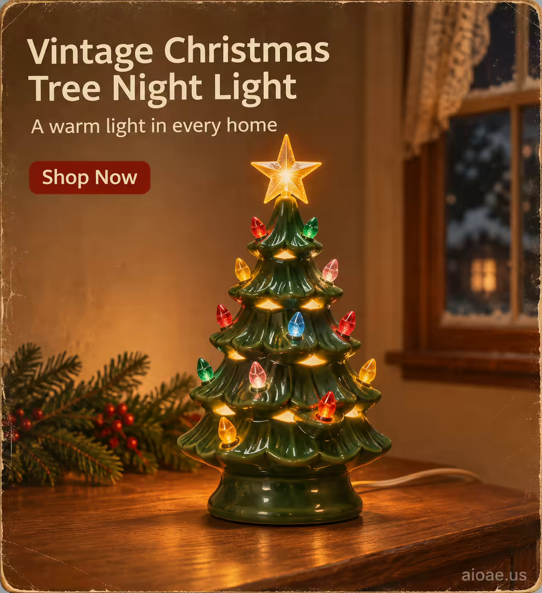

# 案例 142：復古聖誕樹夜燈海報 | Case 142: Vintage Christmas Tree Night Light



復古聖誕樹夜燈：無人物、純產品主角，復古明信片風格，懷舊節日氛圍，每個家都有一盞暖光，溫馨、喜慶、充滿家的味道。

A vintage Christmas tree night light: no people, the product alone is the hero - photorealistic vintage postcard style, nostalgic holiday warmth: a warm light in every home, cozy, festive, full of home.

## 完整提示詞 / Full Prompt

```
SUBJECT & IDEA: Vintage Christmas Tree Night Light Poster. Preserve named subject, requested relationships, main action and format.

CAMPAIGN CASTING: No people. Do not add characters, hands, faces or animals. The product remains the sole hero.

SCENE: indoor. Maintain clear foreground subject, readable mid-ground and simple background so the product stays dominant.

ON-IMAGE AD COPY: Make the exact on-image copy part of the rendered image. Headline "Vintage Christmas Tree Night Light"; subheadline "A warm light in every home"; CTA "Shop Now". Use a single clear sans-serif headline, with smaller subheadline and CTA copy, positioned in empty space without covering the product. The headline should be 40-60pt; subheadline 16-24pt; CTA 12-16pt. The copy's color should contrast with the background, ensuring legibility and a clean advertising layout. Do not add extra copy.

CAMPAIGN ATMOSPHERE: Nostalgic holiday ambiance evokes a feeling of warmth, magic and cosiness in the viewer, creating a warm and inviting atmosphere. The overall mood should be inviting, festive and warm.

STYLE: photorealistic vintage postcard style with a nostalgic look and feel.

CAMERA: eye-level, hero product straight-on, subject-first coherent perspective. Keep the product upright, centred, proportionally natural and fully visible.

WATERMARK: Add the exact text "aioae.us" in the bottom-right corner at 70% transparency (30% opacity), with enough contrast to remain readable.
```

## 適用模型 / Recommended Models

擅長產品攝影與懷舊節日氛圍的模型：GPT Image（Image2）、Flux Pro、Midjourney（建議加 `--ar 3:4`）。

Models strong at product photography and nostalgic holiday mood: GPT Image (Image2), Flux Pro, Midjourney (add `--ar 3:4`).

## 修改說明 / How to Adapt

- 換產品：聖誕樹夜燈換成雪人夜燈或馴鹿夜燈，造型與燈光的描述跟著改。
- 換氛圍：懷舊暖黃換成冷調雪夜，窗外雪花與室內暖光形成對比。
- 換風格：復古明信片換成現代極簡，背景留白、字體改細，版式更乾淨。

- Change the product: swap the Christmas tree night light for a snowman or reindeer night light, and update the shape and glow descriptions.
- Change the mood: swap the nostalgic warm yellow for a cold snowy night, snowflakes outside against warm light inside.
- Change the style: swap the vintage postcard for modern minimalism, more white space and thinner type for a cleaner layout.

---
直達本案例 / Direct link: https://aioae.us/prompt?title=Vintage%20Christmas%20Tree%20Night%20Light
更多同類提示詞 / More prompts like this: [AIOAE 免費 AI 圖片提示詞庫](https://aioae.us/prompts)
